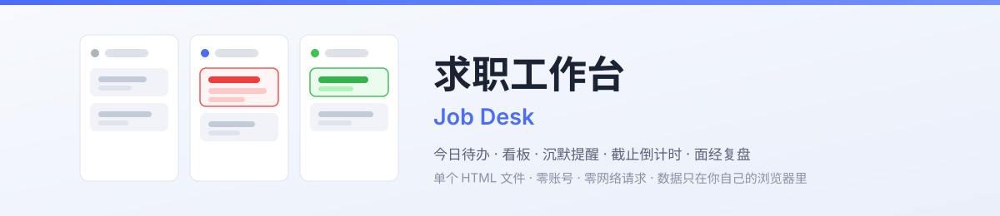
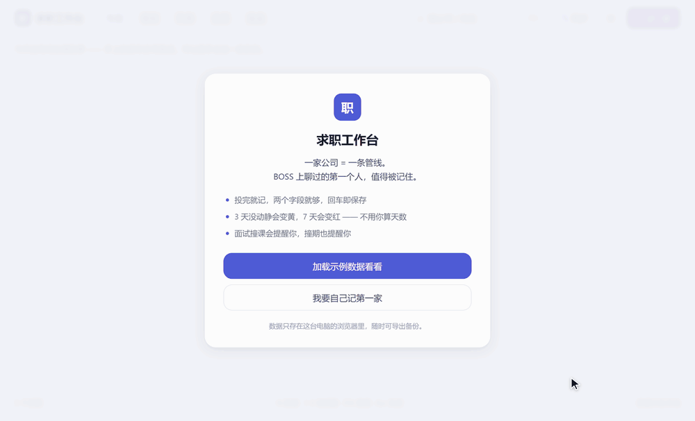
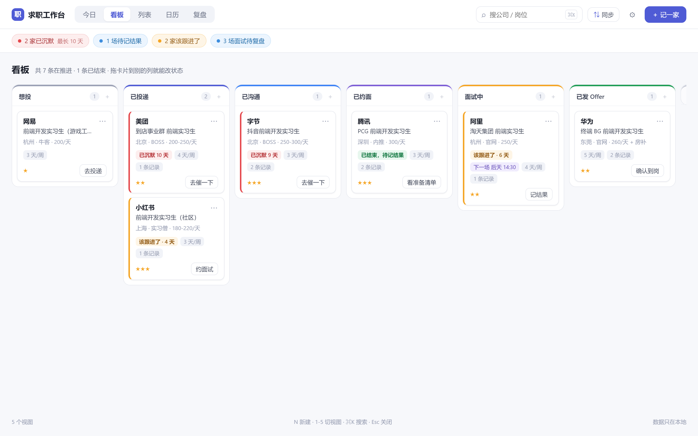
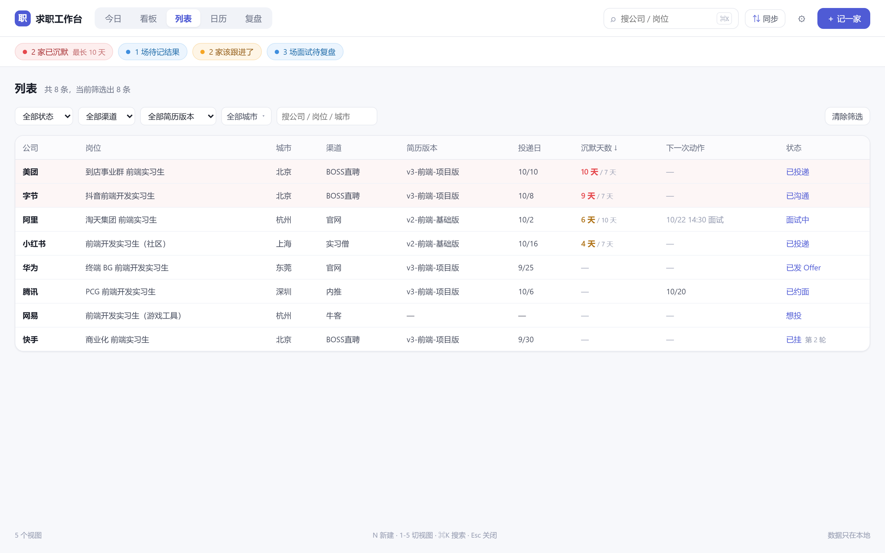
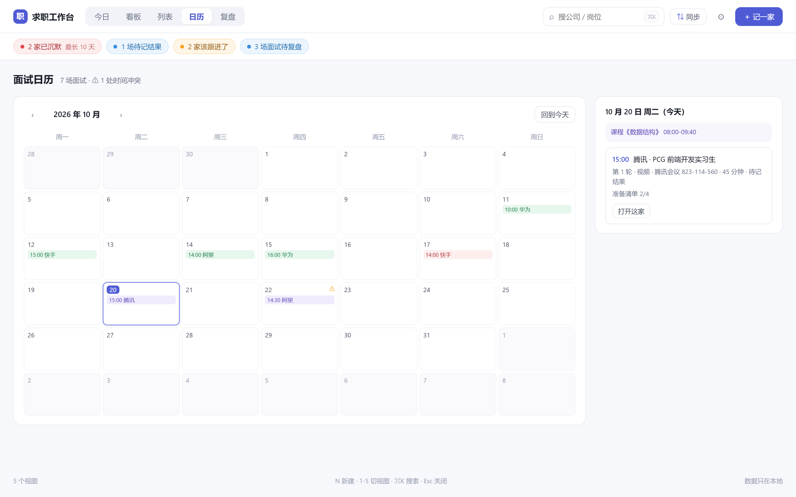
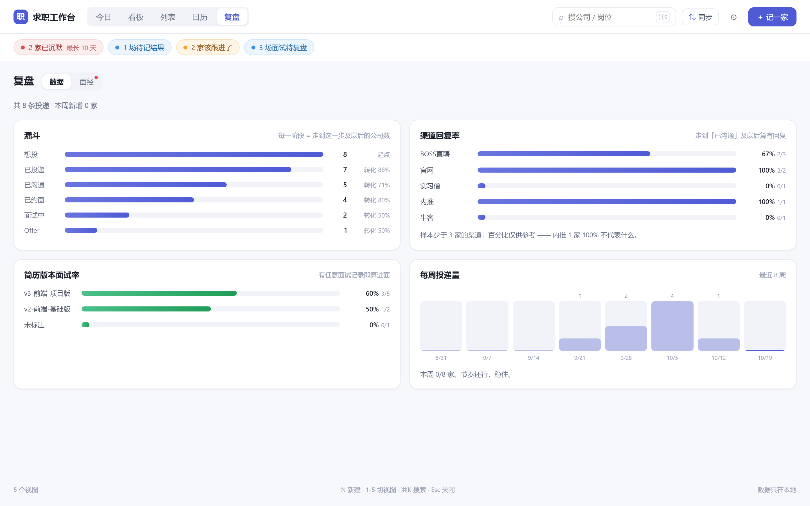
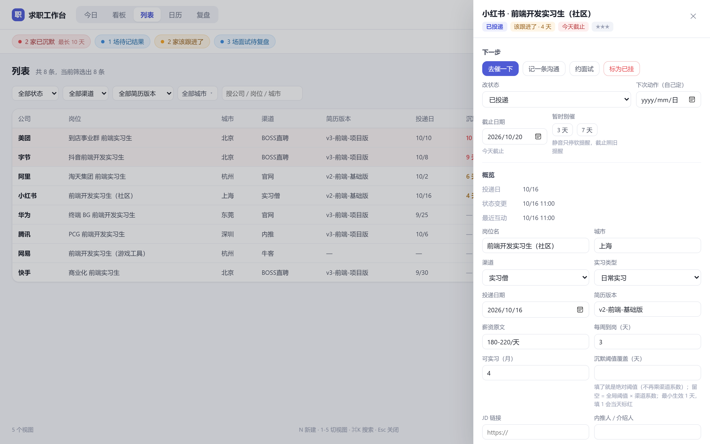

<div align="center">

<picture>
  <source media="(prefers-color-scheme: dark)" srcset="assets/banner-dark.svg">
  <source media="(prefers-color-scheme: light)" srcset="assets/banner-light.svg">
  
</picture>

# Job Desk · 求职工作台

**Local-first job-application workbench — internships, campus hiring, and experienced hires.**

[](https://github.com/Rrrayy/job-desk/actions/workflows/ci.yml)


[](https://github.com/Rrrayy/job-desk/releases/latest)
[](LICENSE)

**One HTML file. No account. Zero network requests. Your data never leaves your browser.**

[⬇️ Download](https://github.com/Rrrayy/job-desk/releases/latest) ｜ [中文](README.md) ｜ [Changelog](CHANGELOG.md)


<sub>Real recording: load sample data → Today → Board → the calendar catching "interview vs. seminar" → one-click follow-up (the "2 stale" badge in the header resets). These 11 seconds are the entire daily loop.</sub>

</div>

> **After 50 applications, do you still remember which one to nudge, whose interview is today,
> and which one has been silent for two weeks?**
> That is the only problem this tool solves. One company = one pipeline line, one screen answers
> "what do I do now". It is not a job aggregator, it does not build résumés, and it never applies on your behalf.

---

## ✨ What it does

**Five views, all answering "what do I do now"**

| View | Question it answers |
| :--- | :--- |
| 📋 **Today** | Any interviews today? Who needs a nudge? What closes tomorrow? |
| 🗂️ **Board** | Where are all 50 stuck (wishlist → applied → chatting → interviewing → result) |
| 📃 **List** | Sorted by days of silence — the coldest ones first |
| 📅 **Calendar** | Interviews, classes, and any personal commitment on one grid — with minute-level collision checks |
| 📊 **Insights** | Funnel, résumé-version hit rate, weekly volume; a second tab holds **interview notes** |

**Underneath the views:**

- ⏱️ **Silence detection** — thresholds scale by channel (referral ×3, official ×2); the offer stage is monitored separately and **never** scaled
- ⏰ **Deadline countdown** — expired / today / within 3 days; muting silences nudges but **never hides an external deadline**
- 💬 One-click follow-up messages; add a company in 3 seconds; drag between stages; `⌘Z` undoes up to 10 steps, `⇧⌘Z` redoes
- 🧯 **Crash without data loss** — a render error shows a "your data is still here" page with a raw-JSON download, not a blank screen
- 🎤 **Multi-round interview modelling** — one card per round, with prep checklist, format, and outcome
- 📥 **Timetable import** — paste straight from your school system, one class per line; bad lines are reported, never silently dropped
- ⚠️ **Schedule collisions** — interviews × classes × personal errands, compared pairwise on the same day with `HH:mm` overlap
- 🔄 **Platform sync** — paste BOSS / Shixiseng / Nowcoder listings, review a diff, confirm row by row, undo the whole merge
- 📚 **Interview notes** — quick capture, a question bank sorted by "weakest first", spaced review, and a "what do I fail most" breakdown
- 💾 JSON backup, CSV of applications, ICS of interviews; schema migrations carry rollback points

## 🚀 Quick start

**Option 1 — download (recommended)**

Grab **`index.html`** from [Releases](https://github.com/Rrrayy/job-desk/releases/latest). One file.
Double-click it. Works over `file://` — no Node, no server.

**Option 2 — build from source**

```bash
git clone https://github.com/Rrrayy/job-desk
cd job-desk/app
npm install && npm run build
# open app/dist/index.html
```

**Option 3 — dev mode**

```bash
cd app && npm install && npm run dev   # http://localhost:5173
```

> First launch asks whether to load sample data (8 companies, 7 statuses) or start empty.
> To wipe everything later: Settings → Data → **Reset to initial state**.

### Optional browser extension

`extension/` is a zero-build MV3 extension that captures the text of the recruiting page you are already looking at,
saving you the `Ctrl+A / Ctrl+V`. It is not on any store — load it unpacked.
The extension **does not parse**; it only emits a `{format, url, title, capturedAt, text}` envelope, so the paste
channel and the extension share exactly one parser.

## 📸 Screens

The 11-second demo at the top covers the full "Today → Board → Calendar → Detail" loop; static shots below.

| 🗂️ Board | 📃 List |
| :---: | :---: |
|  |  |
| **📅 Calendar** | **📊 Insights** |
|  |  |

**Detail drawer — deadline, mute, and silence threshold on one screen**



## 🎯 Design trade-offs

This section explains **why**, and what each choice costs. Feature lists are everywhere; the trade-offs are what this project is.

### ① Deadlines and silence are orthogonal axes

"How long since they replied" and "what the outside world demands of me" are different things. Merged into one axis, they mask each other.

- **How**: `deadlineAt` uses **three-state semantics** — unset (inherit) / `null` (explicitly off) / date (override).
  Severity is expired / today / within 3 days, and deadline items **cannot be checked off in one click** — you must open the detail.
- **Cost**: one more field and one more validator. `??` is a trap here (it collapses `null` and `undefined`, which mean opposite things), so validation must go through `asTriStateDate()`.

### ② Muting silences nudges, never hard deadlines

"Not today" is a legitimate request; "the application closes tomorrow" should never be hidden by an algorithm.

- **How**: a mute expires at "day N, 23:59:59", not `now + N×24h`. In todo generation, **deadlines are computed before the mute check** — reversing that order actively hurts users.
- **Cost**: a muted item can still appear in Today if it is about to expire. That is deliberate.

### ③ The calendar is a general schedule, not an interview calendar

In reality, collisions involve more than interviews — lab meetings, medical appointments, urgent errands.

- **How**: a single `db.events` table holds everything (`kind` separates classes from personal items; `weekly` by weekday, or a single date).
  Collision detection puts interviews, classes, and errands in **one pool compared pairwise**, with the condition
  "same day + `HH:mm` interval overlap" (`a.start < b.end && b.start < a.end`). Touching endpoints do not collide.
- **Cost**: timetable import is **replace-semantics** (only `course && weekly` rows), and manually recorded items must never be overwritten — asserted in tests, not in comments.

### ④ Undo is a stack, and deletions must be undoable

A single-slot undo is no undo at all: the second slip and you get "nothing to undo".

- **How**: a 10-step stack plus redo; a new action clears the redo stack; a sync merge is undoable but not redoable (its inverse is not a clean inverse).
  Undo snapshots **one operation**, never the whole database — otherwise it swallows notes you wrote afterwards.
- **Cost**: deleting an application must also carry the rows it took with it (interviews, timeline, note bindings), and restoring must handle
  "this note was rebound to another application" — in that case it **does not steal it back**.

### ⑤ Failure paths must have exits

A render crash, unreadable data, a failed write — the user must never be trapped.

- **How**: `ErrorBoundary` offers three exits (reload / download raw JSON / copy the error). A read failure first stores the raw bytes under `failedAt.*`, then locks persistence so `saveDB` becomes a no-op.
- **Cost**: **automatic repair is forbidden**. Auto-repair turns "recoverable" into "unrecoverable", so that page only offers exits — it never guesses, fixes, or deletes.

### ⑥ One HTML file is a constraint, not laziness

Each promise maps to an engineering mechanism that keeps it true:

| Promise | Implementation | Regression guard |
| :--- | :--- | :--- |
| Zero network requests | No fetch/XHR/beacon/WebSocket, no CDN | `check:no-network` scans 11 rules; allowlist is empty |
| Single-file, double-click | `vite-plugin-singlefile` + `base:'./'`, inlined JS/CSS | Bundle check + size red line |
| Data never leaves the machine | One localStorage key; import/export via download | CI scan + review red line |
| Corruption never loses data | Lock on read failure, raw copy in `failedAt.*` (max 3) | Three corruption scenarios × reload, verified |
| Undo never swallows data | Per-operation snapshots (status / sync / delete) | Unit tests |
| Sync never fakes silence | `touchedAt` only from platform `lastContactAt`; `lastActivityAt` only via `max()` | 31 sync-engine tests |
| Migrations are idempotent | Pure functions, additive only, snapshot first | 11 migration tests + failure page |

**Cost**: a hard size ceiling (540 KB FAIL). Features cannot grow without bound. That is deliberate.

## 🔒 Where the data lives

| localStorage key | Contents |
| :--- | :--- |
| `jobdesk.v1` | Everything: settings, companies, applications, interviews, timeline, notes, questions, staging, schedule |
| `jobdesk.v1.ui` | Last view position |
| `jobdesk.v1.listFilters` | Last list filters |
| `jobdesk.v1.preMigrate.<ts>` | Pre-migration snapshot (rollback point, kept 30 days) |
| `jobdesk.v1.failedAt.<ts>` | Raw copy after a read failure (max 3, never modified) |

- Data lives **in this browser only**. Closing, refreshing, rebooting — all fine. Clearing site data, private windows, another browser or device — gone.
- **Export before switching machines**: Settings → Data → Export JSON. Only JSON can be imported back (CSV/ICS are for other software).
- Settings shows "last backup: N days ago" and turns red past 7 days. It reminds, it never blocks.
- On corruption or a failed migration the app goes read-only with three exits (download raw / retry / continue empty). The original data is **never modified or deleted**.

## 🛡️ Privacy and boundaries

The hardest promise: **when you open the page, the browser makes no request on its behalf.**

- No analytics, no telemetry, no third-party fonts, no CDN, no update check.
- `npm run check:no-network` statically scans `app/src` and `extension/` (11 rules, including CSS `url()` / `@import` / `<link href>`).
  A hit fails CI. The allowlist is **empty** — empty means zero, not "not filled in yet".

Out of scope by design, not by schedule:

> ❌ Accounts / cloud sync ｜ ❌ Auto-login or auto-apply ｜ ❌ Background daemons, scheduled scraping ｜ ❌ Splitting the single file into a server-backed app

<details>
<summary><b>🔄 Platform sync (details)</b></summary>

Recruiting platforms expose no public API (and would not give one to an individual developer). So this is not scraping —
it reads **what is already on your screen**:

```
① Capture: select-all + copy, or the extension
② Preview: five counts (new / updated / unchanged / conflict / staging) + a diff table
③ Confirm: tick row by row; conflicts are unticked by default
④ Commit: how many were written, how many went to staging
```

Hard rules (implemented literally, see `docs/ARCHITECTURE-v0.2.md`):

- **Only step ④ writes.** Going back from steps ①–③ has zero side effects.
- Timeline timestamps use the platform's **last-contact time**, never the capture time — otherwise every sync would silently reset your silence clock.
- Last activity is always recomputed with `max()`, never overwritten by hand.
- A platform "interview invitation" maps to "chatting" plus a todo. It will **not** schedule an interview or create an interview record — you have not confirmed the time or place.
- Unchanged rows write **no** timeline entry (otherwise the timeline drowns in sync noise).
- Unrecognised rows go to **staging**, never dropped, each with a reason.
- The whole merge is undoable per operation.
- Counts must balance: new + updated + unchanged + conflict + staged === detected. One missing is a bug.

Platforms: BOSS Zhipin, Shixiseng, Nowcoder, plus a generic table fallback. Adding one means a new adapter file + fixture + tests —
see [`docs/adapters/README.md`](docs/adapters/README.md).

</details>

<details>
<summary><b>📚 Interview notes and spaced review (details)</b></summary>

Entry point: **Insights → [Notes]** (not a top-level tab — it is a low-frequency feature used the day you interview).

- **Quick capture**: one question per line, `Enter` to keep going — five questions in 90 seconds.
- **Question bank**: filter by company / category / mastery / due / keyword, sorted "weakest first".
- **Review cards**: `←` `→` to navigate, space to flip; grading reschedules (+1/+3/+7 days initially, then +7, or +14 when you nail it).
- **Stats**: which category you fail most (denominator is **failed interviews**, not question count), top-5 questions per company, failure-reason distribution.
- **Export**: Markdown, optionally anonymised.
- **Community bank**: `community/` holds human-written notes (CC BY-SA 4.0), **imported offline** — you download the JSON yourself. The product never fetches it for you.

</details>

<details>
<summary><b>🧠 Core algorithm: silence (formula)</b></summary>

```
lastActivityAt = max(statusChangedAt, all note.touchedAt under this application)
silenceDays    = calendar-day difference between today(00:00) and lastActivityAt
```

- Thresholds scale by channel: referral ×3, official ×2, others ×1. **An application with an explicit threshold ignores the multiplier.**
- Silence applies to applied / chatting / interviewing / offer. Interviewing uses "waiting for result", offer uses `offerSilenceDays`.
- **Any timeline entry or status change refreshes `lastActivityAt` immediately** and clears the red flag — no manual "un-silence".
- Undo rolls back **that one status change** only; notes, interviews, and settings written afterwards survive.

</details>

## 🏗️ Architecture

**Stack**: Vite 5 + React 18 + TypeScript 5.6 strict. No router, no state-management library, no UI kit.

- **State hub** in `App.tsx`: every write goes through `mutate()`, which carries the undo snapshot; `dbRef` (for callbacks) and `db` (for rendering) move in lockstep.
- **26 components**, no UI library, one `styles.css` with CSS-variable design tokens.
- **Data flow**: `localStorage` → `validateV2` → held by `App.tsx` → derived in views → written back via `mutate()`.
- **Derived over stored**: silence days, todo lists, and funnel stats are pure functions of `DB`, never persisted. A persisted derived value always drifts from reality eventually.

Full data model, merge algorithm, and field-ownership rules: [`docs/ARCHITECTURE-v0.2.md`](docs/ARCHITECTURE-v0.2.md).

## 🧪 Engineering quality

`npm run verify` runs seven gates; any red blocks the merge:

| # | Gate | Guards |
| :--- | :--- | :--- |
| 1 | `typecheck` | TS strict + exhaustive `Ownership` checks on every new field |
| 2 | `test` | Unit coverage of pure functions |
| 3 | `check:no-network` | 11 rules, empty allowlist |
| 4 | `build` | Single-file artifact still builds |
| 5 | `check:bundle` | >470 KB warn / >540 KB fail; single-commit growth >20 KB also blocked |
| 6 | `check:versions` | `package.json` / extension `manifest.json` / artifact must agree |
| 7 | `validate:community` | Format, uniqueness, length, anonymisation |

**Current baseline (reproducible in CI):**

| Metric | Value |
| :--- | :--- |
| Unit tests | **239 across 16 files**, all green (incl. 9 disaster-recovery cases) |
| Bundle | **460,142 B (449 KB)** — red line 470 KB warn / 540 KB fail |
| Network scan | Passing, empty allowlist |
| Independent QA | 478 assertions, 0 failures ([`docs/QA-REPORT-v0.2.md`](docs/QA-REPORT-v0.2.md)) |
| Reproducible build | Clean `npm ci && npm run build` yields identical sha256 |

## ⌨️ Shortcuts

| Key | Action |
| :--- | :--- |
| `N` | New application |
| `1`–`5` | Today / Board / List / Calendar / Insights |
| `⌘K` / `Ctrl+K` | Global search |
| `⌘Z` / `Ctrl+Z` | Undo (up to 10 steps) |
| `⇧⌘Z` / `Ctrl+Y` | Redo |
| `Esc` | Close overlay / drawer |

## ❓ FAQ

<details>
<summary><b>Will my data be wiped?</b></summary>

Only if you clear site data, use a private window, or switch browser/device. Settings shows the last backup time and turns red past 7 days — export JSON before switching machines.

</details>

<details>
<summary><b>Why no cloud sync or accounts?</b></summary>

Because the moment there is a server, "zero requests" becomes a lie — and that promise is why this product exists.
Cross-device today means export → import. The cost is obvious (manual), but it has no privacy price and your data is never deleted for non-payment.

</details>

<details>
<summary><b>Will platforms flag me as a scraper?</b></summary>

No. It does not log in, click, or send requests. Everything comes from text you copied yourself. From the platform's side it is a user pasting text.

</details>

<details>
<summary><b>Does it work on mobile?</b></summary>

It opens, renders, and edits, but drag-and-drop and keyboard shortcuts are desktop-first. The primary surface is a computer, because that is where applying happens.

</details>

<details>
<summary><b>Can I use it commercially?</b></summary>

Code is MIT — yes. Notes under `community/` are CC BY-SA 4.0, which requires attribution and share-alike.

</details>

## ⚠️ Known limitations

- **No recycle bin**: deleting an application is immediate (with confirmation and undo, but the undo stack is memory-only).
- **The undo stack is memory-only**: a reload clears it — by design, since persisting it raises "undo to which version?" ambiguity.
- **Clipboard may be unavailable** over `file://` in some browsers; message templates then expand into a textarea for manual copying.
- **Sync is text parsing, not an API**: platform redesigns break it. It says "could not parse" — it never silently drops data.
- **No virtual scrolling yet**: `Ctrl+A` only captures rendered rows, so "detected N" can be lower than the total.
- **Large libraries unmeasured**: only algorithmic optimisation above 200 applications; no end-to-end benchmark yet.
- **Bare personal names are not anonymised**: title anchors (interviewer / teacher / manager) are handled; pure names need NER, which regex cannot do.

## 🤝 Contributing

See [`CONTRIBUTING.md`](CONTRIBUTING.md). For a new platform adapter, start at
[`docs/adapters/README.md`](docs/adapters/README.md). For interview notes, see [`community/SCHEMA.md`](community/SCHEMA.md) —
**anonymisation is a hard red line**. Please run `npm run verify` before opening a PR.

Security issues: **do not open a public issue**; use the private channel in [`SECURITY.md`](SECURITY.md).

## 📄 License

- Code: MIT — see [`LICENSE`](LICENSE)
- Community notes (`community/`): CC BY-SA 4.0 — see [`community/LICENSE`](community/LICENSE)

---

<div align="center">

**If it helped you land an offer, a ⭐ helps the next person find it**

<sub>Job Desk · MIT License · Made for Chinese students hunting jobs</sub>

</div>
