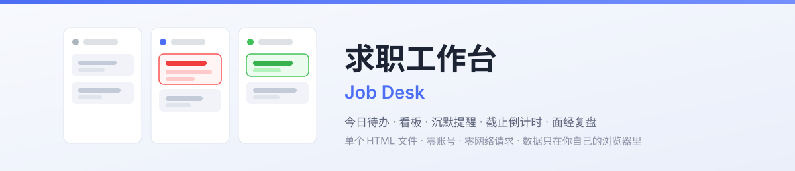
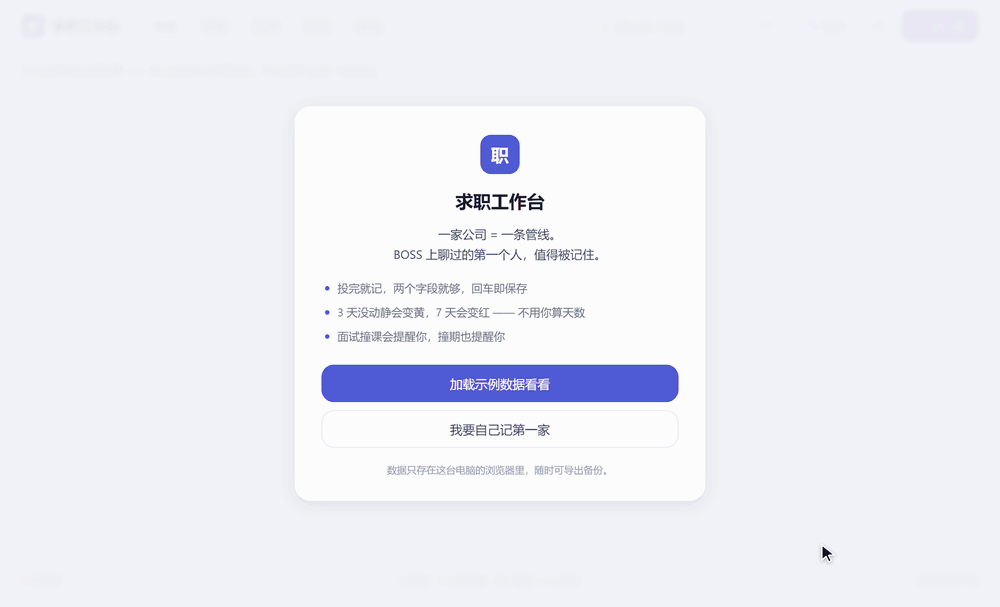

<div align="center">

<picture>
  <source media="(prefers-color-scheme: dark)" srcset="assets/banner-dark.svg">
  <source media="(prefers-color-scheme: light)" srcset="assets/banner-light.svg">
  
</picture>

**A local-first job-application workbench. One HTML file, double-click to run.**

[Download](#quick-start) ｜ [Features](#features) ｜ [Constraints](#hard-constraints) ｜ [Quality](#quality-gates) ｜ [中文](README.md)

[](https://github.com/Rrrayy/job-desk/actions/workflows/ci.yml)
[](https://github.com/Rrrayy/job-desk/releases/latest)
[](LICENSE)

</div>



---

## What it is

After 50 applications you stop remembering **who to follow up with, whose interview is today, and who has gone quiet for two weeks**. Job Desk solves exactly that.

One company, one pipeline, from "wishlist" to "onboarded" — one screen answers "what now".

It is **not** a job aggregator, does **not** apply on your behalf, does **not** write your resume for you, and has **no server** — your data stays in your browser (except when you use AI; see below).

## Quick start

```bash
# Use: download index.html from Releases, double-click. No Node, no server.
# Build:
git clone https://github.com/Rrrayy/job-desk && cd job-desk/app
npm install && npm run build      # → dist/index.html
npm run dev                       # http://localhost:5173
```

First launch offers sample data (8 companies, 7 statuses) or a blank start. Reset via Settings → Data.

`extension/` is a zero-build MV3 extension: it only captures the current job page as an envelope; parsing is shared with the paste path. Not on any store — load it unpacked.

## Features

**Six views**: Today (interviews, follow-ups, deadlines) · Board (pipeline stages) · List (sorted by silence, with a *silence to-do* tab) · Calendar (interviews, classes and personal events, minute-level conflict detection) · Insights (funnel, resume-version hit rate, weekly volume) · Interview bank (five filters, spaced review, "which topic kills me" stats).

**Added in v1.0.0** — the part after you get an offer:

| Module | What it does |
| :--- | :--- |
| Offer decision desk | Nine fields per offer; weighted scoring on pay / growth / city / WLB (missing dimensions are renormalised, never scored 0); adjustable weights summing to 100; side-by-side comparison of up to 8; the decision and its reasons are kept so you can look back in six months |
| Company dossier | Click a company for an aggregated view: overview → totals → applications → interviews → merged timeline; company fields extended to 11 |
| One-line capture | "ByteDance second round tomorrow 3pm" → local dictionary parse → confirm chips → written only after you click save. Pure local rules, zero network requests |
| Silence to-do | Only quiet applications, grouped by silence level (referral thresholds are 3×); batch follow-up is deliberately two steps — generating a message is not sending it |

**Two more areas** (outside the six views):

| Module | What it does |
| :--- | :--- |
| Resume | Structured entry → 8 templates → A4 preview that is the print output (pagination is CSS-driven, guarded by 95 print assertions) → versions bound to specific applications, so insights can show which version actually landed interviews |
| AI (optional, your own key) | 8 scenarios: interview-note cleanup, bulk notes, follow-up drafts, assisted parsing, resume diagnosis, bullet polishing, JD-targeted rewrite, application analysis. The request body is built **only from fields you tick**, with a mandatory preview before sending; model output is only a *suggestion* and is written only when you accept it. 7 presets (3 local, 4 cloud) or any OpenAI-compatible endpoint |

**Data**: file linking (bind your own `data.json`; if externally modified, a conflict copy is written instead of overwriting) · 30-day trash · incremental import with per-row adjudication · CSV/JSON auto-mapping · export JSON / portable bundle / CSV / ICS · optional AES-256-GCM encryption · paste-based sync for BOSS / Shixiseng / Nowcoder / Liepin / generic tables.

## Hard constraints

These are product shape, not implementation detail. CI fails if any is broken.

| Constraint | How | Guard |
| :--- | :--- | :--- |
| Zero network requests by default | with AI unconfigured, not a single request: no CDN, no web fonts, no telemetry. With AI configured, the whole artifact still has exactly one egress: `ai/gateway.ts` | static scan, 11 rules; `gateway.ts` gets its own audit; the allowlist file **stays empty** |
| Single file, double-click | build output is one `index.html` with inlined JS/CSS, runs on `file://` | artifact check + bundle budget |
| Data stays local by default | data lives in your browser; there is no server of ours. **Only what you tick is sent**, and only when you click send, straight to your own provider | mandatory preview; nothing outside the ticked fields enters the request body |
| No data loss on crash | error boundary; on read failure the raw data is preserved before persistence is locked | corruption scenarios × repeated reloads |
| Minimal dependencies | runtime is `react` + `react-dom` only | review rule |

## Quality gates

`npm run verify` runs nine gates; any red blocks a merge.

`typecheck` · `test` · `lint` (incl. architecture boundaries) · `check:no-network` · `build` · `check:bundle` · `check:classes` · `check:versions` · `validate:community`

Two slower gates run separately because they need a real browser: `check:print` (8 resume templates, pagination and decorations) and `check:resume`.

**Measured in v1.0.0** (reproducible from the repo)

| Metric | Value |
| :--- | :--- |
| Unit tests | **1,506 across 91 files**, all green |
| Print gate | 95 assertions (real Chromium, 8 templates) |
| Bundle | **838,781 B (819.1 KB)**; warn 960 KB, fail 1.00 MB |
| Data format | `schemaVersion 6`. 5 → 6 is an empty migration (version bump only, no field backfill), but older builds **reject** v6 outright — downgrading means editing the version back to 5 |
| Network scan | passing, empty allowlist |
| Dependencies | `dependencies`: `react`, `react-dom` |

## Architecture

`App.tsx` is the single state hub; `lib/` holds pure functions (migration, rules, storage, sync engine, AI gateway); `components/` is split by view. **Network access is permitted in exactly one file: `app/src/ai/gateway.ts`.**

- Data model and migration: [`docs/ARCHITECTURE-v0.2.md`](docs/ARCHITECTURE-v0.2.md)
- v1.0.0 incremental design: [`docs/ARCHITECTURE-v1.0.0.md`](docs/ARCHITECTURE-v1.0.0.md)
- **Why it is built this way, and what each choice costs**: [`docs/DESIGN-TRADEOFFS.md`](docs/DESIGN-TRADEOFFS.md)
- Per-release changes: [`CHANGELOG.md`](CHANGELOG.md)

## Known limitations

- The undo stack is in-memory (cleared on reload); trash covers applications only
- With AI, the content you tick (JD / resume modules / application summary) goes to the provider you chose. The `basics` section (name / phone / email / address / photo) is **not a selectable module at all**, so it can never be sent — it is not "unticked by default", there is no checkbox for it
- File linking requires Chromium desktop; Safari / Firefox / mobile show "unsupported" and keep manual import/export
- Encryption protects backups once they leave the machine — it does not stop same-machine XSS or malicious extensions; a lost passphrase cannot be recovered
- Platform sync parses text, not APIs: layout changes break it, and it says so instead of silently dropping data
- One-line capture is a dictionary plus rules; it will ask rather than guess
- 1,000 applications work (virtualised list), but insights and calendar get slower linearly
- Mobile is usable, not designed for: drag and shortcuts assume a keyboard
- The single-file budget is a hard 1 MB ceiling — deliberate

## Contributing

See [`CONTRIBUTING.md`](CONTRIBUTING.md). Platform adapters start at [`docs/adapters/README.md`](docs/adapters/README.md); community interview reports follow [`community/SCHEMA.md`](community/SCHEMA.md) — **redaction is non-negotiable**.

Run `npm run verify` before submitting. Security issues: **no public issue**, use [`SECURITY.md`](SECURITY.md).

## License

Code MIT ([`LICENSE`](LICENSE)); `community/` content CC BY-SA 4.0 ([`community/LICENSE`](community/LICENSE)).
