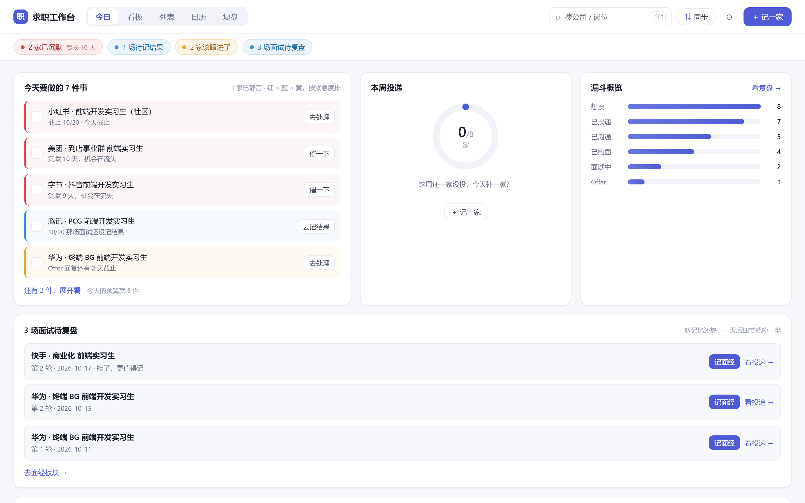

<div align="center">

<picture>
  <source media="(prefers-color-scheme: dark)" srcset="assets/banner-dark.svg">
  
</picture>

# Job Desk · 求职工作台

**Local-first job-application workbench — internships, campus hiring, and experienced hires.**

[](https://github.com/Rrrayy/job-desk/actions)


[](https://github.com/Rrrayy/job-desk/releases)
[](LICENSE)

**One HTML file. No account. Zero network requests. Your data never leaves your browser.**

[中文](README.md) ｜ English

</div>



> **After 50 applications, do you still remember which one to nudge, whose interview is today,
> and which one has been silent for two weeks?**
> That is the only problem this tool solves. One company = one pipeline line, one screen answers
> "what should I do now?". It is not a job aggregator, not a resume builder, and it does not auto-apply.

---

## ✨ What it does

**Five views, all answering "what now"**

| View | Question it answers |
| :--- | :--- |
| 📋 **Today** | Any interviews today? Who should I nudge? What closes tomorrow? |
| 🗂️ **Board** | Where are my 50 applications stuck (wishlist → applied → chatting → interviewing → result) |
| 📃 **List** | Sorted by silence days — the coldest ones first |
| 📅 **Calendar** | Interviews, classes and personal errands on one timeline — do they collide to the minute? |
| 📊 **Insights** | Funnel conversion, resume-version hit rate, weekly volume; second tab is the interview notebook |

**Under the hood it also does:**

- ⏱️ **Silence detection** scaled by channel (referral ×3, official site ×2); offer stage tracked separately, never scaled
- ⏰ **Deadline countdown** in three levels (overdue / today / within 3 days); muting silences nudges, **never deadlines**
- 💬 One-click follow-up messages; add a company in 3 seconds; drag to change stage; `⌘Z` undoes up to 10 steps, `⇧⌘Z` redoes
- 🧯 **Crash-safe**: a render error shows a recovery page with "download raw data" instead of a blank screen
- 🎤 **Multi-round interview modelling** with prep checklists, format and result per round
- 📥 **Timetable import**: paste from your school system, one class per line; unparsable lines are reported, never silently dropped
- ⚠️ **Conflict detection**: interview × interview × class × errand, compared as exact HH:mm overlaps
- 🔄 **Platform sync**: paste BOSS / 实习僧 / 牛客 lists, review each diff, undo in one step
- 📚 **Interview notebook**: one line per question, review queue, failure-category stats
- 💾 JSON backup + CSV export + ICS calendar export, automatic schema migration with rollback points

## 🚀 Quick start

**Option 1 — download (recommended)**

Grab **`index.html`** from [Releases](https://github.com/Rrrayy/job-desk/releases/latest) and double-click it.
It runs over `file://` — no Node, no server, no install.

**Option 2 — build from source**

```bash
git clone https://github.com/Rrrayy/job-desk
cd job-desk/app
npm install && npm run build
# double-click app/dist/index.html
```

**Option 3 — dev mode**

```bash
cd app && npm install && npm run dev   # http://localhost:5173
```

> First launch asks: load the sample data, or record your first company yourself.
> The sample has 8 companies across 7 statuses — 30 seconds to understand the product.

## 📸 Screens

| 🗂️ Board — where the 50 are stuck | 📃 List — the coldest ones |
| :---: | :---: |
|  |  |
| **📅 Calendar — collisions** | **📊 Insights — funnel & questions** |
|  |  |

**Detail drawer — deadline, mute and silence threshold in one place**


## 🧯 v0.4.1 — finishing the failure paths

No new views in this release, only the places where you could actually lose data or get bitten:

| Situation | Before | Now |
| :--- | :--- | :--- |
| Render crash | Blank page; data was there but no way out | Recovery page: reload / **download raw JSON** / copy error |
| Three mis-clicks in a row | Only one undo step | **10-step** undo stack, `⇧⌘Z` / `Ctrl+Y` to redo |
| Deleted the wrong application | Interviews and notes gone forever | Delete is undoable — application, interviews, notes and notebook links come back |
| Same company + role added twice | Silent duplicate card on the board | Warning with existing status and date; a second click writes |
| Version numbers | Settings said `v0.2`, extension manifest said `0.2.0` | Single version source + CI gate across app / extension / bundle |
| Backups | Rely on memory | "Last backup: N days ago", red after 7 days; one-click cleanup of migration rollback points |

## 📅 v0.4 — the calendar is a general schedule

| | Before | Now |
| :--- | :--- | :--- |
| Timetable | Hard-coded sample slots in settings | **Import**: paste from your school system, one class per line, bad lines get a reason |
| Other events | Could not be recorded | **＋ Add an event**: meetings, medical appointments, urgent errands |
| Conflicts | Interview × interview only | Interview × class × errand, pairwise, exact HH:mm overlap |
| Reset | Settings survived "clear all" | **Back to initial state**: everything cleared, welcome screen returns |

## 🎯 v0.3 — three designs that prevent misjudgement

| | Problem before | Behaviour now |
| :--- | :--- | :--- |
| ⏰ **Deadline** | Only "how long has the other side been quiet" — no external due date | Application-level `deadlineAt`, tri-state (inherit / explicitly off / override); overdue / today / within 3 days; deadline items cannot be dismissed in one click |
| 🔕 **Mute** | Either get nudged forever or lose the item | Mute 3 / 7 days, expiring at 23:59:59 of day N; silences soft reminders, **never hard deadlines** |
| 🎯 **Daily budget** | 12 todos and 0 todos have the same effect: ignored | 5 items by default (configurable); order is priority: red (deadline/silence) → blue (interview) → amber (nudge) |

## 🔒 Where the data lives

| localStorage key | Contents |
| :--- | :--- |
| `jobdesk.v1` | Everything: settings, companies, applications, interviews, timeline, notebook, questions, staging, events |
| `jobdesk.v1.ui` | Last view position |
| `jobdesk.v1.listFilters` | Last list filters |
| `jobdesk.v1.lastExportAt` | When you last exported (used only for the reminder) |
| `jobdesk.v1.preMigrate.<time>` | Pre-migration snapshot (rollback point, 30 days) |
| `jobdesk.v1.failedAt.<time>` | Raw copy of unreadable data (max 3, never overwritten) |

- Data stays **in this browser only**: survives refresh and reboot; lost with "clear site data", incognito, or another browser/device.
- **Export before switching machines**: Settings → Data → "Export JSON". Only JSON can be imported back (CSV / ICS are one-way).
- On corrupted data or failed migration the app locks read-only and offers three exits; your raw data is never modified automatically.

## 🛡️ Privacy and boundaries

**Opening the page makes zero network requests.** No CDN, no fonts, no analytics, no update check.
CI scans the source and the built bundle against 11 rules (including CSS `url()`, `@import`, `link href`) and fails on any hit.

What it does **not** do: no cloud sync, no accounts, no telemetry, no encryption at rest (it is a local HTML file — treat it like a local document), no scraping of job sites.

<details>
<summary><b>🔄 Platform sync — how it avoids lying to you</b></summary>

- Paste the list page text from BOSS / 实习僧 / 牛客; parsers are pure functions in `src/adapters/`.
- Five counters must add up: new + updated + unchanged + conflict + staged === parsed rows.
- Conflicts default to unchecked (= keep local). The merge never calls `App.addNote`, never lowers `lastActivityAt`, and never overwrites fields you edited by hand (notes, priority, resume version).
- One-step undo per sync, as a field-level snapshot — never a whole-database rollback.

</details>

<details>
<summary><b>🧠 Silence algorithm</b></summary>

```
lastActivityAt = max(statusChangedAt, latest note.touchedAt)
silentDays     = floor((now - lastActivityAt) / 86400000)
threshold      = warn 3d / stale 7d, × channel coefficient (referral 3 / official 2 / else 1)
isSilent       = silentDays > threshold
```

- `offer` is monitored too, and never scaled by channel (referral ×3 would turn 7 days into 21).
- `silenceOverride` is an **absolute** threshold, not multiplied by the coefficient.
- Silence is a derived state — it is never stored.

</details>

<details>
<summary><b>🧪 Development commands</b></summary>

```bash
cd app
npm run verify        # typecheck → tests → no-network → build → bundle → versions → community
npm run release:prep  # verify + pack release assets into release/v<version>/
npm test              # vitest (239 tests / 16 files)
```

Bundle guardrails: warn 470 KB, fail 540 KB, plus a regression check against the previous version.

</details>

<details>
<summary><b>📁 Project layout</b></summary>

```
app/        Vite 5 + React 18 + TypeScript strict; single-file build
  src/adapters/   community-owned parsers (pure functions)
  src/lib/sync/   maintainer-owned merge engine
extension/  MV3 extension, zero build step
community/  community-contributed interview notes (validated in CI)
docs/       architecture, PRD, QA reports, release notes
```

</details>

## 🏗️ Architecture and quality

| Guarantee | Mechanism | Enforcement |
| :--- | :--- | :--- |
| One file, double-clickable | `vite-plugin-singlefile` + `base:'./'` | build + size gate |
| Data never leaves the machine | single localStorage key, export via download | CI scan + review rule |
| Corrupted data is never overwritten | lock on read failure, raw copy to `failedAt.*` | storage tests |
| Undo never swallows data | per-action snapshots (status / delete / sync) | unit tests |
| Crash is recoverable | ErrorBoundary with raw-data export | manual + smoke |
| Migrations are idempotent | pure functions, additive only, pre-snapshot | migration + disaster tests |
| Version consistency | build-time injection from package.json | `check:versions` gate |

**Current baseline (all reproducible in CI):**

| Metric | Value |
| :--- | :--- |
| Unit tests | **239 / 16 files**, all green (9 disaster-recovery cases) |
| Bundle | **460,142 B (449 KB)** — warn 470 KB / fail 540 KB |
| Network scan | Passed, empty allowlist |
| Build reproducibility | identical sha256 from a clean `npm ci && npm run build` |

Stack: **Vite 5 + React 18 + TypeScript 5.6 strict**. No router, no state library, no UI kit —
state lives in `App.tsx` (every write goes through `mutate()` with undo snapshots), views are 26 components,
styling is one `styles.css` with design tokens.

## ⌨️ Shortcuts

| Key | Action |
| :--- | :--- |
| `N` | New application |
| `1` `2` `3` `4` `5` | Today / Board / List / Calendar / Insights |
| `⌘K` / `Ctrl+K` | Global search |
| `⌘Z` / `Ctrl+Z` | Undo (up to 10 steps) |
| `⇧⌘Z` / `Ctrl+Y` | Redo |
| `Esc` | Close overlay |

## 🗺️ Roadmap

| Version | Theme |
| :--- | :--- |
| v0.5 | **Reliable foundation** — IndexedDB migration, trash / recycle bin, backup reminders, performance gates |
| v0.6 | Local file linkage (File System Access API, write-ahead buffer, conflict copies) |
| v0.8 | Plugin sandbox + optional AI plugins (always explicit about what leaves the machine) |
| v1.0 | Resume templates, JD matching, mock interviews, PWA / Tauri shells |

Full plan: [`docs/ROADMAP.md`](docs/ROADMAP.md).

## ⚠️ Known limitations

- **Adapter selectors are not verified against real logged-in pages** for BOSS / 实习僧 / 牛客 — they may need calibration. The paste channel is the reliable path.
- **Bare names are not redacted** in exports (only names with titles like "面试官 / 老师" are). Reliable redaction needs NER, which regex cannot do.
- **The extension is not on any store** — load it unpacked (`chrome://extensions` → Load unpacked).
- **5 MB storage ceiling**: localStorage is the store; the settings page shows the watermark.
- **Safari / Firefox** are not part of the test matrix (Chromium-first).

## 🤝 Contributing

- Adapters (`src/adapters/`) are community-owned: a new platform = a parser + fixtures + tests. No `if` in the engine.
- The merge engine (`src/lib/sync/`) is maintainer-owned.
- `npm run verify` must be green before a PR; CI runs the same 7 gates.

## 📄 License

[MIT](LICENSE) © Rrrayy

<div align="center">

**If this saves you from forgetting one interview, a ⭐ helps others find it.**

</div>
