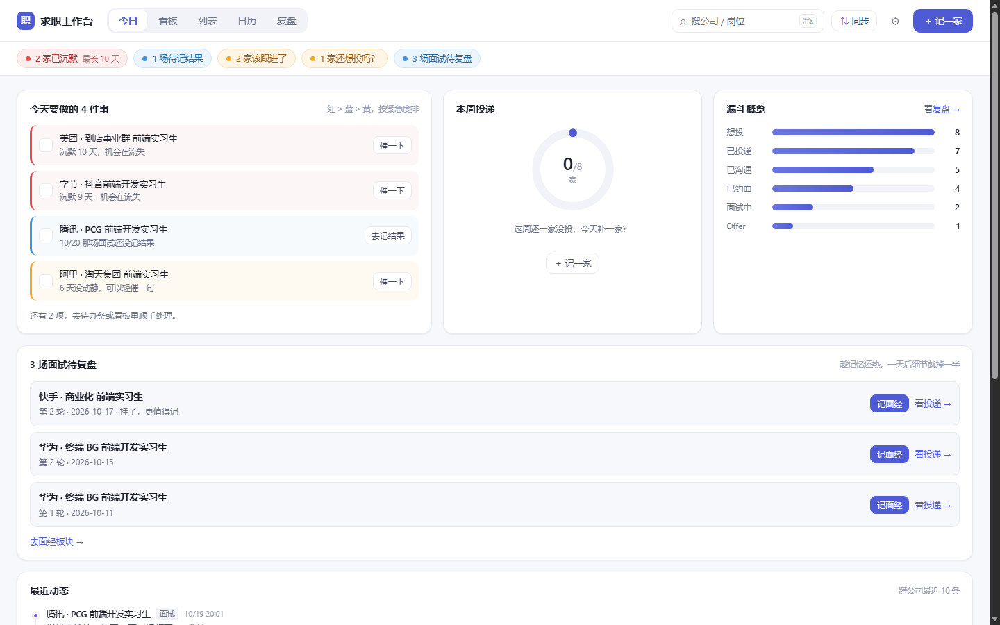

# 求职工作台 · Job Desk

<!-- 徽章：仓库地址替换 OWNER 后自动生效（见 docs/RELEASE-CHECKLIST.md 第 1 条） -->
<!-- 
 -->

### 本地优先的招聘工作台：日常实习 / 暑期实习 / 秋招 / 春招 / 提前批 / 社招

**单个 HTML 文件，零账号、零网络请求，数据只在你自己的浏览器里。**

一家公司 = 一条线，一屏看清「今天该做什么」。它不是招聘聚合器，也不做简历生成 ——
它只解决一件事：投了 50 家之后，你还记得哪家该催、哪家面试在今天、哪家已经沉默两周了吗？

```
下载 dist/index.html → 双击打开 → 开始记第一家
```



---

## 目录

- [它能干什么](#它能干什么)
- [适用场景与兼容性矩阵](#适用场景与兼容性矩阵)
- [30 秒上手](#30-秒上手)
- [数据存在哪 / 怎么备份](#数据存在哪--怎么备份)
- [隐私与边界（这一节比功能重要）](#隐私与边界这一节比功能重要)
- [招聘平台进度同步](#招聘平台进度同步)
- [面经与复习](#面经与复习)
- [核心算法（沉默判定）](#核心算法沉默判定)
- [架构与设计决策](#架构与设计决策)
- [工程质量](#工程质量)
- [快捷键](#快捷键)
- [开发](#开发)
- [目录结构](#目录结构)
- [路线图](#路线图)
- [已知限制](#已知限制)
- [参与贡献](#参与贡献)
- [许可](#许可)

## 它能干什么

**五个视图，都在回答「现在做什么」**

| 视图 | 回答的问题 |
| --- | --- |
| **今日** | 今天有几场面试？谁该催了？哪家沉默太久了？ |
| **看板** | 50 家分别卡在哪个阶段（想投 → 已投 → 沟通中 → 面试中 → 结果） |
| **列表** | 按沉默天数排序，一眼看出「最凉的那几家」 |
| **日历** | 这周的面试和课程/其他安排撞不撞 |
| **复盘** | 漏斗转化、简历版本命中率、每周投递量；二级 tab 是**面经** |

**做的事**

- 3 秒记一家（公司+岗位就够），拖拽换阶段，`⌘Z` 按次撤销
- 沉默判定：按渠道放大阈值（内推 ×3、官网 ×2），红了就是真该动了
- 催进话术一键生成（话术是模板，不用自己想措辞）
- 面试多轮次建模：每轮一场卡片，带准备清单、形式（现场/视频/电话）、结果；挂了记在第几轮
- **平台状态同步**：把 BOSS / 实习僧 / 牛客的投递列表粘进来，自动比对差异、逐条确认、可撤销
- **面经**：一行一题快记 → 题库按「不会的先复习」排序 → 间隔复习 → 统计「哪类题最容易挂」→ 导出 Markdown
- 导入导出 JSON 备份，schema 自动迁移（带回滚点，失败不上锁不覆盖）

## 适用场景与兼容性矩阵

Job Desk 不绑定「日常实习」这一个场景。数据模型里 `jobType` 字段覆盖三类，状态机与沉默算法对全场景通用。
下面是诚实的支持度说明 —— 没写 ✅ 的地方就是还没做好，不糊弄：

| 场景 | 支持度 | 说明 |
| --- | --- | --- |
| 日常实习 | ✅ 完整 | 设计原点，全功能覆盖 |
| 暑期实习 | ✅ 完整 | `jobType = summer`，流程与日常实习一致 |
| 秋招 / 提前批 | ⚠️ 可用，v0.3 重点优化 | `jobType = fulltime`；多轮次面试已建模（`round` / `totalRounds` / `rejectedAtRound`），但 100+ 投递的批量工作流、性能水位、offer 对比还在路线图上 |
| 春招 | ✅ 可用 | 流程同秋招，时间窗口更短，沉默阈值建议调小 |
| 社招 | ⚠️ 部分可用 | 流程通用；缺薪酬结构、职级、猎头渠道等字段（v0.3 数据模型扩展） |

**各场景真实差异，以及我们怎么对待它们：**

- **投递量级**：日常实习 10–30 条，秋招 150–300 条。列表/看板全部做了虚拟滚动，但「批量操作」
  （批量打标签、批量沉默）还没有 —— 这是当前最大的场景缺口。
- **流程轮次**：实习普遍 1–2 轮，秋招 3–5 轮 + 交叉面。多轮次已建模，但「轮次进度条」这类
  可视化还没做。
- **时间窗口**：秋招窗口集中（9–11 月），意味着同一周内大量状态翻转 —— 今日视图的优先级
  排序按「紧急度 × 沉默度」设计，窗口期不失效。
- **决策要素**：社招看薪酬包，秋招看平台与成长性。Offer 对比决策工具在路线图（见下）。

## 30 秒上手

**方式一：直接用（推荐）**

```bash
git clone <this-repo>
cd job-desk/app
npm install && npm run build
# 然后双击 app/dist/index.html —— 就这一个文件，拷到哪都能用
```

`dist/index.html` 已经把 JS/CSS 全部内联，`file://` 直接打开，不需要起服务。

> **`<this-repo>` 是占位符** —— 这个仓库是作为模板发布的（`app/package.json` 里的
> `repository.url` / `homepage` 也还是 `github.com/OWNER/...`）。如果你 fork 出去自己发布，
> 先照 [`docs/RELEASE-CHECKLIST.md`](docs/RELEASE-CHECKLIST.md) 第 1 条把它们替换掉。

**方式二：开发模式**

```bash
cd app
npm install
npm run dev      # http://localhost:5173
```

首次打开会让你选「加载示例数据看看」或「我要自己记第一家」。
示例数据是 8 家公司、覆盖 7 种状态，30 秒能看懂产品在干什么。

## 数据存在哪 / 怎么备份

| localStorage key | 内容 |
| --- | --- |
| `jobdesk.v1` | 全量数据：设置、公司、投递、面试、时间线、面经、题目、暂存区 |
| `jobdesk.v1.ui` | 上次的视图位置（刷新后还原） |
| `jobdesk.v1.listFilters` | 列表视图的筛选条件（刷新后还原） |
| `jobdesk.v1.preMigrate.<时间>` | 迁移前的原始数据（回滚点，保留 30 天） |
| `jobdesk.v1.failedAt.<时间>` | 读取失败时的原始数据副本（最多 3 份，永不被覆盖修改） |

- 数据**只在这个浏览器里**，不跨设备、不跨浏览器、不上传。
- 清浏览器「网站数据 / Cookie」会一起清掉 —— **换电脑或清缓存前先导出**。
- 设置 → 数据 → 「导出 JSON」，会下载 `求职工作台-备份-YYYY-MM-DD.json`。
- 数据损坏 / 迁移失败时不会白屏也不会丢：应用进入只读锁定态，给你三个出口
  （下载原始数据、重试、用空数据进入），原始数据**不会被自动修改或删除**。

## 隐私与边界（这一节比功能重要）

这个项目最硬的一条承诺：**打开页面，浏览器不会为它发出任何请求。**

- 没有统计、没有埋点、没有第三方字体、没有 CDN、没有「检查更新」；
- `npm run check:no-network` 会静态扫描 `app/src` 和 `extension/`，
  出现 `fetch` / `XMLHttpRequest` / `sendBeacon` / `WebSocket` 就直接让 CI 失败；
- 白名单 `no-network-allowlist` 默认**是空的** —— 空不是还没填，空就是真的一个都没有。

明确不做的事（不是排期问题，是产品定位）：

- ❌ 账号系统 / 云同步 / 多端实时同步
- ❌ 自动登录招聘平台、自动投递、自动发消息
- ❌ 后台常驻、定时抓取
- ❌ 把单文件产物拆成需要起服务的多文件应用

## 招聘平台进度同步

平台没有公开接口（就算有也不会给个人开发者用），所以这里做的不是「爬虫」，而是
**「读你自己屏幕上已经能看到的内容」**：

```
① 抓取：整页 Ctrl+A/Ctrl+V，或用扩展（extension/）一键抓
② 预览：五类计数（新增 / 更新 / 无变化 / 冲突 / 待归类）+ 差异表
③ 确认：逐条勾选，冲突行默认不勾
④ 结果：写入了多少条、多少条进了暂存区
```

几条设计上的硬规矩（都写在 `docs/ARCHITECTURE-v0.2.md` 里，代码严格照做）：

- **只有第 ④ 步写库**。前三步返回上一步不产生任何副作用。
- 同步写入的时间线只用平台给的**最后联系时间**，绝不用「抓取时刻」——
  否则你每同步一次，沉默计时就被骗着清零一次。
- 「最后活动时间」永远走 `max()` 重算，不手工覆盖。
- 平台「邀请面试」只映射到「沟通中」+ 一条待办，**不会**自动给你排面试、
  **不会**自动造面试记录 —— 时间地点你没确认过，凭什么替你写。
- 没有变化的记录**不写时间线**（否则时间线会被同步噪音灌满）。
- 认不出、对不上的记录进**暂存区**，一条都不丢，逐条给阶段或忽略。
- 整个合并可**按次撤销**（逐字段回到合并前）。

支持平台：BOSS 直聘、实习僧、牛客、通用表格兜底。平台改版了怎么办：见
[`docs/adapters/README.md`](docs/adapters/README.md)，每个适配器都有 fixture 和单测。

## 面经与复习

入口在**复盘 → [面经]**（不新增一级 tab：面经是「面完当天才用」的低频功能）。

- **快记**：一行一题，`Enter` 连记，90 秒记 5 题。分类/难度/我的回答留到编辑器里补。
- **题库**：公司 / 分类 / 掌握度 / 到期 / 关键词 五维筛选，按「不会的先复习」排序。
- **复习卡**：`←` `→` 切题，空格翻面；标完掌握度自动重排下次复习时间
  （初始 +1/+3/+7 天，之后不会 +3、一般 +7、会了 +14）。
- **统计**：「哪类题最容易挂」（分母是**挂掉的场次数**，不是题目数）、公司高频题 Top 5、挂的原因分布。
- **导出**：一键 Markdown，可脱敏（公司名 → 首字母）。
- **社区题库**：`community/` 里是真人写的面经（CC BY-SA 4.0），**离线**导入 ——
  你自己去 GitHub 下载 JSON，拖进设置页。产品不会替你发起拉取请求。

## 核心算法（沉默判定）

```
lastActivityAt = max(statusChangedAt, 该投递下所有 note.touchedAt)
silenceDays    = 今天（自然日零点）− lastActivityAt 的自然日差
```

- 阈值按渠道放大：内推 ×3、官网 ×2、其余 ×1；**单独设过阈值的公司不受系数影响**（填 10 就是 10 天）
- 沉默只在 `已投 / 沟通中 / 面试中` 三个状态派生；面试中用「等结果超时」当阈值
- **任何一条时间线新增、任何状态变更，`lastActivityAt` 立刻刷新，红色自动消失** —— 不需要手动「取消沉默」
- 撤销**只回滚那一次状态变更**：之后你手写的备注、面试、设置都不会被吞

## 架构与设计决策

单文件、本地优先不是省事，是一系列**可验证的约束**。每条约束都有对应的工程手段守着：

| 约束 | 实现 | 防回归手段 |
| --- | --- | --- |
| 零网络请求 | 无 fetch/XHR/beacon/WebSocket，无 CDN | CI 静态扫描 `check:no-network`，白名单为空 |
| 单文件双击可用 | `vite-plugin-singlefile` + `base:'./'`，JS/CSS 内联 | CI 产物检查 + `check:bundle` 体积红线 |
| 数据不出本机 | localStorage 单 key，导入导出走下载 | CI 扫描 + 代码评审红线 |
| 数据损坏不丢用户数据 | 读取失败即上锁，原文另存 `failedAt.*`（最多 3 份） | 三种损坏场景 × 刷新的硬验证（见 QA 报告） |
| 撤销不吞用户数据 | 按次快照（status/sync 两类），纯函数回滚，禁止整库回滚 | 单测覆盖 |
| 同步不骗沉默计时 | `touchedAt` 只用平台 `lastContactAt`；`lastActivityAt` 只走 `max()` | 同步引擎单测 31 条 |
| 迁移幂等可回滚 | 纯函数、只加不减、前置快照 | 迁移单测 11 条 + 迁移失败页 |

技术栈：**Vite 5 + React 18 + TypeScript 5.6 strict**。没有路由库、没有状态管理库、没有 UI 组件库 ——
状态中枢在 `App.tsx`（所有写操作走 `mutate()`，内置撤销快照），视图层是 26 个组件，样式是一份
带 CSS 变量设计令牌的 `styles.css`。

架构与合并算法的完整设计（含数据流图、时序图、31 个子任务分解）：
[`docs/ARCHITECTURE-v0.2.md`](docs/ARCHITECTURE-v0.2.md)。

## 工程质量

当前基线（每条都能在 CI 里复现）：

| 指标 | 数值 | 说明 |
| --- | --- | --- |
| 单元测试 | 201 个（14 个文件），全绿 | 纯函数层全覆盖：同步引擎、迁移、存储、脱敏、复习算法、沉默与截止规则、CSV/ICS 导出 |
| 产物体积 | 442,872 B（单 HTML） | 红线：470KB WARN / 540KB FAIL |
| 零网络扫描 | 通过，白名单为空 | CI 每次提交都扫 |
| 独立 QA | 478 断言 0 失败 | 浏览器探针 + 交互回放，报告见 [`docs/QA-REPORT-v0.2.md`](docs/QA-REPORT-v0.2.md) |
| 可复现构建 | 干净目录 `npm ci && npm run build` 产物 sha256 一致 | 发布前必验 |

CI（`.github/workflows/ci.yml`）六步全绿才算过：**类型 → 单测 → 零网络扫描 → 构建 → 体积红线 → 社区数据校验**。
每一步对应产品的一条硬承诺，不是顺手加的检查。

## 快捷键

| 键 | 作用 |
| --- | --- |
| `N` | ＋记一家 |
| `1` `2` `3` `4` `5` | 今日 / 看板 / 列表 / 日历 / 复盘 |
| `⌘K` / `Ctrl+K` | 全局搜索（回车打开第一条） |
| `⌘Z` / `Ctrl+Z` | 撤销上一步（状态变更 / 同步合并） |
| `Esc` | 关闭浮层 / 抽屉 |

## 开发

```bash
cd app
npm install

npm run dev            # 开发模式
npm run typecheck      # tsc --noEmit
npm test               # vitest（纯函数单测）
npm run build          # 类型检查 + 产出单文件 dist/index.html
npm run check:bundle   # 产物体积红线：>470KB 警告 / >540KB 失败
npm run check:no-network   # 静态扫描：不许出现网络调用
npm run validate:community # 社区面经：格式 + 唯一性 + 长度 + 脱敏

npm run verify         # 以上全套，交付前跑这一条
```

发布前请走一遍 [`docs/RELEASE-CHECKLIST.md`](docs/RELEASE-CHECKLIST.md)
（第一条是「替换 `OWNER` 占位符」，脚本测不出来但会让 clone 地址指向不存在的仓库）。

## 目录结构

```
job-desk/
├── app/                      # 应用本体
│   ├── dist/index.html       # 构建产物：单文件、双击即用
│   ├── src/
│   │   ├── App.tsx           # 状态中枢（所有写操作走 mutate()，含撤销快照）
│   │   ├── types.ts          # 数据模型（schema v2）
│   │   ├── adapters/         # 平台适配器：boss / shixiseng / nowcoder / custom（各带 fixture + 单测）
│   │   ├── lib/
│   │   │   ├── rules.ts      # 核心算法：沉默派生、待办聚合、漏斗、话术
│   │   │   ├── storage.ts    # localStorage 读写 / 导入导出 / 校验 / 迁移入口 / 损坏上锁
│   │   │   ├── migrate.ts    # v1 → v2 迁移（纯函数、幂等、只加不减）
│   │   │   ├── rollback.ts   # 回滚点与 30 天清理
│   │   │   ├── interview.ts  # 面经统计与间隔复习
│   │   │   ├── sync/         # 同步引擎：normalize / statusMap / engine / capture
│   │   │   └── budget.ts     # 体积水位与文本截断
│   │   └── components/       # 视图 + 抽屉 + 面经 + 同步面板
│   └── scripts/              # 测试启动器与三个检查脚本
├── extension/                # 可选 MV3 扩展（只 activeTab + scripting）
├── community/                # 社区面经（CC BY-SA 4.0，离线导入）
├── docs/
│   ├── PRD-v0.2.md  ARCHITECTURE-v0.2.md  QA-REPORT-v0.2.md
│   └── adapters/README.md    # 适配器协议 + 七步新增指南 + 已知限制
├── .github/                  # CI + Issue/PR 模板 + 网络白名单
├── CONTRIBUTING.md  CODE_OF_CONDUCT.md  SECURITY.md
└── CHANGELOG.md  LICENSE  README.en.md
```

## 路线图

> 完整评审、数据模型草案与验收标准见 [`docs/ROADMAP.md`](docs/ROADMAP.md)（产品经理 × 架构师多轮联合评审）。

**v0.3 —— 地基（已发布 [`0.3.0`](docs/RELEASE-NOTES-v0.3.0.md)）**

- [x] **截止日期**：应用级 `deadlineAt`，三态语义（未设置 / 显式关闭 / 覆盖），投递截止与 Offer 回复截止共用一条轴
- [x] **静音开关**：「静音 3 天 / 7 天」，压掉软提醒但**压不住硬截止**（外部期限不该被算法藏起来）
- [x] **今日行动预算**：默认只露 5 件，其余折叠 —— 12 件待办和 0 件待办对用户是同一种效果
- [x] **Offer 沉默覆盖**：`offer` 进入沉默计算，且**不乘渠道系数**（内推 ×3 会把 7 天变成 21 天＝永不提醒）
- [x] **给别的软件看的导出**：投递表 CSV（带 BOM、防公式注入）+ 面试日历 ICS（RFC 5545 折行、UTC 时间）
- [x] **性能**：写盘只序列化一次；时间线索引把「今日待办」从 `O(投递 × 时间线)` 降到 `O(投递 + 时间线)`
- [x] **CI 收紧**：体积红线 600 → 540 KB；「零网络请求」扫描补上 CSS `url()` / `@import` / `<link href>` 三个口子

**v0.4 —— 数据模型重构（下一版主线）**

- [ ] **招聘季（Season）+ 双层截止**：赛季级截止 + 公司级覆写，`effectiveDeadlineOf()` 唯一入口
- [ ] **阶段 × 结果双轴**：`stage(7) × outcome(5)` 取代单一 status（`scheduled` 改为派生，`offer` 升为实体）
- [ ] **轮次语义化**：一面/二面/交叉面/HR 面各自建模，「挂在第几轮」不再是手填数字
- [ ] **撤销栈**：当前是单槽（用完即换），改成 10 层 LIFO，`Cmd+Z` 可连按
- [ ] **staging 预检分批**：超 200 条丢最旧之前先告诉用户，而不是丢完再提示

**v0.5 —— 闭环与归因**

- [ ] **行为等价验收 5 条 DoD**（迁移前后待办/漏斗/沉默逐条比对，有排期否决权）
- [ ] 轮次 → 面经闭环（面试卡片一键带上下文见面经）
- [ ] 简历版本实体化 + 两层统计（按名称聚合、按版本下钻；样本 < 5 不显示比率）
- [ ] 批量操作 + 事务级撤销；公司级视图（一司多岗）；JD 快照；内推人脉
- [ ] 组件测试（jsdom + Testing Library）+ Playwright E2E 直测 `file://` 产物 + 迁移 fixture 库

**v1.0 —— 决策与长期使用**

- [ ] Offer 加权对比（薪酬 / 地点 / 成长 / 确定性）
- [ ] 归档与招聘季切换（归档记录仍可被搜索）
- [ ] 归因统计（第几轮挂的人最多），带三档覆盖率标注
- [ ] 文档站 + i18n
- [ ] 社招包（谈薪 / 背调 / 隐身求职）

不做的事见[隐私与边界](#隐私与边界这一节比功能重要)——路线图不会悄悄跨越那条线。

## 已知限制

- **没有回收站**：删投递是即时的（有二次确认，但删了就没了）—— 建议定期导出备份。
- **剪贴板可能不可用**：`file://` 下部分浏览器禁止剪贴板 API，催进话术会自动展开在文本框里让你手抄。
- **同步是文本解析，不是接口**：平台改版会让解析失效。失效时会明确告诉你「没解析出来」，不会静默丢数据。
- **列表虚拟滚动**：Ctrl+A 只能拿到已渲染的条目，所以「识别 N 条」小于总数是正常的。
- **移动端只是能用**：窄屏做了适配，但拖拽和键盘快捷键是桌面优先设计的。
- **单文件产物有体积上限**：超 540 KB 会让 CI 失败 —— 这是刻意的约束，不是 bug。
- **撤销只有一层**：`Cmd+Z` 只能退一步，连按不会继续往前退（v0.4 改成 10 层栈）。
- **截止日期只有应用级**：还没有「招聘季整体截止」，每条投递要单独填（v0.4 补 Season）。
- **秋招量级只做了算法级优化，没有实测**：150+ 投递下的端到端耗时尚无基准数据。

## 参与贡献

见 [`CONTRIBUTING.md`](CONTRIBUTING.md)。想加平台适配器，从
[`docs/adapters/README.md`](docs/adapters/README.md) 开始。想贡献面经，看
[`community/SCHEMA.md`](community/SCHEMA.md) —— **脱敏是硬红线**。
每个版本改了什么，看 [`CHANGELOG.md`](CHANGELOG.md)（含「为什么版本号从 1.0.0 回到 0.2.0」）。
发现安全问题请**不要开公开 Issue**，走 [`SECURITY.md`](SECURITY.md) 里的私下渠道。

## 许可

- 代码：MIT，见 [`LICENSE`](LICENSE)
- 社区面经内容（`community/`）：CC BY-SA 4.0，见 [`community/LICENSE`](community/LICENSE)
