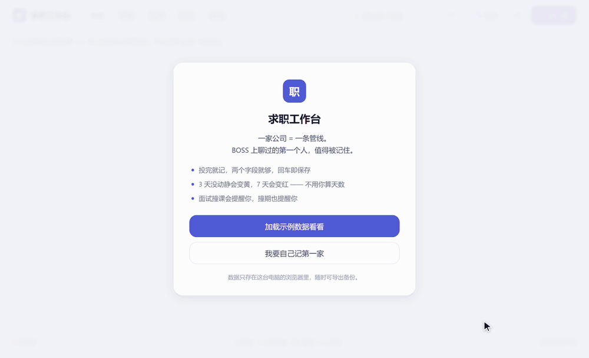

<div align="center">

<picture>
  <source media="(prefers-color-scheme: dark)" srcset="assets/banner-dark.svg">
  <source media="(prefers-color-scheme: light)" srcset="assets/banner-light.svg">
  
</picture>

**本地优先的求职投递工作台。一个 HTML 文件，双击即用。**

[下载](#快速开始) ｜ [功能](#功能) ｜ [工程约束](#硬约束) ｜ [工程质量](#工程质量) ｜ [English](README.en.md)

[](https://github.com/Rrrayy/job-desk/actions/workflows/ci.yml)
[](https://github.com/Rrrayy/job-desk/releases/latest)
[](LICENSE)

</div>



<sub>21 秒真实录屏：加载示例 → 打开红色待办 → 一键催进（沉默计时当场清零）→ 看板 → 日历抓出「面试 × 组会」冲突 → 搜索直达详情。</sub>

---

## 这是什么

投了 50 家之后，人会记不清**哪家该催、哪家面试在今天、哪家已经沉默两周**。Job Desk 只解决这一件事。

一家公司一条线，从「想投」到「入职」走完整条管线；一屏回答「现在该做什么」。

它**不是**招聘聚合器，**不代替**你投递，**不替你写简历**，也**没有服务器** —— 数据留在你浏览器里（用 AI 时除外，见下）。

## 快速开始

```bash
# 用：到 Releases 下载 index.html，双击打开。不需要 Node，不需要起服务
# 改：
git clone https://github.com/Rrrayy/job-desk && cd job-desk/app
npm install && npm run build      # 产出 dist/index.html
npm run dev                       # 开发模式 http://localhost:5173
```

首次打开会问「加载示例数据（8 家公司 7 种状态）」还是「自己记第一家」。清空走 设置 → 数据 → 回到初始状态。

`extension/` 是零构建的 MV3 扩展，只负责抓当前招聘页文本、产出信封，解析交给与粘贴通道**完全相同**的代码，省掉 `Ctrl+A / Ctrl+V`。未上架，走「加载已解压的扩展程序」。

## 功能

**六个视图**

| 视图 | 回答的问题 |
| :--- | :--- |
| 今日 | 今天几场面试？谁该催了？哪家明天截止？ |
| 看板 | 50 家分别卡在哪一阶段 |
| 列表 | 按沉默天数排序，最凉的排前面；二级 tab 是**沉默待办** |
| 日历 | 面试 / 课表 / 私事同框，冲突精确到分钟 |
| 复盘 | 漏斗转化、简历版本命中率、每周投递量 |
| 面经 | 题库五维筛选、间隔复习、按「哪类题最容易挂」统计 |

**v1.0.0 补齐了投递之后的账**

| 模块 | 内容 |
| :--- | :--- |
| Offer 决策台 | 9 个字段录入；薪资 / 成长 / 城市 / WLB 四维加权（缺维按已评归一，不按 0 分）；权重可调、恒和 100；最多 8 个并排对比；决策与理由留档，半年后能回看 |
| 公司档案 | 点公司名看聚合视图：概览 → 小计 → 投递 → 面试 → 合并时间轴；公司字段扩到 11 个 |
| 一句话快记 | 「明天下午 3 点字节二面」→ 本地词表解析 → 确认条 → 点了才写库。纯本地规则，不发网络请求 |
| 沉默待办 | 只收「该跟进 / 已沉默」的投递，归组只看沉默等级；批量催问必须两步（生成话术 ≠ 已发出） |

**还有两块**（不在上面六个视图里）

| 模块 | 内容 |
| :--- | :--- |
| 简历 | 结构化录入 → 8 套模板 → A4 预览即打印（分页靠 CSS，95 条打印断言守着）→ 版本绑定到具体投递，复盘里能看到哪版简历命中率高 |
| AI（可选，自己的 Key） | 8 个场景：面经整理 / 批量面经 / 话术草稿 / 辅助解析 / 简历诊断 / 润色 / JD 定向改写 / 投递分析。请求体**只由你勾选的字段拼**，发送前必弹预览；模型输出只算「建议」，勾了才写库。7 家预设（3 本地 + 4 云端）或任意 OpenAI 兼容地址 |

**数据能力**：文件联动（绑自己的 `data.json`，被外部改过就另存冲突副本，不覆盖）· 回收站 30 天 · 增量导入（两边值不同逐条裁决）· CSV/JSON 自动映射 · 导出 JSON / 便携包 / CSV / ICS · 可选 AES-256-GCM 加密 · BOSS / 实习僧 / 牛客 / 猎聘 / 通用表格同步

## 硬约束

这五条是产品形态，不是实现细节。违反任何一条 CI 会红。

| 约束 | 做法 | 怎么防回归 |
| :--- | :--- | :--- |
| 默认零网络请求 | 不配 AI 时一行请求都不发：无 CDN、无第三方字体、无埋点。配了 AI，整个产物也只有 `ai/gateway.ts` 一个出口 | 静态扫描 11 条规则；`gateway.ts` 另有专项审计；白名单文件**保持为空** |
| 单文件双击可用 | 构建产物就是一个 `index.html`，JS/CSS 全内联，`file://` 直接跑 | 产物检查 + 体积红线 |
| 数据默认不出本机 | 数据只存在浏览器里，没有我们的服务器。**只有你主动点发送时**，勾选的那部分文本才直连你填的厂商 | 发送前必弹预览，勾选之外一个字符都不进请求体 |
| 崩溃不丢数据 | 渲染异常进兜底页；读取失败先备份原文再锁定写入 | 损坏场景 × 多次刷新 |
| 依赖最小 | 运行时仅 `react` + `react-dom` | 评审红线 |

## 工程质量

`npm run verify` 九关，任何一关红就不合并。

| # | 关卡 | 守什么 |
| :--- | :--- | :--- |
| 1 | `typecheck` | TS strict + `noUncheckedIndexedAccess` |
| 2 | `test` | 纯函数与组件行为 |
| 3 | `lint` | correctness + hooks + 架构边界（适配器禁读 DOM、禁 fetch） |
| 4 | `check:no-network` | 11 条规则，白名单为空 |
| 5 | `build` | 单文件产物可生成 |
| 6 | `check:bundle` | 体积红线 + 单次涨幅告警 |
| 7 | `check:classes` | 类名压缩表往返一致、黄金副本等价 |
| 8 | `check:versions` | `package.json` / 扩展 `manifest.json` / 产物三处一致 |
| 9 | `validate:community` | 面经格式 + 脱敏 |

另有两条不进 `verify`（要起真浏览器，慢）：`check:print`（8 套简历模板分页与装饰）与 `check:resume`。

**v1.0.0 实测**（都能在仓库里一条命令复现）

| 指标 | 数值 |
| :--- | :--- |
| 单元测试 | **1506 条 / 91 文件**，全绿 |
| 打印门禁 | 95 条断言（真 Chromium，8 套模板） |
| 产物体积 | **838,781 B（819.1 KB）**，红线 960 KB 警告 / 1.00 MB 失败 |
| 数据格式 | `schemaVersion 6`。5 → 6 是空迁移（只改版本号，不补字段）；但旧版本见到 v6 会**直接拒绝**，降级得手动把版本号改回 5 |
| 零网络扫描 | 通过，白名单为空 |
| 依赖 | `dependencies` 仅 `react` + `react-dom` |

## 架构

`App.tsx` 是唯一状态中枢；`lib/` 放纯函数（迁移、规则、存储、同步引擎、AI 网关）；`components/` 按视图切分；**网络调用只允许出现在 `app/src/ai/gateway.ts` 一处**。

- 数据结构与迁移：[`docs/ARCHITECTURE-v0.2.md`](docs/ARCHITECTURE-v0.2.md)
- v1.0.0 增量设计与任务分解：[`docs/ARCHITECTURE-v1.0.0.md`](docs/ARCHITECTURE-v1.0.0.md)
- **为什么这么设计、代价是什么**：[`docs/DESIGN-TRADEOFFS.md`](docs/DESIGN-TRADEOFFS.md)
- 每个版本改了什么：[`CHANGELOG.md`](CHANGELOG.md)

## 已知限制

- 撤销栈是内存态（刷新即清）；回收站只覆盖投递，公司 / 面试 / 日程删了只能靠撤销栈捞
- 用 AI 时，你勾选的内容（JD / 简历模块 / 投递摘要）会发给你自己选的模型厂商。`basics` 板块
  （姓名 / 电话 / 邮箱 / 地址 / 照片）**不在可选模块里**，所以永远发不出去 —— 不是「默认不勾」，是「没有那个勾选框」
- 文件联动只在 Chromium 桌面版可用，Safari / Firefox / 移动端明确显示「不支持」并保留手动导入导出
- 加密只保护「备份文件离开这台机器之后」，挡不住同机 XSS 或恶意扩展；忘口令没有找回通道
- 同步是**文本解析**不是接口，平台改版会让解析失效 —— 失效时会明说「没解析出来」，不静默丢数据
- 快记是词典 + 规则，不认识「国庆后那周」这类说法；认不出就问，不猜
- 大库 1000 条可用（列表窗口化），复盘 / 日历这类全量派生视图仍随条数线性变慢
- 移动端只是能用：拖拽与快捷键按桌面设计
- 单文件体积有硬上限 1 MB（红线），这是刻意约束

## 参与贡献

见 [`CONTRIBUTING.md`](CONTRIBUTING.md)。加平台适配器从 [`docs/adapters/README.md`](docs/adapters/README.md) 开始；贡献面经看 [`community/SCHEMA.md`](community/SCHEMA.md) —— **脱敏是硬红线**。

提交前跑 `npm run verify`。安全问题**不要开公开 Issue**，走 [`SECURITY.md`](SECURITY.md)。

## 许可

代码 MIT（[`LICENSE`](LICENSE)）；`community/` 面经 CC BY-SA 4.0（[`community/LICENSE`](community/LICENSE)）。

<div align="center">

<sub>Job Desk · MIT License</sub>

</div>
