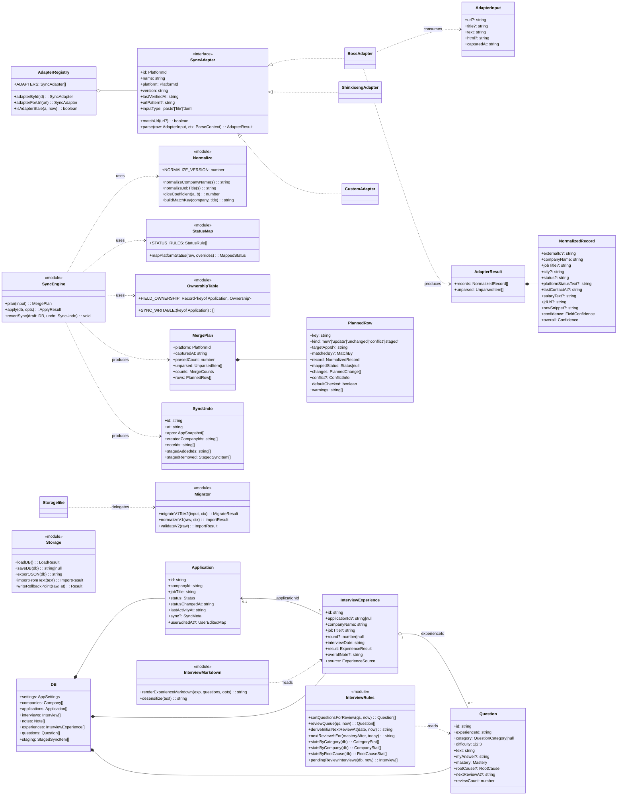
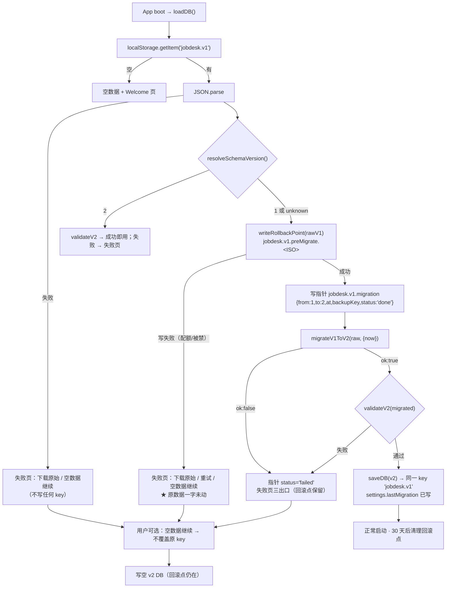
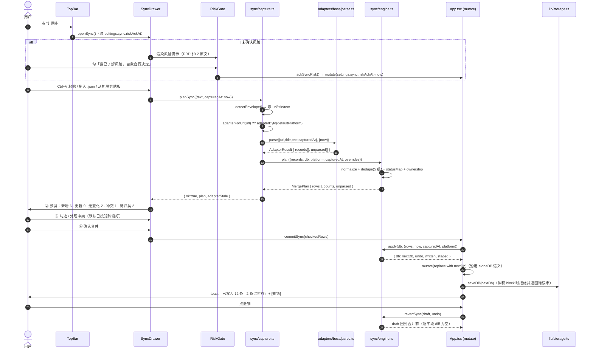
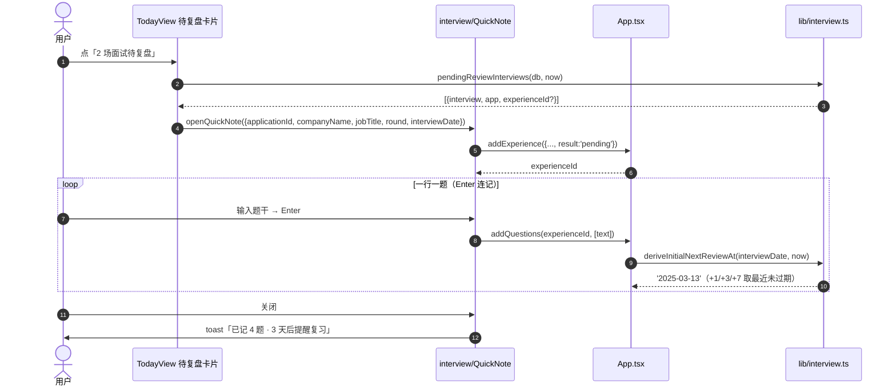

# 求职工作台 v0.2 · 架构设计与任务分解

| 项 | 内容 |
| --- | --- |
| 上游 | `docs/PRD-v0.2.md`（增量）+ `docs/PRD.md` v1.0（基线）+ QA Round 3 |
| 基线代码 | `app/src` 8,851 行（TS/TSX 5,966 + CSS 2,885），`dist/index.html` 284,198 B |
| 本文作用 | 给出**不可再讨论的决策**、**可直接贴进代码的接口**、**改到函数级的文件清单**、**可并行执行的任务分解** |
| 读者 | 工程师（照此实现，不需要回来问）+ QA（照此验收）+ 未来的贡献者（照此写适配器） |
| 版本口径 | `appVersion` 0.2.0 / `schemaVersion` 2（两者解耦，见 PRD §A.5） |

> 阅读顺序建议：§0 决策速查 → §2 接口 → §3 算法 → §5 任务 → §7 风险。
> 只想写代码的人：直接看 §5 任务分解，每个子任务都写了「改哪个文件的哪个函数」。

---

## 0. 决策速查（每条 = 决策 + 理由 + 代价）

| # | 决策 | 理由 | 代价 |
| --- | --- | --- | --- |
| D-01 | **不做 monorepo**。仓库根只有 `app/`（唯一 npm 包）、`extension/`（零构建 MV3）、`community/`（纯数据）、`docs/`、`.github/` | 只为 ~200 行扩展引入 pnpm workspace，会让「clone 后 5 分钟跑出 dist」这个 P0 验收多出一步装包器；且扩展不需要任何依赖，workspace 对它零收益 | 未来若扩展要写 TS、要共享解析器，需要再引入构建（届时成本不变，只是推迟） |
| D-02 | **适配器放 `app/src/adapters/`，不放 `lib/sync/adapters/`** | PRD §A.4 已把 `src/adapters/` 定义为**唯一稳定契约**并写了 `docs/adapters/README.md` 的路径；更重要的是**目录边界 = 所有权边界**：`adapters/` 归社区（只写纯函数），`lib/sync/` 归维护者（状态映射/ownership/合并=产品语义，PRD §B.4 明确不让单个 PR 改） | 与最初的 `lib/sync/adapters` 设想不同，PRD 与 docs 已按 `src/adapters/` 写，改回要同步改 PRD |
| D-03 | **扩展只做 DOM→原始文本，不做解析**。扩展产出一个 JSON 信封（`format/text/url/title/capturedAt`），经剪贴板交给主应用，与「Ctrl+A/C/V」走**同一条代码路径** | ① 扩展无 TS/打包，写解析必然产生第二份实现并静默腐烂；② 解析器只有一份 → 一套 `parse.test.ts` 同时覆盖粘贴与扩展两条通道；③ 扩展能保持 ~200 行，reviewer 扫「无网络请求」只需 30 秒 | 剪贴板里是 30~80 KB 纯文本而非结构化数据；用户仍需一次 Ctrl+V（但比 Ctrl+A/C 少一步，且自动识别来源） |
| D-04 | **新增 Vitest（devDependency）**，`vitest.config.ts` 独立于 `vite.config.ts` | PRD 强制要求 `parse.test.ts` / 9 条映射单测 / 排序单测 / `validate:community`，没有测试跑不起来；PRD §A.4 的门槛原话是「不用跑起来（`npm test -- boss`）」。独立 config 是为了不把 `test` 字段塞进 `vite.config.ts`（会污染 `defineConfig` 类型） | CI 时间 +30~50s；`devDependencies` 增加 vitest+jsdom（**不进产物**，对 284 KB 零影响） |
| D-05 | **迁移不放 `validateImport` 里，而是 `validateImport` 做版本分发**：v1 → `migrateV1ToV2`，v2 → `validateV2`。启动与导入共用同一个入口 | PRD §D.3 要求「v1 备份导入 v0.2 必须成功，走同一条 `migrateV1ToV2`，不另写宽容解析」。让两条路径物理上只有一个实现，就不存在不一致 | `validateImport` 语义变成「校验+迁移」，名字略有误导，故在 `storage.ts` 顶部注释里写明 |
| D-06 | **迁移时绝不复用现有 v1 校验器的默认值填充**（`storage.ts:184/202/215` 里 `new Date()`）。抽 `lib/validateV1.ts`，时间戳由 `ctx.nowIso` 注入 | §D.2 契约 4 要求迁移「不读时间」；现有 v1 校验器会给缺失的时间戳填 `new Date()` → 破坏幂等与「无损」的可测性（同一份数据两次迁移结果不同） | 多一个 230 行的 `validateV1.ts`（内容基本是 `storage.ts:138-360` 的搬运） |
| D-07 | **同步的 note `touchedAt` 只能用平台给的 `lastContactAt`，且 `lastActivityAt` 用 `max()` 重算，不许赋值**。绝不复用 `App.addNote` | `App.tsx:298 addNote` 里是 `target.lastActivityAt = touchedAt`（赋值）。同步若直接调用它、平台时间又比本地旧，会把沉默基准**往回调**，红色标记凭空出现。`rules.ts:155 lastActivityAtOf` 已经是 max 语义，同步必须用它 | 同步不能复用 `addNote`，要写一条独立写入路径（已在 `engine.apply` 里） |
| D-08 | **去重键多加一级 `sync.matchKey`**（= 归一化公司 + `\|` + 归一化岗位，写入时存一份） | PRD §B.6 只有 externalId 和 fuzzy 两级。但 BOSS 粘贴通道拿不到 `externalId`（纯文本无 href），且用户**事后改 jobTitle** 会让 fuzzy 失配 → 同一条投递被二次「新增」。存一份写入时的归一化快照，第二次同步就能稳定命中 | `Application.sync` 多一个字段（16 字节/条）；引入「归一化函数一改，旧 matchKey 失效」的隐性耦合 → 用 `matchKeyVersion` 常量兜住 |
| D-09 | **`SYNC_STATUS_RANK` 与 `rules.ts:stageRankOf` 分开，不复用** | `stageRankOf` 是**漏斗口径**（把 rejected/dropped 按面试记录回推成 3），语义是「走到过第几步」；同步要的是**推进次序**（rejected 必须排在 interviewing 之后，否则「已约面 → 不适合」会被判成「冲突」而不是「前进」）。两者共用会互相污染 | 多一张 9 元常量表 |
| D-10 | **`lastSyncedAt` 允许每行都刷，但永不计入沉默**；`sync` 类型 note 只在「状态变了」或「平台确实有更新的联系时间」时写 | PRD §B.8 的「绝不骗用户」：无变化行若写 note，`lastActivityAt` 会被刷新，20 条沉默记录瞬间全绿 | 需要 `plannedChanges.length === 0` 时跳过写 note 的分支（一行 if） |
| D-11 | **`version` 从 `1.0.0` 降到 `0.2.0`** | PRD §A.5 明确「v0.2 停在 0.x」，且 v1.0.0 的发布条件未达成。留着 1.0.0 是虚假承诺，而 0.x 的语义本就允许 MINOR 位小破坏 | 版本号「倒退」在 CHANGELOG 里要写一句解释，否则像事故 |
| D-12 | **扩展不申请 `host_permissions`，也不申请 `tabs`**，只用 `activeTab` + `scripting` | 比 PRD §B.3 的「目标域名 host_permissions」更保守：`activeTab` 在用户点击扩展图标后即授予当前标签页的 URL 与脚本注入权，够用 | 无法在「未获授权」时按域名隐藏图标——所以图标常驻，点击后**在 popup 内**判定 URL 并给出「这页不是沟通/投递列表页」；（PRD §B.3 的「URL 未命中按钮不出现」在 `activeTab` 模型下无法做到，见 §8-歧义 6） |
| D-13 | **分类计数从 4 类扩到 5 类**：新增/更新/无变化/冲突/**待归类**，五者之和 === 识别条数 | PRD §B.9 要求「四个计数之和严格等于识别条数」，但 §B.7 又要求「映射不出来的进暂存」——暂存本身也是一个分类，四类装不下。五类求和才是那条不变式 | 预览表头多一个数字（§B.5 的线框图要 +1 列） |
| D-14 | **面经的三个视图全部走 `AppApi` 契约，组件之间零 import** | 沿用 `api.ts:2` 的既有约定（「避免组件之间互相 import 造成循环依赖」）。面经要读投递/面试，最容易犯的错就是直接 import `DetailDrawer` | `AppApi` 增加 ~14 个方法，`App.tsx` 继续变胖（645 → 约 900 行）。可接受：v0.3 再拆 `useStore<T>` 泛型，本轮不动 |
| D-15 | **CI 的「零网络扫描」用 node 脚本 `check-no-network.mjs`，不用 `grep` 命令** | GitHub Actions 的 `grep` 在不同 runner 版本上行为/退出码不稳定；脚本能输出**文件:行号**（PRD §A.3-4 要求「指出行号」）并支持 allowlist 注释 | 多一个 40 行脚本 |

---

## 1. 目录结构（完整）

```
job-desk/                                   ← GitHub 仓库根（尚未 git init）
├── .github/
│   ├── workflows/
│   │   └── ci.yml                          # 4 项检查（PRD §A.3）
│   ├── ISSUE_TEMPLATE/
│   │   ├── bug_report.yml
│   │   ├── feature_request.yml
│   │   └── adapter_request.yml             # 社区增长入口，勾「愿写解析器」→ 自动 label
│   ├── pull_request_template.md
│   └── no-network-allowlist                # 允许出现的网络调用白名单（默认空）
├── community/                              # 社区面经（内容 CC BY-SA 4.0）
│   ├── README.md                           # 格式 + 怎么提 PR + 一键转小红书文案
│   ├── SCHEMA.md                           # 字段定义（与 C.2 同源）
│   ├── LICENSE                             # CC BY-SA 4.0
│   ├── _index.json                         # 生成物：文件清单 + 公司/岗位/轮次
│   ├── boss/2025-03-bytedance-fe-2.json    # maintainer 先写 5 篇撑目录
│   ├── boss/2025-03-meituan-fe-1.json
│   ├── shixiseng/2025-03-xiaohongshu-fe-1.json
│   ├── nowcoder/2025-02-kuaishou-fe-1.json
│   └── nowcoder/2025-02-tme-fe-1.json
├── docs/
│   ├── PRD.md                              # v1.0 基线
│   ├── PRD-v0.2.md
│   ├── ARCHITECTURE-v0.2.md                 ← 本文
│   ├── QA-REPORT.md
│   ├── class-diagram-v0.2.mermaid           # 本文 §2 图，供渲染/评审
│   ├── sequence-diagram-v0.2.mermaid        # 本文 §4 图
│   ├── adapters/
│   │   ├── README.md                       # 贡献指南（3 文件 + 1 行注册）
│   │   ├── boss.md                         # 支持的页面 / 字段 / 已知限制
│   │   └── shixiseng.md
│   ├── qa-evidence/
│   └── screenshots/
├── extension/                              # 零构建 MV3（P1 源码，本轮交付）
│   ├── manifest.json
│   ├── content/
│   │   ├── selectors.boss.js               # 集中选择器配置（用户可自行修正）
│   │   └── capture.js                      # DOM → {text,url,title,capturedAt}
│   ├── popup/
│   │   ├── popup.html
│   │   ├── popup.css
│   │   └── popup.js
│   ├── icons/ icon16.png icon48.png icon128.png
│   └── README.md                           # 加载已解压 + 权限说明 + 合规声明 + 选择器失效怎么改
├── app/                                    # 唯一 npm 包
│   ├── package.json                        # name job-desk / version 0.2.0 / MIT
│   ├── tsconfig.json
│   ├── vite.config.ts
│   ├── vitest.config.ts                    # 新增（D-04）
│   ├── index.html
│   ├── README.md                           # 瘦身为 3 行开发命令（详细内容在根 README）
│   ├── scripts/
│   │   ├── check-bundle.mjs                # >350KB warn / >400KB fail
│   │   ├── check-no-network.mjs            # src/ 与 extension/ 扫 fetch/XHR/beacon/WS
│   │   └── validate-community.mjs          # schema + id 唯一 + 脱敏正则
│   ├── dist/index.html                     # 构建产物（.gitignore，走 Release 附件）
│   └── src/
│       ├── main.tsx
│       ├── App.tsx
│       ├── styles.css
│       ├── types.ts
│       ├── adapters/                       # ★ 社区贡献边界（只放纯函数）
│       │   ├── types.ts                    # 协议，改它要 MAJOR
│       │   ├── registry.ts                 # ['boss','shixiseng','nowcoder','custom']
│       │   ├── boss/
│       │   │   ├── adapter.ts
│       │   │   ├── parse.ts
│       │   │   ├── parse.test.ts
│       │   │   ├── fixtures/ chat-list.txt apply-list.txt empty.txt garbage.txt expected.json
│       │   │   └── README.md
│       │   ├── shixiseng/ adapter.ts parse.ts parse.test.ts fixtures/ README.md
│       │   ├── nowcoder/  adapter.ts parse.ts parse.test.ts fixtures/ README.md
│       │   └── custom/    adapter.ts parse.ts parse.test.ts fixtures/
│       ├── lib/
│       │   ├── api.ts                      # AppApi 契约（视图唯一入口）
│       │   ├── date.ts
│       │   ├── util.ts
│       │   ├── rules.ts                    # v0.1 规则（只加 NOTE_TYPE_LABEL['sync']）
│       │   ├── sample.ts                   # ★ 必须补 v2 三个数组，否则示例数据崩
│       │   ├── storage.ts                  # façade：loadDB/saveDB/exportJSON/importFromText
│       │   ├── validateV1.ts               # 新增：v1 结构归一化（时间注入）
│       │   ├── validateV2.ts               # 新增：v2 结构校验（字段级错误）
│       │   ├── migrate.ts                  # 新增：migrateV1ToV2（纯函数）
│       │   ├── rollback.ts                 # 新增：回滚点读写 + 30 天清理 + 失败页数据
│       │   ├── budget.ts                   # 新增：体积水位
│       │   ├── interview.ts                # 新增：面经纯函数（排序/复习队列/统计）
│       │   ├── interviewMarkdown.ts        # 新增：Markdown 导出 + 脱敏
│       │   └── sync/
│       │       ├── types.ts                # NormalizedRecord / MergePlan / SyncUndo
│       │       ├── normalize.ts            # normalizeCompanyName / normalizeJobTitle / dice
│       │       ├── normalize.test.ts
│       │       ├── statusMap.ts            # 平台原文 → Status（9 条 + overrides）
│       │       ├── statusMap.test.ts
│       │       ├── ownership.ts            # FIELD_OWNERSHIP 常量表
│       │       ├── engine.ts              # plan() / apply()（纯函数）
│       │       ├── engine.test.ts
│       │       └── capture.ts             # 信封解析 / 粘贴通道 / 文件通道 / 平台识别
│       └── components/
│           ├── TopBar.tsx  TodoBar.tsx  TodayView.tsx  BoardView.tsx  ListView.tsx
│           ├── CalendarView.tsx  DetailDrawer.tsx  QuickAdd.tsx
│           ├── SettingsDrawer.tsx  Toast.tsx  Field.tsx  Welcome.tsx
│           ├── MigrationFailPage.tsx       # 新增：迁移失败三出口
│           ├── BulkBanner.tsx              # 新增：体积水位横幅（或直接复用 .banner）
│           ├── sync/
│           │   ├── SyncDrawer.tsx          # 四步壳 + 状态机
│           │   ├── RiskGate.tsx            # 风险确认门（riskAckAt）
│           │   ├── Step1Capture.tsx        # 粘贴区 / 拖文件 / 扩展提示
│           │   ├── Step2Preview.tsx        # 五类计数 + 差异表
│           │   ├── Step3Confirm.tsx        # 逐项勾选 + 冲突决策
│           │   ├── StagingList.tsx         # 待归类暂存区
│           │   └── badges.tsx              # 置信度/来源/冲突小标签
│           └── interview/
│               ├── InsightsTabs.tsx        # [数据][面经] 二级 tab
│               ├── QuickNote.tsx           # 一行一题 + Enter 连记
│               ├── QuestionBank.tsx        # 筛选 + 掌握度排序
│               ├── ReviewCards.tsx         # 复习卡片模式
│               ├── InterviewStats.tsx      # 分类×挂 / 公司高频 / rootCause
│               └── ExperienceEditor.tsx    # 回头补（myAnswer/overallNote）
├── README.md                               # 前 3 屏：是什么/为什么安全/30 秒用上
├── README.en.md
├── LICENSE                                 # MIT
├── CONTRIBUTING.md                         # Conventional Commits + 脱敏五条 + 适配器入口
├── CODE_OF_CONDUCT.md                      # Contributor Covenant 2.1 原文
├── CHANGELOG.md                            # [Unreleased] + v0.1.0 + v0.2.0
├── SECURITY.md                             # 威胁模型 + 隐私承诺 + 拒收网络请求 PR
├── .gitignore
└── .editorconfig
```

### 1.1 `app/package.json` 元数据

```jsonc
{
  "name": "job-desk",
  "private": false,              // 开源 public 包（不发布 npm，但别写 private:true 挡住 fork 后 publish 的可能性）
  "version": "0.2.0",            // ← 从 1.0.0 降下来，理由见 D-11
  "type": "module",
  "description": "求职工作台 · 把投递当管线管，数据只留在你自己的浏览器里",
  "license": "MIT",
  "repository": { "type": "git", "url": "git+https://github.com/<owner>/job-desk.git" },
  "homepage": "https://github.com/<owner>/job-desk#readme",
  "keywords": ["job-search", "internship", "kanban", "local-first", "privacy", "offline", "react", "single-file"],
  "engines": { "node": ">=18" },
  "scripts": {
    "dev": "vite",
    "build": "tsc --noEmit && vite build",
    "preview": "vite preview",
    "typecheck": "tsc --noEmit",
    "test": "vitest run",
    "test:watch": "vitest",
    "check:bundle": "node scripts/check-bundle.mjs",
    "check:network": "node scripts/check-no-network.mjs",
    "validate:community": "node scripts/validate-community.mjs",
    "verify": "npm run typecheck && npm test && npm run check:network && npm run build && npm run check:bundle && npm run validate:community"
  }
}
```

> `<owner>` 由主理人在 `git init` 后填真值。`check:bundle` 必须在 `build` 之后跑（读 `dist/index.html`）。

### 1.2 `.gitignore`

```gitignore
node_modules/
dist/
dist-ssr/
*.local
.env
.env.*
!.env.example
.DS_Store
Thumbs.db
# 本地导出备份（用户真实数据，绝不能进仓库）
求职工作台-备份-*.json
*.preMigrate.*
# QA / 调试临时脚本与截图
qa-tmp/
*.qa.mjs
docs/qa-evidence/tmp/
# 编辑器
.vscode/*
!.vscode/extensions.json
.idea/
*.swp
# 日志
*.log
npm-debug.log*
```

**为什么 `dist/` 必须忽略**：284 KB 单文件每次构建产生完全不同的内联字符串，二进制式 diff 会在 3 次提交内把仓库历史撑到几十 MB，而它对使用者毫无价值（Release 附件才是分发渠道）。这条写进 CONTRIBUTING，避免「好心人」强行提交产物。

---

## 2. 数据模型与接口（可直接贴进代码）

### 2.1 `app/src/types.ts`（v2 全量增量）

```ts
/* ===================== v0.1 既有类型保持不变 ===================== */
// Status / JobType / Channel / InterviewFormat / InterviewResult / Company / Application(改造) / Interview

/** v0.1 → v0.2 唯一的枚举扩张：5 → 6 */
export type NoteType = 'chat' | 'interview' | 'followup' | 'system' | 'memo' | 'sync';

/** 平台标识：只增不改，等同一个稳定命名空间 */
export type PlatformId = 'boss' | 'shixiseng' | 'nowcoder' | 'custom';

/** 同步元信息。**平台独占，用户不可见不可编辑** */
export interface SyncMeta {
  platform: PlatformId;
  /** 平台侧稳定 id；粘贴通道通常拿不到（纯文本无 href） */
  externalId?: string;
  /**
   * 写入时算好的去重快照：`${normalizeCompanyName(name)}|${normalizeJobTitle(title)}`
   * 目的：用户事后改 jobTitle 后，下一次同步仍能命中同一条（D-08）
   * 失效条件：NORMALIZE_VERSION 变更 —— 命中前必须校验 matchKeyVersion
   */
  matchKey?: string;
  matchKeyVersion?: number;
  /** 平台原文状态，永远保留原样，便于用户核对与 overrides 调试 */
  platformStatusRaw?: string;
  /** 平台给的最后联系时间（ISO）。**绝不等于抓取时刻** */
  lastContactAt?: string;
  /** 本次写入时间（心跳）。**不参与沉默计算** */
  lastSyncedAt?: string;
}

/** 同步可写字段白名单（ownership 表的键） */
export type SyncableField =
  | 'status'
  | 'statusChangedAt'
  | 'lastActivityAt'
  | 'appliedAt'
  | 'jobTitle'
  | 'jdUrl'
  | 'city'
  | 'salaryText'
  | 'channel';

/** 用户手改过哪些字段（只记被改过的，用来做「默认不覆盖」判定） */
export type UserEditedMap = Partial<Record<SyncableField, string>>;

export interface Application {
  /* …v0.1 全部字段不变… */
  /** v2：同步元信息 */
  sync?: SyncMeta;
  /** v2：用户手改时间戳，只记被改过的字段 */
  userEditedAt?: UserEditedMap;
}

/** v2：note 的来源追踪（只有 type==='sync' 才有） */
export interface NoteSource {
  platform: PlatformId;
  externalId?: string;
  /** 本次抓取时刻，仅用于审计，不参与任何派生 */
  capturedAt: string;
  /** 平台给的业务时间，参与派生 */
  platformTime?: string;
}

export interface Note {
  /* …v0.1 全部字段不变… */
  source?: NoteSource;
}

/** v2：同步设置 */
export interface SyncSettings {
  /** 风险确认时刻；一旦有值，永不再弹窗（PRD §B.2） */
  riskAckAt?: string;
  defaultPlatform: PlatformId;
  /** 平台原文案 → 内部状态。null = 明确不映射。空对象时用内置 9 条 */
  statusMapOverrides: Record<string, Status | null>;
  /** 是否用平台时间刷新 lastActivityAt（默认 true） */
  autoRefreshActivity: boolean;
}

/** v2：迁移审计（写进 db 内部，便于导出备份时自查） */
export interface MigrationRecord {
  from: number;
  to: number;
  at: string;
  /** localStorage 里回滚点的 key */
  backupKey: string;
}

export interface AppSettings {
  schemaVersion: 2;                       // ← 从字面量 1 改为 2
  warnAfterDays: number;
  staleAfterDays: number;
  interviewResultWaitDays: number;
  wishlistExpireDays: number;
  resultPromptHour: number;
  channelFactor: Record<Channel, number>;
  weeklyApplyGoal: number;
  courseSlots: { weekday: number; start: string; end: string; name: string }[];  // v0.4 起废弃，见下方注记
  defaultResumeVersion?: string;
  sync: SyncSettings;                     // v2 新增
  lastMigration?: MigrationRecord;        // v2 新增
}

/* ===================== v2 三个新实体 ===================== */

export type ExperienceResult = 'passed' | 'failed' | 'pending' | 'unknown';
export type ExperienceSource = 'self' | 'community';

/** 一场面试 = 一个壳。companyName/jobTitle 是**冗余快照**（投递被删了面经还在） */
export interface InterviewExperience {
  id: string;
  /** 可空：笔试原题、群面、「朋友的题」、社区面经天然无本地投递（PRD §C.1） */
  applicationId?: string | null;
  companyName: string;
  jobTitle?: string;
  round?: number | null;
  /** YYYY-MM-DD（纯日期，不带时间） */
  interviewDate: string;
  result: ExperienceResult;
  /** ≤3000 字（PRD §D.4 防护） */
  overallNote?: string;
  source: ExperienceSource;
  /** 社区导入时的来源文件名，可审计；source==='self' 时不存在 */
  originFile?: string;
  createdAt: string;
  updatedAt: string;
}

export type QuestionCategory = 'algo' | 'concept' | 'project' | 'behavior' | 'reverse' | 'hr';
export type Mastery = 0 | 1 | 2;
export type RootCause = 'conceptGap' | 'forgot' | 'nervous' | 'misread' | 'neverSeen';

/** 一道题 = 一张复习卡 */
export interface Question {
  id: string;
  experienceId: string;
  /** null = 没标（「没标」约等于「心里没底」，排序时按 0 处理） */
  category: QuestionCategory | null;
  difficulty: 1 | 2 | 3;
  /** 题干 ≤2000 字 */
  text: string;
  /** 我当时怎么答的 ≤5000 字 —— 面经最值钱的字段 */
  myAnswer?: string;
  mastery: Mastery;
  rootCause?: RootCause;
  /** 下次怎么改，一句话 */
  nextTime?: string;
  tags: string[];
  /** 派生：YYYY-MM-DD。见 lib/interview.ts deriveInitialNextReviewAt */
  nextReviewAt?: string;
  reviewCount: number;
  lastReviewedAt?: string;
  createdAt: string;
  updatedAt: string;
}

export type StagedReason = 'unmapped' | 'ambiguous' | 'conflict';

/** 暂存区（上限 200，超出丢最旧并提示） */
export interface StagedSyncItem {
  id: string;
  platform: PlatformId;
  externalId?: string;
  /** 原始解析结果（含逐字段置信度） */
  parsed: NormalizedRecord;
  /** conflict / ambiguous 时的候选本地投递 */
  candidateAppId?: string;
  reason: StagedReason;
  /** 状态映射失败时的平台原文，供 UI 直接展示 */
  platformStatusRaw?: string;
  capturedAt: string;
}

export interface DB {
  settings: AppSettings;
  companies: Company[];
  applications: Application[];
  interviews: Interview[];
  notes: Note[];
  /* v2 三个新表，平铺顶层（PRD §D.1） */
  experiences: InterviewExperience[];
  questions: Question[];
  staging: StagedSyncItem[];
}
```

> `StagedSyncItem` 引用 `NormalizedRecord`（来自 `adapters/types.ts`）会造成 `types.ts → adapters/types.ts` 的循环。
> **解法**：`NormalizedRecord` 定义在 `adapters/types.ts`，`types.ts` 用 `import type` 引入——`import type` 在编译后完全擦除，`isolatedModules` 下安全，无运行时循环。工程师不要改成 `import {}`。

### 2.2 `app/src/adapters/types.ts`（适配器协议 = 社区契约）

```ts
import type { PlatformId } from '../types';

export type Confidence = 'high' | 'medium' | 'low';

/** 适配器**唯一**的输入：全是字符串。这既是可测性也是可审计性的来源 */
export interface AdapterInput {
  url?: string;
  title?: string;
  /** 页面纯文本（粘贴通道 = 用户 Ctrl+A/C 的内容；扩展通道 = 列表容器 innerText） */
  text: string;
  /** 可选 HTML（当前所有通道都不提供，保留给未来的 DOM 适配器） */
  html?: string;
  /** 抓取时刻 ISO，由调用方注入 */
  capturedAt: string;
}

/** 一条规范化记录。字段名是**产品语义**，适配器只负责填，不负责解释 */
export interface NormalizedRecord {
  externalId?: string;
  /** 必填：拿不到公司名的行必须落进 unparsed，不许编一个 */
  companyName: string;
  jobTitle?: string;
  city?: string;
  /** 平台原文状态，如「沟通中」「邀请面试」 */
  status?: string;
  /** 与 status 同源，UI 原样展示用（两者可相同；分开是为了让适配器能给出更完整的上下文） */
  platformStatusText?: string;
  /** ISO。**不许用抓取时刻替代**；拿不到就 undefined */
  lastContactAt?: string;
  salaryText?: string;
  jdUrl?: string;
  /** 原始片段（≤500 字），用于预览表展开、以及用户手工兜底 */
  rawSnippet?: string;
  /** 逐字段置信度，缺省 medium */
  confidence: Partial<Record<keyof NormalizedRecord, Confidence>>;
  /** 整条置信度 = 各字段最小值 */
  overall: Confidence;
}

export interface UnparsedItem {
  /** ≤500 字原文片段 */
  rawSnippet: string;
  /** 说人话的原因，直接显示给用户：「这一行没有公司名」「日期格式不认识」 */
  reason: string;
}

export interface AdapterResult {
  records: NormalizedRecord[];
  /** 解析失败的必须落这里，**不允许静默丢**（PRD §B.9 P0） */
  unparsed: UnparsedItem[];
}

export interface ParseContext {
  /** 注入的「现在」，用于补年份；保证 parse 是纯函数（可测） */
  now: string;
}

export interface SyncAdapter {
  id: PlatformId;
  name: string;
  platform: PlatformId;
  /** 协议版本；协议本身变更时 = MAJOR */
  version: string;
  /** 最后人工验证该平台页面结构的时间；超 6 个月 UI 标「⚠️ 可能已失效」（标但不阻断） */
  lastVerifiedAt: string;
  /** 该页能不能读。URL 命中用这个，不散落在组件里 */
  matchUrl?: (url: string) => boolean;
  /** 人读的 URL 特征，如 'zhipin.com/web/geek/chat'，写进 docs 与错误文案 */
  urlPattern?: string;
  /** 输入形态；paste 与 file 都走 parse，dom 预留 */
  inputType: 'paste' | 'file' | 'dom';
  parse(raw: AdapterInput, ctx: ParseContext): AdapterResult;
}
```

`app/src/adapters/registry.ts`：

```ts
import type { SyncAdapter } from './types';
import type { PlatformId } from '../types';
import { bossAdapter } from './boss/adapter';

/** 加一个平台 = 这里加一行 + 建一个目录（不改任何组件） */
export const ADAPTERS: SyncAdapter[] = [bossAdapter /* , shixiseng, nowcoder, custom */];

export function adapterById(id: PlatformId): SyncAdapter | null {
  return ADAPTERS.find((a) => a.id === id) ?? null;
}
export function adapterForUrl(url: string | undefined): SyncAdapter | null {
  if (!url) return null;
  return ADAPTERS.find((a) => a.matchUrl?.(url)) ?? null;
}
/** 超 6 个月未验证 */
export function isAdapterStale(adapter: SyncAdapter, now: string): boolean {
  const months = (Date.parse(now) - Date.parse(adapter.lastVerifiedAt)) / (30 * 24 * 3600 * 1000);
  return months > 6;
}
```

### 2.3 `app/src/lib/sync/types.ts`（合并引擎的 I/O）

```ts
import type {
  Application, DB, NoteSource, PlatformId, StagedReason, Status, SyncableField,
} from '../../types';
import type { Confidence, NormalizedRecord } from '../../adapters/types';

export type MatchBy = 'externalId' | 'matchKey' | 'company+title' | 'company+emptyTitle';

/** 一行计划。**UI 只读这个，不做任何推导** */
export interface PlannedRow {
  /** 稳定 UI key：externalId 或 matchKey 或 `${companyName}#${idx}` */
  key: string;
  kind: 'new' | 'update' | 'unchanged' | 'conflict' | 'staged';
  /** 命中本地投递时的 id */
  targetAppId?: string;
  matchedBy?: MatchBy;
  /** 用于模糊匹配的相似度（0-1），仅 company+title 时存在 */
  similarity?: number;
  record: NormalizedRecord;
  /** 映射后的内部状态；null = 映射不出来 */
  mappedStatus: Status | null;
  /** 平台「想表达」但被 ownership 拦下的字段，UI 需要解释「为什么没写」 */
  changes: PlannedChange[];
  blockedBy?: 'user-edited' | 'platform-behind' | 'same-rank-diff' | 'low-confidence';
  /** kind==='conflict' 时填，供 UI 逐项选择 */
  conflict?: {
    field: 'status';
    local: Status;
    platform: Status;
    localRank: number;
    platformRank: number;
    /** 用户手改该字段的时间（PRD §B.5 硬规则 1 的判据） */
    userEditedAt?: string;
  };
  /** staged 行的暂存原因 */
  stagedReason?: StagedReason;
  /** 默认是否勾选（PRD §B.5 硬规则 1/2） */
  defaultChecked: boolean;
  /** 给用户看的一句话解释：'你 3/10 手动改过'、'平台落后于你' */
  warnings: string[];
}

export interface PlannedChange {
  field: SyncableField;
  from?: string;
  to?: string;
}

export interface MergeCounts {
  new: number;
  update: number;
  unchanged: number;
  conflict: number;
  staged: number;
}

export interface MergePlan {
  platform: PlatformId;
  capturedAt: string;
  /** 必须是 adpater.parse().records.length，UI 用它做「识别 N 条」 */
  parsedCount: number;
  /** 解析失败的条目，UI 必须显示出来（不许静默丢） */
  unparsed: { rawSnippet: string; reason: string }[];
  counts: MergeCounts;
  /** 不变式：counts 五项之和 === parsedCount（D-13） */
  rows: PlannedRow[];
}

/** 一次同步的撤销快照。**只存在内存**（与 StatusUndo 一致），刷新即失效 */
export interface SyncUndo {
  id: string;
  at: string;
  platform: PlatformId;
  /** 本次触碰过的投递。before === null 表示「本次新建」，撤销即删除 */
  apps: { appId: string; before: Application | null }[];
  /** 本次新建的公司 id（撤销时若已无投递引用则删除） */
  createdCompanyIds: string[];
  /** 本次写入的 note id，撤销时按 id 精确删除 */
  noteIds: string[];
  /** 本次新增到暂存区的 id */
  stagedAddedIds: string[];
  /** 本次从暂存区移除的条目（用户处理掉的），撤销时原样放回 */
  stagedRemoved: { id: string; item: import('../../types').StagedSyncItem }[];
  /** 用于生成 note 的上下文 */
  source: NoteSource;
}

export interface ApplyOptions {
  /** 用户最终勾选的行（含在 conflict 行上显式勾选 = 强制覆盖） */
  rows: PlannedRow[];
  now: string;
  capturedAt: string;
  platform: PlatformId;
}

export interface ApplyResult {
  db: DB;
  undo: SyncUndo;
  /** 实际写入条数，用于 ④ 的「将写入 N 条」 */
  written: number;
  /** 未勾选但需要保留到暂存区的条数 */
  staged: number;
}
```

### 2.4 `app/src/lib/sync/ownership.ts`（字段 ownership 常量表）

```ts
import type { Application } from '../../types';

/**
 * 六种归属：
 * - never             平台永不写，用户也不能直接写（由写入器维护）
 * - user-only         永远以用户为准，平台永不触碰（主观判断 / 私有资产）
 * - fill-only         平台可覆盖，**仅当本地为空**（补全型）
 * - platform-later-only  平台可写，但仅当平台时间晚于本地
 * - platform-guarded  平台可写，但受映射/置信度/手改/推进次序四重约束
 * - platform-only     平台独占，用户不可见
 * - set-once          只在本地为空时按平台设定一次，之后不再改
 */
export type Ownership =
  | 'never'
  | 'user-only'
  | 'fill-only'
  | 'platform-later-only'
  | 'platform-guarded'
  | 'platform-only'
  | 'set-once';

/**
 * 用 Record<keyof Application, …> 做**编译期穷尽检查**：
 * 以后给 Application 加字段而忘了声明归属 → tsc 直接报错。
 * 这是本表最大的价值，不要改成 Partial。
 */
export const FIELD_OWNERSHIP: Record<keyof Application, Ownership> = {
  id: 'never',
  companyId: 'never',
  createdAt: 'never',
  updatedAt: 'never',
  sync: 'platform-only',
  userEditedAt: 'user-only',

  // 平台可写（受约束）
  status: 'platform-guarded',
  statusChangedAt: 'platform-guarded',
  lastActivityAt: 'platform-later-only',
  appliedAt: 'fill-only',
  channel: 'set-once',

  // 补全型
  jobTitle: 'fill-only',
  jdUrl: 'fill-only',
  city: 'fill-only',
  salaryText: 'fill-only',

  // 永远以用户为准（PRD §B.6 末行，逐条对应）
  jobType: 'user-only',
  priority: 'user-only',
  tags: 'user-only',
  resumeVersion: 'user-only',
  daysPerWeek: 'user-only',
  durationMonths: 'user-only',
  silenceOverride: 'user-only',
  rejectReason: 'user-only',
  rejectedAtRound: 'user-only',
  nextActionAt: 'user-only',
};

/** 会被同步写到的字段（UI 预览表列顺序 = 这个顺序） */
export const SYNC_WRITABLE: (keyof Application)[] = [
  'status', 'lastActivityAt', 'appliedAt', 'jobTitle', 'city', 'jdUrl', 'salaryText', 'channel',
];
```

### 2.5 `app/src/lib/sync/statusMap.ts`

```ts
import type { Status } from '../../types';
import type { Confidence } from '../../adapters/types';

export type MapAction = 'fillAppliedAt' | 'todoInterview' | 'promptInterviewRecord';

export interface StatusRule {
  /** 顺序敏感：先匹配者胜 */
  re: RegExp;
  status: Status | null;
  action?: MapAction;
  confidence: Confidence;
  /** 一句话给用户看 */
  note: string;
}

/**
 * PRD §B.7 的 9 条，顺序即优先级。
 * 原则：只做事实，不做推断。「邀请面试」→ chatting（不自动 scheduled）。
 */
export const STATUS_RULES: StatusRule[] = [
  { re: /邀请面试|邀你面试|约面试/, status: 'chatting', action: 'todoInterview', confidence: 'high', note: '平台邀面了，去约时间' },
  { re: /已面试|面试完成|面试已结束/, status: 'interviewing', action: 'promptInterviewRecord', confidence: 'medium', note: '平台已面完，补一场面试记录' },
  { re: /已录用|发放\s*offer|offer/i, status: 'offer', confidence: 'high', note: '平台显示已录用' },
  { re: /已入职/, status: 'onboarded', confidence: 'high', note: '平台显示已入职' },
  { re: /不合适|已结束|不符合|暂不匹配/, status: 'rejected', confidence: 'high', note: '平台显示不合适' },
  { re: /已投递|简历已送达|已送达/, status: 'applied', action: 'fillAppliedAt', confidence: 'high', note: '平台已收简历' },
  { re: /沟通中/, status: 'chatting', confidence: 'high', note: '平台显示沟通中' },
];

/**
 * 映射不出来的**不落库**（PRD §B.7 原则③）。
 * overrides 的键 = 平台原文（去空白后精确匹配）。
 */
export function mapPlatformStatus(
  platformStatusRaw: string | undefined,
  overrides: Record<string, Status | null>,
): { status: Status | null; confidence: Confidence; action?: MapAction; note: string } {
  const raw = (platformStatusRaw ?? '').replace(/\s+/g, '');
  if (!raw) return { status: null, confidence: 'low', note: '平台没给状态' };

  const key = Object.keys(overrides).find((k) => k.replace(/\s+/g, '') === raw);
  if (key) {
    const forced = overrides[key];
    return forced === null
      ? { status: null, confidence: 'low', note: '你设置了这个文案不映射' }
      : { status: forced, confidence: 'high', note: '按你的映射设置' };
  }
  for (const rule of STATUS_RULES) {
    if (rule.re.test(raw)) {
      return { status: rule.status, confidence: rule.confidence, action: rule.action, note: rule.note };
    }
  }
  return { status: null, confidence: 'low', note: '这个平台文案不认识，需要你归类' };
}
```

### 2.6 迁移与校验接口

```ts
// lib/migrate.ts
export interface MigrateContext { now: string }
export type MigrateResult =
  | { ok: true; db: DB; changed: boolean }
  | { ok: false; error: string };

/**
 * v1 → v2。**纯函数**：不读时间（用 ctx.now）、不碰 DOM、不写 storage、不用随机数。
 * 幂等：输入已是 v2 时 changed=false、原对象字段一字不改（§D.2 契约 3）。
 * 只加不减（契约 2）：4 个既有数组原样透传，不重排、不补默认值、不改 time。
 */
export function migrateV1ToV2(input: unknown, ctx: MigrateContext): MigrateResult;

// lib/validateV1.ts  —— 从 storage.ts:138-360 搬运，唯一改动：所有 new Date() → ctx.nowIso
export function normalizeV1(raw: Record<string, unknown>, ctx: { nowIso: string }): ImportResult;

// lib/validateV2.ts
export function validateV2(raw: unknown): ImportResult;

// lib/storage.ts（façade，保持既有 import 路径不变）
export function loadDB(): LoadResult;
export function saveDB(db: DB): string | null;
export function exportJSON(db: DB): string;
export function importFromText(text: string): ImportResult;
export function defaultSettings(): AppSettings;
export function emptyDB(): DB;
export function loadUIView(): UIViewState | null;   // 签名升级，见 §2.9
export function saveUIView(state: UIViewState): void;
export { validateImport } from './validate';        // 版本分发入口
```

```ts
// lib/storage.ts 内部：版本分发（替代 storage.ts:146 的 `version !== 1` 判定）
function resolveSchemaVersion(raw: Record<string, unknown>): number | 'unknown' {
  const settings = isRecord(raw.settings) ? raw.settings : {};
  const v = settings.schemaVersion ?? raw.schemaVersion ?? raw.version; // 顺序即优先级
  if (v === undefined || v === null) return 'unknown';                  // 老手工文件 → 当 1 处理
  const n = Number(v);
  return Number.isFinite(n) ? Math.trunc(n) : 'unknown';
}

export function validateImport(raw: unknown): ImportResult {
  if (!isRecord(raw)) return { ok: false, error: '顶层不是一个对象' };
  if (!('settings' in raw) && !('applications' in raw)) {
    return { ok: false, error: '缺少 settings / applications 字段，这不像是本应用导出的备份' };
  }
  const v = resolveSchemaVersion(raw);
  if (v === 2) return validateV2(raw);
  if (v === 1 || v === 'unknown') {
    // §D.3：v1 备份导入必须成功，且走同一条迁移
    return migrateV1ToV2(raw, { now: new Date().toISOString() });
  }
  return {
    ok: false,
    error:
      v > 2
        ? `这份备份来自 v${v} 数据格式的新版本，请先升级工具再导入（当前支持到 2）`
        : `无法识别的数据格式版本：${String(v)}`,
  };
}
```

```ts
// lib/rollback.ts
export const MIGRATION_POINTER_KEY = 'jobdesk.v1.migration';
export const BACKUP_KEY_PREFIX = 'jobdesk.v1.preMigrate.';
export const BACKUP_TTL_DAYS = 30;

export interface MigrationPointer {
  from: number; to: number; at: string;
  backupKey: string;
  status: 'done' | 'failed' | 'aborted';
  /** 失败原因，直接展示 */
  reason?: string;
}

/** 先备份：写失败必须返回 false，调用方**中止迁移**（§D.2 契约 5） */
export function writeRollbackPoint(rawV1: string, at: string): { ok: true; key: string } | { ok: false; error: string };

/** 读回滚点（失败页「下载原始」用） */
export function readRollbackPoint(key: string): string | null;

/** 启动时清理超 30 天的回滚点 */
export function sweepRollbackPoints(now: string): void;

export function readPointer(): MigrationPointer | null;
export function writePointer(p: MigrationPointer): void;
```

```ts
// lib/budget.ts
/** 测量口径：JSON.stringify(db).length 的**字符数**（UTF-16 码元）。与 PRD §D.4 的口径一致 */
export const BUDGET = {
  warn: 3_500_000,
  block: 4_500_000,
  /** 单字段上限，超出截断并提示（不静默丢） */
  limits: { questionText: 2000, myAnswer: 5000, overallNote: 3000, noteContent: 2000 },
} as const;

export type BudgetLevel = 'ok' | 'warn' | 'block';
export function measureDB(db: DB): number;
export function budgetLevelOf(size: number): BudgetLevel;
/** 截断并返回是否发生截断，调用方负责 toast */
export function clampText(value: string, limit: number): { text: string; truncated: boolean };
```

### 2.7 `AppApi` 增量（`lib/api.ts`）

```ts
export type InsightsTab = 'data' | 'interview';

/** 二级 tab 与视图一起记忆（PRD §E.1「第二次按 5 不重置」） */
export interface UIViewState { view: ViewKey; insightsTab: InsightsTab }

export interface AppApi {
  /* …v0.1 全部成员… */
  insightsTab: InsightsTab;
  setInsightsTab: (tab: InsightsTab) => void;

  /* —— 同步（全部是动作，不是视图） —— */
  syncOpen: boolean;
  openSync: () => void;
  closeSync: () => void;
  /** ① → ②：对原始文本跑适配器 + 合并计划。返回计划供面板渲染 */
  planSync: (input: { text: string; platform?: PlatformId; capturedAt: string }) => SyncPlanOutcome;
  /** ④ 确认合并。rows 是用户最终勾选的行 */
  commitSync: (rows: PlannedRow[]) => void;
  /** 暂存区逐条处理。status 为 null = 忽略（丢弃） */
  resolveStaged: (stagedId: string, status: Status | null) => void;
  clearStaging: () => void;
  ackSyncRisk: () => void;

  /* —— 面经 —— */
  addExperience: (input: NewExperienceInput) => string;
  updateExperience: (id: string, patch: Partial<InterviewExperience>) => void;
  deleteExperience: (id: string) => void;
  addQuestions: (experienceId: string, texts: string[]) => number;  /** 返回实际写入条数 */
  updateQuestion: (id: string, patch: Partial<Question>) => void;
  deleteQuestion: (id: string) => void;
  /** 复习一次：reviewCount+1、lastReviewedAt、nextReviewAt 按新 mastery 重算 */
  reviewQuestion: (id: string, mastery: Mastery) => void;
  /** 打开快记并带入上下文（来自投递详情 / 今日待复盘卡片） */
  openQuickNote: (ctx?: QuickNoteContext) => void;
  exportExperienceMarkdown: (experiences: InterviewExperience[], opts: { desensitize: boolean }) => void;
  /** 社区题库导入（P1） */
  importCommunityFile: (file: File) => void;
}

export interface QuickNoteContext {
  applicationId?: string;
  companyName?: string;
  jobTitle?: string;
  round?: number;
  interviewDate?: string;
}

export type SyncPlanOutcome =
  | { ok: true; plan: MergePlan; adapterId: PlatformId; adapterStale: boolean }
  | { ok: false; error: string };
```

### 2.8 类图

见 `docs/class-diagram-v0.2.mermaid`（与本图同一份，改一处必须同步另一处）。



### 2.9 视图状态持久化（`app/src/lib/storage.ts`）

```ts
const UI_KEY = 'jobdesk.v1.ui';   // ★ 不换 key

export interface UIViewState { view: string; insightsTab: 'data' | 'interview' }

/**
 * 兼容两种历史值：
 * - v0.1 写入的是裸字符串 'board'
 * - v0.2 写入 '{"view":"insights","insightsTab":"interview"}'
 */
export function loadUIView(): UIViewState | null;
export function saveUIView(state: UIViewState): void;
```

---

## 3. 合并算法（精确到可直接实现）

### 3.1 归一化（`lib/sync/normalize.ts`，带单测）

```ts
/** 归一化规则变更时 +1，用于让旧 matchKey 失效（D-08） */
export const NORMALIZE_VERSION = 1;

const LEGAL_SUFFIXES = [
  '有限责任公司', '股份有限公司', '有限公司', '集团有限公司', '集团',
  '科技有限公司', '网络科技有限公司', '信息技术有限公司',
  '科技', '网络', '信息', '技术', '控股', '股份',
];
const CITY_WORDS = [
  '北京','上海','广州','深圳','杭州','成都','武汉','南京','西安','苏州','天津','重庆','长沙',
  '郑州','合肥','厦门','福州','济南','青岛','大连','沈阳','哈尔滨','长春','昆明','南昌','贵阳',
  '南宁','太原','石家庄','兰州','乌鲁木齐','呼和浩特','海口','珠海','东莞','佛山','无锡','宁波',
];

/** 全角→半角（ASCII 区 + 数字/字母） */
export function toHalfWidth(s: string): string;

/**
 * 公司名归一化：全角→半角 → 去所有空白与「（）()·・-—_」→ 去合法后缀（**长的先剥，循环剥到不再变**）→ 小写
 * 例：'北京三快在线科技有限公司' → '北京三快在线'
 *     'ＢＹＴＥＤＡＮＣＥ （北京）' → 'bytedance北京'（括号内容不剥，公司名里括号常是分支名）
 */
export function normalizeCompanyName(s: string): string;

/**
 * 岗位名归一化：全角→半角 → 去空白 → 去括号及内容（中英文括号、方括号）→ 去城市词 → 小写
 * 例：'前端开发实习生（base北京）' → '前端开发实习生'
 *     '前端开发工程师-抖音' → '前端开发工程师-抖音'（保留 -，Dice 会自然处理）
 */
export function normalizeJobTitle(s: string): string;

/**
 * 二元组 Dice 系数（**多重集**口径）：
 *   A、B 各取所有长度 2 的连续子串；空串或长度 1 → 退化为单字符集合比较
 *   dice = 2 * |A ∩ B| / (|A| + |B|)，交点按计数取小
 * 阈值：TITLE_SIMILARITY = 0.8
 */
export function diceCoefficient(a: string, b: string): number;
export const TITLE_SIMILARITY = 0.8;

export function buildMatchKey(companyName: string, jobTitle: string | undefined): string;
```

**归一化规则的三条硬约束**（写进 `normalize.test.ts`）：

| # | 约束 | 反例（必须为 false） |
| --- | --- | --- |
| 1 | **绝不按公司名单独合并** | `normalizeCompanyName('字节跳动') === normalizeCompanyName('字节跳动')` 但两条不同岗位**不得合并**——合并判定必须同时满足岗位条件 |
| 2 | 去后缀不能吃掉有效信息 | `'三快在线'` 与 `'三快在线科技'` 归一化后相同（可以），但 `'小米'` 与 `'小米有品'` **必须不同**（`有品` 不是后缀） |
| 3 | 岗位相似度对「实习生/校招」不敏感 | `'前端开发实习生'` vs `'前端开发工程师'` → dice ≈ 0.67 < 0.8 → **不合并**（正确：这两个可能真是两个岗位）；若要求合并，靠用户手工 `merge`（v0.3），不靠放宽阈值 |

### 3.2 去重（5 级，顺序敏感）

```
输入：plan = (records, db, platform, capturedAt, overrides)
输出：rows[]，每条 record 恰好产出 1 行

对 records 逐条（保持顺序）：
  r = record
  rn_company = normalizeCompanyName(r.companyName)
  rn_title   = normalizeJobTitle(r.jobTitle ?? '')

  # ---------- 阶段 1：定位目标 ----------
  target = null; matchedBy = null

  (1) if r.externalId:
        hit = db.applications.find(a => a.sync?.platform === platform && a.sync?.externalId === r.externalId)
        if hit: target = hit; matchedBy = 'externalId'

  (2) if target == null and rn_title != '':
        key = `${rn_company}|${rn_title}`
        hit = db.applications.find(a =>
              a.sync?.matchKey === key && a.sync?.matchKeyVersion === NORMALIZE_VERSION)
        if hit: target = hit; matchedBy = 'matchKey'

  (3) if target == null and rn_title != '':
        cands = db.applications.filter(a =>
                  normalizeCompanyName(companyNameOf(a)) === rn_company &&
                  a.jobTitle && diceCoefficient(normalizeJobTitle(a.jobTitle), rn_title) >= 0.8)
        if len(cands) === 1: target = cands[0]; matchedBy = 'company+title'
        if len(cands) >  1: → 直接判 kind='staged', stagedReason='ambiguous'，进暂存，**不猜**（宁可让用户点一下，也不能错并）

  (4) if target == null:
        cands = db.applications.filter(a =>
                  normalizeCompanyName(companyNameOf(a)) === rn_company && !a.jobTitle)
        if len(cands) === 1: target = cands[0]; matchedBy = 'company+emptyTitle'
        if len(cands) >  1: → staged/ambiguous

  # ---------- 阶段 2：状态映射 ----------
  mapped = mapPlatformStatus(r.status ?? r.platformStatusText, overrides)

  # ---------- 阶段 3：无目标 → 新增 ----------
  if target == null:
      if mapped.status == null:
          → kind='staged', stagedReason='unmapped'      # 映射不出来**不落库**
      else:
          → kind='new', defaultChecked = (r.overall != 'low')
          # 新增行也必须过 B.7 的 action：applied 补 appliedAt；不自动造 Interview

  # ---------- 阶段 4：有目标 → 计算差异 ----------
  changes = []
  for field in SYNC_WRITABLE:
      decide by FIELD_OWNERSHIP[field]:
        'fill-only':        if 本地为空 && r 有值 → 计划写
        'set-once':         if 本地为空 && r 有值 → 计划写（写入后永不再改）
        'platform-later-only':
                            if r.lastContactAt && r.lastContactAt > target.lastActivityAt
                               && settings.sync.autoRefreshActivity → 计划写
        'platform-guarded'(status/statusChangedAt):
                            → 进阶段 5 的冲突判定，先不写

  # ---------- 阶段 5：status 冲突判定（PRD §B.5 四条硬规则 + D-09） ----------
  platformTime = r.lastContactAt ?? capturedAt
  editedAt = target.userEditedAt?.status

  if mapped.status == null:
      # 有目标但状态读不出来 → 暂存（reason=unmapped），其余 fill-only 也先不写（整行延后）
      → kind='staged', stagedReason='unmapped'

  else if mapped.status === target.status:
      → 若无其它 changes: kind='unchanged'（只刷 sync.lastSyncedAt）
        否则            : kind='update', defaultChecked=true

  else if editedAt && editedAt > platformTime:            # 硬规则 1
      → kind='conflict', blockedBy='user-edited', defaultChecked=false
        warnings += `你 ${fmtDateCn(editedAt)} 手动改过状态`

  else if SYNC_STATUS_RANK[mapped.status] > SYNC_STATUS_RANK[target.status]:   # 前进
      → kind='update', defaultChecked = (mapped.confidence === 'high')
        # 中置信度（PRD §B.7「沟通中 + 只有我发过」）默认不勾

  else if SYNC_STATUS_RANK[mapped.status] < SYNC_STATUS_RANK[target.status]:   # 平台落后
      → kind='conflict', blockedBy='platform-behind', defaultChecked=false     # 硬规则 2：以用户为准
        warnings += `平台状态落后于你（${STATUS_LABEL[target.status]} → ${STATUS_LABEL[mapped.status]}）`

  else:                                                    # 同 rank 不同值（极少）
      → kind='conflict', blockedBy='same-rank-diff', defaultChecked=false

  # ---------- 阶段 6：计数 ----------
  counts[kind] += 1     # new / update / unchanged / conflict / staged

不变式（engine.test.ts 必须断言）：
  1. rows.length === records.length
  2. counts.new + counts.update + counts.unchanged + counts.conflict + counts.staged === records.length
  3. 每条 record 恰好出现在 1 行里（key 唯一）
  4. kind==='conflict' 的行 defaultChecked === false（硬规则 2）
  5. 用户刚手改过 status 的行，kind 必为 'conflict' 或 'unchanged'，**绝不可能是 'update'**（硬规则 1）
```

```ts
/** 推进次序（D-09）。与漏斗口径 stageRankOf 无关，不要互相替代 */
export const SYNC_STATUS_RANK: Record<Status, number> = {
  wishlist: 0, applied: 1, chatting: 2, scheduled: 3,
  interviewing: 4, offer: 5, onboarded: 6, rejected: 7, dropped: 8,
};
```

**为什么 rejected 排在 offer 之后**：被拒可能发生在任何阶段（含 offer 后毁约）。若把 rejected 放在 interviewing 之前，「已约面 → 不合适」会被判成「平台落后」直接跳过——而这正是同步最该生效的一条（PRD §B.7 明确它是**高置信度**）。代价：`rejected → chatting` 会被判成冲突（默认不写），这正是我们要的保守行为。

### 3.3 默认勾选矩阵（UI 照抄）

| 场景 | kind | 默认勾选 | 用户看到的话 |
| --- | --- | --- | --- |
| 无匹配 + 状态可映射 + 整体置信度 high/medium | `new` | ☑ | 新增（来源：BOSS · 沟通列表） |
| 无匹配 + 整体置信度 low | `new` | ☐ | 置信度低，建议先核对 |
| 状态前进一步 + 高置信度 | `update` | ☑ | 已沟通 → 已约面 |
| 状态前进一步 + 中置信度 | `update` | ☐ | 平台说沟通中，但可能只是你单方面发过消息 |
| 状态后退 | `conflict` | ☐ | ⚠ 平台状态落后于你，建议以你为准 |
| 用户手改过 status 且晚于平台时间 | `conflict` | ☐ | 你 3/10 手动改过，平台数据更旧 |
| 只补全 `jobTitle/jdUrl/city/salaryText` | `update` | ☑ | 补全：岗位名 |
| 只刷新 `lastContactAt` | `update` | ☑ | 最后联系 3/10 14:20（本地 3/08） |
| 完全无差异 | `unchanged` | ☐（不可勾） | 已挂 = 已挂 · 仅记一次同步时间 |
| 状态映射不出来 | `staged` | ☐ | ⚠ 待归类 → 请选：已投递 / 已沟通 … |
| 匹配到多条候选 | `staged` | ☐ | ⚠ 有 2 条疑似同公司同岗位，请先合并或手动指定 |

### 3.4 写入（`apply`）精确步骤

```
apply(db, opts) -> { db: newDb, undo, written, staged }

1. newDb = structuredClone(db)（沿用 util.cloneDB）；undo = 空骨架
2. for row of opts.rows where row.checked:
   a. 先把 newDb.staging 里 与该 row 同 key 的残留删掉（重新同步时同一行不该重复暂存），记入 undo.stagedRemoved
   b. kind === 'new':
        companyId = 复用同名公司（精确相等 name）或 新建 Company（记 undo.createdCompanyIds）
        app = { id: uid('app'), companyId, jobTitle, jobType:'daily', city, channel: CHANNEL_BY_PLATFORM[platform],
                appliedAt: (mapped==='applied' ? (r.lastContactAt?.slice(0,10) ?? today) : undefined),
                status: mapped, statusChangedAt: platformTime, lastActivityAt: platformTime,
                jobUrl…, sync:{platform, externalId, matchKey, matchKeyVersion, platformStatusRaw,
                               lastContactAt: r.lastContactAt, lastSyncedAt: opts.now},
                userEditedAt: {}, tags:[], createdAt: now, updatedAt: now }
        undo.apps.push({appId: app.id, before: null})
   c. kind === 'update' | 'conflict'(用户勾了):
        before = 深拷贝当前 app → undo.apps.push({appId, before})
        按 changes 逐字段覆盖（fill-only 只填空；status 写时同时写 statusChangedAt=platformTime）
        app.sync = { ...app.sync, platform, externalId: externalId ?? app.sync?.externalId,
                     matchKey: buildMatchKey(...), matchKeyVersion: NORMALIZE_VERSION,
                     platformStatusRaw, lastContactAt: max(旧, 新), lastSyncedAt: now }
        # ★ 绝不直接写 userEditedAt（那是用户行为的产物）
   d. kind === 'unchanged'（用户勾了）: 只写 app.sync.lastSyncedAt，同样记 undo 快照
3. 写 note（**每个被写入的 app 最多 1 条**）：
   shouldWriteNote =
       (status 发生了实际变化) ||
       (r.lastContactAt && r.lastContactAt > 该 app 写入前的 lastActivityAt)
   if shouldWriteNote:
       // ★ D-07：touchedAt 只用平台时间；拿不到就不写 note（只用 statusChangedAt 表达）
       touchedAt = r.lastContactAt ?? (status 变化的场景才退化用 platformTime)
       note = { id: uid('n'), applicationId, type:'sync', auto:true,
                content: '平台同步：状态 已沟通 → 已约面（BOSS · 平台时间 3/12 10:20）',
                touchedAt, source: { platform, externalId, capturedAt, platformTime } }
       undo.noteIds.push(note.id)
4. 重算 lastActivityAt（对每个被触碰的 app，**用 max 语义**）：
       app.lastActivityAt = lastActivityAtOf(app, newDb.notes)     // rules.ts:155，已存在
   # 不得赋值、不得用 opts.now
5. B.7 的 action 落地：
   fillAppliedAt      → 已并入 (b)/c. 的 appliedAt fill-only
   todoInterview      → 不建数据，仅把 row.warnings 带出，UI 在 ④ 之后 toast「平台邀面了，去约时间」
   promptInterviewRecord → 同上，toast「平台已面完，补一场面试记录」+ 深链到 DetailDrawer 的面试区
6. 未勾选且 kind==='conflict' 的行 → 写入 staging（reason='conflict'，parsed 原样）
   未勾选且 kind==='staged' 的行 → 写入 staging（reason 原样）
   kind==='new' 未勾选 → 也进 staging（reason='unmapped'? 不：用 'ambiguous'？ → 见 §8-歧义 9 的解法：新加 reasoning 用 'unmapped'，但 UI 文案写「本次未写入」）
   staging 上限 200：超出时按 capturedAt 升序丢最旧的，并在返回值里带 discarded 计数供 toast
7. 返回 { db: newDb, undo, written, staged }
```

### 3.5 撤销

```ts
/** 供 App.mutate 调用；纯函数，便于单测 */
export function revertSync(draft: DB, undo: SyncUndo): void {
  // 1. notes 按 id 精确删除（绝不过滤 applicationId）
  draft.notes = draft.notes.filter((n) => !undo.noteIds.includes(n.id));

  // 2. 投递逐条还原
  for (const snap of undo.apps) {
    if (snap.before === null) {
      // 本次新建 → 删掉，且删掉它名下所有 note（理论上只有本次那条）
      draft.applications = draft.applications.filter((a) => a.id !== snap.appId);
      draft.notes = draft.notes.filter((n) => n.applicationId !== snap.appId);
    } else {
      const idx = draft.applications.findIndex((a) => a.id === snap.appId);
      if (idx >= 0) draft.applications[idx] = snap.before;   // 整条替换 = 逐字段 diff 为空
    }
  }

  // 3. 本次新建的公司：只有在已无投递引用时才删
  for (const cid of undo.createdCompanyIds) {
    if (!draft.applications.some((a) => a.companyId === cid)) {
      draft.companies = draft.companies.filter((c) => c.id !== cid);
    }
  }

  // 4. 暂存区：先删本次新增的，再把用户处理掉的放回
  draft.staging = draft.staging.filter((s) => !undo.stagedAddedIds.includes(s.id));
  for (const { item } of undo.stagedRemoved) {
    if (!draft.staging.some((s) => s.id === item.id)) draft.staging.push(item);
  }
}
```

**为什么整条替换 `snap.before` 是安全的**：快照在**写入前**深拷贝，写入后到撤销前只有同步自己会改这些记录（toast 5 秒内用户改别的记录不受影响，改同一条的概率极低且此时撤销按钮已消失）。相比逐字段 diff，整条替换能保证「逐字段 diff 为空」这条验收（PRD §B.9 P0 最后一行）**可以自动化断言**。

### 3.6 同步产生的 note 与沉默机制

| 项 | 决定 |
| --- | --- |
| `type` | `'sync'`（新增第 6 值，**必须同步改** `storage.ts:276 allowedNoteTypes` 与 `rules.ts:107 NOTE_TYPE_LABEL`） |
| `auto` | `true`（UI 依据 `auto` 禁用编辑，沿用 v0.1 机制） |
| `source` | `{ platform, externalId?, capturedAt, platformTime }` |
| `content` | `平台同步：状态 已沟通 → 已约面（BOSS · 平台时间 3/12 10:20）`；只刷时间时：`平台同步：对方 3/12 10:20 有新消息` |
| 参与沉默？ | **参与**（`touchedAt` 是真实业务时间）；因此它能解除沉默，且不会误解除（不会用抓取时刻） |
| 会污染时间线吗 | UI 给 `type==='sync'` 的 note 加灰色「同步」chip + 半透明样式，与「我记的」视觉可分（PRD §B.8 要求能一眼分出） |

---

## 4. 迁移流程与程序调用流

### 4.1 迁移（含失败路径）



| 出口 | 数据来源 | 写不写 storage |
| --- | --- | --- |
| 下载原始 | `readRollbackPoint(pointer.backupKey)`；无回滚点（JSON.parse 就失败）时用内存里的 `raw` 字符串 | 不写 |
| 重试 | 同上，重跑 `migrateV1ToV2` | 成功才写 |
| 以空数据继续 | `emptyDB()` + `settings.lastMigration` | 写（**保留回滚点 key**） |

`LoadResult` 扩展：

```ts
export interface LoadResult {
  db: DB;
  /** v0.1 语义不变：读到了但解析失败（降级空数据）时的提示文案 */
  error: string | null;
  /** v2 新增：迁移失败时 UI 必须渲染 MigrationFailPage 而不是主界面 */
  migration?: {
    failed: true;
    from: number;
    backupKey: string | null;
    /** 原始字符串（≤ 8 MB 内存占用可接受），供「下载原始」直接用 */
    raw: string;
    reason: string;
  };
}
```

**执行时机**：只在 `loadDB()`（启动）与 `validateImport()`（导入）里。**不在** `saveDB`、不在 `useEffect`、不在任何组件里。理由：迁移必须**先备份后改**，而备份只在这两个入口有一致的时机窗口。

**回滚点存什么**：存**整份原始 JSON 字符串**（不是只存必要字段）。代价：v1 真实数据 26 条约 40 KB，存两份翻倍；但「只存必要字段」等于第二次实现一遍序列化，一旦失败重试的语义就会漂移。40 KB 换「任何情况下都能一键退回 v0.1」，值。

### 4.2 同步主流程

见 `docs/sequence-diagram-v0.2.mermaid`（同一份）。



### 4.3 面经快记流程（关键路径，用于验收「90 秒 5 题」）



---

## 5. 任务分解（5 个主线 / 31 个子任务）

> **硬规则**：每个子任务 = 一个能独立跑通的改动（`npm run typecheck` 绿 + 手点验证通过）。
> `规模`：S ≤ 150 行 / M 150-400 行 / L 400-800 行。
> **禁止**把配置文件拆到多个任务；**禁止**一个文件一个任务。

### T01 · 仓库骨架与工具链（P0，无依赖）

| ID | 任务 | 涉及文件（相对 `job-desk/`） | 规模 | 依赖 | 可并行 |
| --- | --- | --- | --- | --- | --- |
| T01-1 | **根级 9 件套**：README（前 3 屏 + 隐私自证路径 + 断网验证步骤）、README.en、LICENSE(MIT)、CONTRIBUTING（Conventional Commits + 脱敏五条 + 适配器入口）、CODE_OF_CONDUCT(Covenant 2.1 原文)、CHANGELOG（Unreleased + v0.1.0 + v0.2.0，写清 version 1.0.0→0.2.0 的原因）、SECURITY（威胁模型 + 拒收网络请求 PR + CI 如何拦）、.gitignore、.editorconfig | 根目录 9 文件 | M | — | 与 T01-2/4/5 并行 |
| T01-2 | **CI 四项 + 两个检查脚本**：`ci.yml`（typecheck+test+build / bundle 体积 / 自包含扫描 / 零网络扫描）、`check-bundle.mjs`（350 warn 400 fail）、`check-no-network.mjs`（扫 `app/src` + `extension`，输出 文件:行号，支持 allowlist）、`no-network-allowlist`（空文件 + 注释说明格式） | `.github/workflows/ci.yml`、`.github/no-network-allowlist`、`app/scripts/check-bundle.mjs`、`app/scripts/check-no-network.mjs` | M | T01-3（脚本要 `npm run` 挂上） | 与 T01-4/5 并行 |
| T01-3 | **包元数据 + Vitest 接入**：`package.json` 改 name/version 0.2.0/license/repository/keywords/engines/scripts（test、check:*、validate:community、verify）、新增 `vitest.config.ts`（`environment:'node'`，include `src/**/*.test.ts`）、`tsconfig.json` 的 include 加 `vitest.config.ts`、加一个 `src/lib/adapters-sanity.test.ts` 空壳跑通 `npm test` | `app/package.json`、`app/vitest.config.ts`、`app/tsconfig.json`、`app/src/lib/<首个测试>` | S | — | **必须最先** |
| T01-4 | **community/ 骨架 + 校验器**：README、SCHEMA.md（与 C.2 同源字段表）、LICENSE(CC BY-SA 4.0)、`_index.json`、5 篇示例面经 JSON、`validate-community.mjs`（schema + id 唯一 + 字数上限 + 脱敏正则：手机号/邮箱/微信/身份证/QQ，命中 fail 并输出行号） | `community/*`、`app/scripts/validate-community.mjs` | M | T01-3 | 与 T01-2/5 并行 |
| T01-5 | **docs/adapters + extension 骨架 + app/README 瘦身**：`docs/adapters/README.md`（3 文件 + 1 行注册的完整步骤，含一个假平台示例）、`docs/adapters/boss.md`、`extension/manifest.json`（只 activeTab+scripting）、`extension/icons/*`、`extension/README.md`（加载已解压步骤 + 权限清单 + 合规声明 + 选择器失效怎么改）、`app/README.md` 砍成 3 行 | `docs/adapters/*`、`extension/manifest.json`、`extension/icons/*`、`extension/README.md`、`app/README.md` | M | — | 与 T01-2/4 并行 |

### T02 · 数据层 v2 + 迁移（P0，依赖 T01-3）

| ID | 任务 | 涉及文件与函数 | 规模 | 依赖 |
| --- | --- | --- | --- | --- |
| T02-1 | **`types.ts` v2 全量**：加 `NoteType['sync']`、`PlatformId`、`SyncMeta`、`SyncableField`、`UserEditedMap`、`NoteSource`、`SyncSettings`、`MigrationRecord`、`InterviewExperience`、`Question`、`StagedSyncItem`、`DB` 三个新数组、`AppSettings.schemaVersion: 2` + `sync` + `lastMigration`、`Application.sync/userEditedAt`、`Note.source` | `app/src/types.ts` | M | T01-3 |
| T02-2 | **抽 `validateV1.ts`**：把 `storage.ts:122-360` 的结构归一化整体搬走，**所有 `new Date()` 换成 `ctx.nowIso`**（`storage.ts:184,202,215,229,230` 等 6 处），`validateImport` 改为委托 | `app/src/lib/validateV1.ts`（新）、`app/src/lib/storage.ts`（删 240 行、留 re-export） | M | T02-1 |
| T02-3 | **迁移 + v2 校验 + 版本分发**：`migrate.ts`（纯函数、幂等、只加不减）、`validateV2.ts`（字段级错误、含新三表的引用完整性检查：`questions.experienceId` 必须存在、`experiences.applicationId` 允许为空但非空时必须存在、`staging` 上限）、`storage.ts` 的 `resolveSchemaVersion` + `validateImport` 分发 + `exportJSON` 加 `version: 2` 与三个新数组 + `emptyDB`/`defaultSettings` 补 `sync`/三数组 | `app/src/lib/migrate.ts`、`app/src/lib/validateV2.ts`、`app/src/lib/storage.ts` | L | T02-2 |
| T02-4 | **回滚点 + 失败页**：`rollback.ts`（写/读/指针/30 天清理）、`loadDB` 返回 `migration` 字段、`MigrationFailPage.tsx`（三出口：下载原始 / 重试 / 空数据继续）、`App.tsx:57` 的 boot 分支改为先看 `boot.migration` | `app/src/lib/rollback.ts`、`app/src/components/MigrationFailPage.tsx`、`app/src/App.tsx`（boot 段） | M | T02-3 |
| T02-5 | **体积水位**：`budget.ts`（measure/clamp/level）；`storage.ts saveDB` 前置 block 判断；`App.tsx` 的 save 副作用把 block 转成常驻红色 banner（不允许用户以为存上了）；`App.tsx:398 updateSettings` 的 `schemaVersion: 1` 硬编码改为保留现值；`clampText` 接入后续输入处（面经表单在 T04 用） | `app/src/lib/budget.ts`、`app/src/lib/storage.ts`、`app/src/App.tsx`、`app/src/components/BulkBanner.tsx` | M | T02-3 |
| T02-6 | **v1 遗留点清扫**（不改就崩）：`sample.ts` 三个新数组 + `settings.sync`（否则「加载示例数据」后 `db.experiences` 为 undefined）；`rules.ts:107 NOTE_TYPE_LABEL` 加 `sync: '同步'`；`storage.ts:276 allowedNoteTypes` 加 `'sync'`；`App.tsx:414 clearAllData` 覆盖新数组 | `app/src/lib/sample.ts`、`app/src/lib/rules.ts`、`app/src/lib/validateV1.ts`、`app/src/App.tsx` | S | T02-1 |

### T03 · 同步引擎（P0 核心 / P1 扩展，依赖 T02-1）

| ID | 任务 | 涉及文件与函数 | 规模 | 依赖 | 可并行 |
| --- | --- | --- | --- | --- | --- |
| T03-1 | **适配器协议 + 注册表 + 归一化**：`adapters/types.ts`、`adapters/registry.ts`、`lib/sync/normalize.ts` + `normalize.test.ts`（≥12 例，覆盖 §3.1 三条硬约束）、`lib/sync/types.ts`、`lib/sync/ownership.ts` | `app/src/adapters/types.ts`、`app/src/adapters/registry.ts`、`app/src/lib/sync/{types,normalize,ownership}.ts`、`normalize.test.ts` | L | T02-1 | 与 T04-1 并行 |
| T03-2 | **BOSS 适配器（P0 唯一必须）**：`boss/adapter.ts`（matchUrl `/zhipin\.com\/web\/geek\/(chat|apply)/`、lastVerifiedAt）、`boss/parse.ts`（分块 → 逐条抽 6 字段 → 置信度 → unparsed）、`boss/fixtures/`（chat-list.txt / apply-list.txt / empty.txt / garbage.txt + expected.json）、`boss/parse.test.ts`（happy + 3 异常）、`boss/README.md` | `app/src/adapters/boss/*` | L | T03-1 | 并行 |
| T03-3 | **状态映射 + ownership 单测**：`lib/sync/statusMap.ts` + `statusMap.test.ts`（9 条映射全覆盖 + overrides 覆盖 + 未知文案不映射） | `app/src/lib/sync/statusMap.ts`、`statusMap.test.ts` | S | T03-1 | 与 T03-2 并行 |
| T03-4 | **合并引擎**：`engine.ts` 的 `plan()`（5 级去重 + 冲突判定 + 计数不变式）、`apply()`（写入 + 暂存 + note）、`revertSync()`；`engine.test.ts`（≥8 例，断言 §3.2 的五条不变式 + 撤销后 deep-equal） | `app/src/lib/sync/engine.ts`、`engine.test.ts` | L | T03-1、T03-3 | 需 T03-3 |
| T03-5 | **采集通道**：`capture.ts`（`detectEnvelope` 识别扩展信封 / 裸文本 / JSON 备份文件；`pickAdapter`；`toAdapterInput`）、粘贴区拖拽落文件的读取、平台识别失败文案 | `app/src/lib/sync/capture.ts` | M | T03-1 | 与 T03-4 并行 |
| T03-6 | **扩展源码（P1 交付）**：`content/selectors.boss.js`（多候选选择器 + `minItems`）、`content/capture.js`（挂 `window.__JOB_DESK_CAPTURE`，多候选 → 兜底文本启发式 → 失败返回 ok:false）、`popup/popup.{html,css,js}`（URL 判定 → 两次 executeScript → 剪贴板 → 失败降级 textarea） | `extension/content/*`、`extension/popup/*` | M | T01-5、T03-5 | **完全可并行**（不碰 app/src） |
| T03-7 | **P1 适配器**：`custom`（兜底：公司名+岗位名表格解析）、`shixiseng`、`nowcoder`（各 3 文件 + fixtures + test） | `app/src/adapters/{custom,shixiseng,nowcoder}/*` | M | T03-2 | 可并行，P1 |

### T04 · 面经模块（P0，依赖 T02-1）

| ID | 任务 | 涉及文件与函数 | 规模 | 依赖 | 可并行 |
| --- | --- | --- | --- | --- | --- |
| T04-1 | **面经纯函数层**：`lib/interview.ts` 的 `sortQuestionsForReview`（mastery 0→1→2，组内 nextReviewAt 升序，null 末尾）、`reviewQueue`（到期置顶）、`deriveInitialNextReviewAt`、`nextReviewAtFor`、`bumpMastery`、`groupByCategory`、`statsByCategory/Company/RootCause`、`pendingReviewInterviews`、`experiencesOfApp`、`questionsOf`；`interview.test.ts`（≥10 例） | `app/src/lib/interview.ts`、`interview.test.ts` | L | T02-1 | 与 T03-1 并行 |
| T04-2 | **Markdown 导出 + 脱敏**：`interviewMarkdown.ts` 的 `renderExperienceMarkdown`（模板见 §6.5）、`renderQuestionPlain`、`desensitize`（手机号/邮箱/金额/面试官真名占位）；`interviewMarkdown.test.ts` | `app/src/lib/interviewMarkdown.ts`、`interviewMarkdown.test.ts` | M | T04-1 | 并行 |
| T04-3 | **快记视图**：`QuickNote.tsx`（一行一题、Enter 连记、`+ 再加一题`、category/mastery 可跳过、移动端底部固定、单题卡片 ≤2 行、保存 toast 带「N 天后提醒复习」） | `app/src/components/interview/QuickNote.tsx` | L | T04-1 | 串行（依赖 T04-1） |
| T04-4 | **题库 + 复习卡片**：`QuestionBank.tsx`（5 维筛选 + 掌握度排序 + 到期标红 + 考前一分钟按钮）、`ReviewCards.tsx`（←/→/空格、翻面不丢滚动位置、标 mastery 后列表实时重排）、`ExperienceEditor.tsx`（回头补 myAnswer/nextTime/overallNote） | `app/src/components/interview/{QuestionBank,ReviewCards,ExperienceEditor}.tsx` | L | T04-1、T04-3 | 与 T04-5 并行 |
| T04-5 | **复盘统计**：`InterviewStats.tsx`（分类×挂、公司高频题 Top N、rootCause 分布；**无数据时给引导文案不画空图**） | `app/src/components/interview/InterviewStats.tsx` | M | T04-1 | 与 T04-4 并行 |
| T04-6 | **社区题库导入（P1）**：设置页「面经」区 + `importCommunityFile`（粘贴/拖 .json → 预览 → 按 id 去重合并 → `source:'community'` 只读角标），UI 必须写出「为什么不做自动联网拉取」 | `app/src/components/interview/CommunityImport.tsx`、`SettingsDrawer.tsx` 增量 | M | T04-1 | 可并行，P1 |

### T05 · UI 集成与回归（P0，依赖 T03-4 / T04-3..5）

| ID | 任务 | 涉及文件与函数 | 规模 | 依赖 |
| --- | --- | --- | --- | --- |
| T05-1 | **App.tsx 中枢改造**：`api` 对象补齐 §2.7 全部成员；`applyUndo` 泛化为 `Undo = {kind:'status',...} \| {kind:'sync',...}`；`insightsTab` 状态 + 持久化；`uiView` 兼容解析；`loadDB` 的 migration 分支；新写操作的 mutate 路径（全部走 `dbRef` + `cloneDB`） | `app/src/App.tsx`、`app/src/lib/api.ts` | L | T02-5、T03-4、T04-3 |
| T05-2 | **同步抽屉壳 + 风险门**：`SyncDrawer.tsx`（640px、四步单向前进、步骤指示、放弃/只导出预览/确认合并）、`RiskGate.tsx`（PRD §B.2 原文、必须勾选、`riskAckAt` 永不二次弹窗、设置页可查）、`badges.tsx`（置信度/来源/冲突 chip） | `app/src/components/sync/{SyncDrawer,RiskGate,badges}.tsx` | L | T05-1、T03-4 |
| T05-3 | **四步内容**：`Step1Capture.tsx`（粘贴区 200px + 拖拽 + 扩展提示 + 「识别 N 条·置信度 高x/中x/低x」）、`Step2Preview.tsx`（五类计数 + 差异表 4 列）、`Step3Confirm.tsx`（三个批量开关 + 逐项勾选 + 冲突建议）、`StagingList.tsx`（逐条处理 / 全部忽略 / 上限提示） | `app/src/components/sync/{Step1Capture,Step2Preview,Step3Confirm,StagingList}.tsx` | L | T05-2 |
| T05-4 | **入口与信号**：`TopBar.tsx` 右侧加 `⇅ 同步`（带未确认红点 + 「N 条待确认」）+ props 扩展；`TodoBar.tsx` 加两类 pill（`N 场面试待复盘` 蓝 / `N 条同步待确认`、`1 条冲突待决` 琥珀）；`buildTodos` 不改，新增 `rules.ts` 的 `pendingReviewCount` 或直接用 `lib/interview.ts` | `app/src/components/TopBar.tsx`、`TodoBar.tsx`、`app/src/lib/rules.ts`（只加不删） | M | T05-1、T04-1 |
| T05-5 | **复盘二级 tab**：`InsightsTabs.tsx`（`[数据][面经]`，`5` 键进复盘且记住上次 tab，`面经` 带未读点）；`InsightsView.tsx` 把现有内容包进 `tab==='data'` 分支、`tab==='interview'` 挂 `InterviewStats/QuestionBank/QuickNote` 三个子视图 | `app/src/components/interview/InsightsTabs.tsx`、`app/src/components/InsightsView.tsx` | M | T04-4、T04-5 |
| T05-6 | **详情抽屉两个入口**：面试区每场右侧「记面经 / 已有 N 题 ▸」；基本信息区显示 `来源：BOSS 同步 · 3/12 10:20`（点开看平台原文）；`rejectedAtRound=null` 时复用 QA R-6 的补录 chip | `app/src/components/DetailDrawer.tsx` | M | T05-1 |
| T05-7 | **样式增量 + 响应式**：`.sync*`、`.exp*`、`.qb*`、`.quick-note*` 四组类（复用 `.btn/.card/.chip/.pill/.notice/.empty-block/.field`），375px / 768px / 1440px 三档手测，移动端快记输入框底部固定 | `app/src/styles.css` | L | T05-3、T05-5 |
| T05-8 | **回归 + 体积 + 变更日志**：全量手测清单（见 §6.4）、`npm run verify`、`check:bundle` 实测、CHANGELOG v0.2.0 定稿、`docs/QA` 交接口径 | — | M | 全部 |

### 5.1 并行编排（4 波）

```
波 1（可 4 人同时开工）
  T01-3 ──► T01-2
          ├► T01-4
          ├► T01-1
          └► T01-5

波 2（T01-3 完成后，串行为主）
  T02-1 → T02-2 → T02-3 → { T02-4 , T02-5 }
                     └► T02-6（可与 T02-4/5 并行）

波 3（T02-1 完成后，两条线并行；T03-6 完全独立）
  T03-1 → T03-2 → T03-7(可延后)
        ├→ T03-3 → T03-4
        └→ T03-5 → T03-6（扩展，独立）
  T04-1 → T04-2
        └→ T04-3 → T04-4
                  └→ T04-5
                  └→ T04-6(可延后)

波 4（T03-4 + T04-3..5 完成后）
  T05-1 → T05-2 → T05-3 ─┐
         ├→ T05-4         ├→ T05-7 → T05-8
         ├→ T05-5 ────────┘
         └→ T05-6
```

**关键路径**：`T01-3 → T02-1 → T02-2 → T02-3 → T03-1 → T03-3 → T03-4 → T05-1 → T05-2 → T05-3 → T05-7 → T05-8`（13 个节点）。
**可并行度**：波 3 是最大值（T03 与 T04 两条线 + 独立扩展线，最多 3 人）。

---

## 6. 共享知识（跨文件约定，工程师必读）

### 6.1 命名

| 对象 | 规则 | 例 |
| --- | --- | --- |
| id 前缀 | `app_` 投递、`c_` 公司、`n_` note、`iv_` 面试、`exp_` 面经、`q_` 题目、`st_` 暂存 | `uid('exp')` |
| 纯函数模块 | `lib/<域>.ts`，导出具名函数，**不导出 class** | `normalizeCompanyName` |
| 常量表 | 全大写 + `_` 分隔，`as const` 或 `Record<>` | `FIELD_OWNERSHIP`、`BUDGET` |
| 组件 | PascalCase 文件 = 组件名；子模块进同名子目录 | `components/sync/SyncDrawer.tsx` |
| CSS | 复用现有原子类（`.btn/.card/.chip/.pill/.notice/.empty-block/.field/.muted/.banner`）；**新增只允许 4 个模块前缀**：`.sync`、`.exp`、`.qb`、`.quick-note`，内部仍用 `block__el` / `block--mod` 风格 | `.sync__row`、`.qb__card--overdue` |
| 禁止 | 禁止新增 `.card2`、`.btn-primary`（连字符）之类的平行命名；禁止内联 style（除已在用的 width/height 计算） | — |

### 6.2 错误处理（三层，禁止越界）

| 层 | 规则 |
| --- | --- |
| 纯函数（`lib/**`） | **不 throw**。返回 `{ok:true,...} \| {ok:false,error}` 或 `null`。`error` 必须是**说人话的中文**，可直接渲染 |
| 存储（`storage.ts`） | `saveDB` 返回 `string \| null`（沿用 v0.1）；`loadDB` 永不上抛，失败降级空数据 + `error`；`migrate` 失败返回 `ok:false` 并由调用方决定页 |
| 视图 | 只渲染，不 catch 业务错误。禁止 `alert()`；一律 `api.toast()`。空态一律用 `.empty-block` + 一句引导文案（沿用 `InsightsView.tsx:31` 的写法） |

### 6.3 时间与格式

- 时间戳一律 ISO 8601 字符串（`new Date().toISOString()`）；纯日期一律 `YYYY-MM-DD`（`todayISO()`）。
- **派生量不落库**：沉默天数、复习是否到期、漏斗 rank 全部实时算。
- 落库的时间只能来自：用户输入 / 平台给的业务时间 / 系统写入时刻（`opts.now`），**三者不许混用**。同步的 note 只能用地 2 种（D-07）。
- 展示统一走 `date.ts`：`fmtDate` / `fmtDateCn` / `fmtTime` / `fmtDateTime` / `relativeCountdown`。禁止组件里手写 `toLocaleDateString`。

### 6.4 手测清单（T05-8 用，也作为 QA 交接）

1. v1 真实导出（26 条）→ 启动自动迁移 → 4 个数组条数与字段值逐项相等；`localStorage` 里有 `jobdesk.v1.preMigrate.*`。
2. 同一份 v1 文件走「导入」→ 与 1. 的结果 `deep-equal`。
3. 注入非法 v1（删掉 `applications[3].jobTitle`）→ 失败页三出口全部可用；原 key 未被覆盖。
4. 粘贴 BOSS 沟通列表 → 识别 ≥10 条；★ 故意删掉某行的公司名 → 该行必出现在「待归类/解析失败」，**不许消失**。
5. 手改某条 `status` → 再同步 → 该条显示「你 X 月 X 日手动改过」且默认不勾；确认合并后状态**未变**。
6. 同步 → 撤销 → `applications/notes/staging` 与同步前 deep-equal。
7. 无变化行同步后 `lastActivityAt` 不变（沉默天数不变）。
8. 快记连打 5 题 ≤90 秒、全程不用鼠标；刷新后仍在。
9. 删除某投递 → 其面经仍显示正确公司名（不出现「未知公司」）。
10. 复习一次 → `reviewCount+1`、列表按新 mastery 实时重排、`nextReviewAt` 不超过 +14 天。
11. 导出的 Markdown 粘进任意渲染器层级正确；勾脱敏后不含手机号/邮箱/金额数字。
12. 断网双击 `dist/index.html` → 除同步入口外全部可用；DevTools Network 零请求。
13. 构造 3.6 MB 数据 → 出现警告；4.6 MB → 写入被拒 + 提示导出。
14. 375px 下：快记输入框不被键盘遮挡；同步抽屉不出现横向滚动。

### 6.5 Markdown 导出模板（T04-2 照此实现）

```md
## 字节跳动 · 抖音前端 · 二面（2025-03-12）

- 结果：未通过
- 来源：我自己记的（`self`）

> 项目讲太散。深挖到 QPS 就卡住了，其实做过但要能一句话说清。

### Q1 · 算法 · 难度 2 · 掌握度 0/2

**Q：手写 `Promise.all`，要求所有失败也返回**

**我当时答：** 只写了全成功分支，`reject` 直接抛出去了。

**复盘：** 没考虑部分失败要保留其它结果（`allSettled` 语义）。
**下次：** 先写签名 + 空数组边界，再写 `map` 包一层，最后处理 reject。

`标签：手写题`

### Q2 · 项目 · 难度 3 · 掌握度 1/2

**Q：你这个列表虚拟化怎么做的？**

**我当时答：** 只讲了 `IntersectionObserver`，没讲高度不固定的处理。

**复盘：** 被追问「变高怎么算」时答不出。

### Q3 · 反问 · 难度 1 · 掌握度 2/2

**Q：团队现在最大的技术债是什么？**
```

导出规则：
- 一场面试一个 `##`；题目 `###` 顺序 = 用户录入顺序（不按 mastery 排，**导出是给人看的，不是复习**）。
- `result` 映射：`passed→通过`、`failed→未通过`、`pending→还没消息`、`unknown→不记得`。
- 空字段**整行省略**（不输出 `**我当时答：** `）。
- 多场一起导出：`# 字节跳动 面经（3 场）` 作一级标题，每场 `##`。
- 脱敏开关打开时：手机号→`138****0000`、邮箱→`a***@example.com`、`\d+(k|K|元|万)` 的薪资数字→`<薪资>`、连续中文姓名（2-3 字）后跟「面试官」→`面试官`。

---

## 7. 风险清单

### 7.1 技术风险（按翻车概率排序）

| # | 风险 | 影响 | 缓解 |
| --- | --- | --- | --- |
| R1 | **单文件体积撞 400 KB 上限**。当前 284 KB，本轮新增约 2,700 行源码（同步 4 步 UI + 面经 4 视图 + 引擎）。按 minified 约 0.7 折算，预计 **350~390 KB**，正好压在 warn/fail 之间 | CI 变红，无法交付 | ① 每个子任务结束后跑 `npm run build && npm run check:bundle` 并记录数字到 PR 描述；② **禁止**新增依赖（含图标库、日期库）；③ CSS 新增硬预算 **≤ 600 行**，优先复用 `.card/.chip/.btn`；④ 文案精简（长文案进 `docs/`，不进 UI 字符串）；⑤ 若 >395 KB：把 `docs/adapters` 的 P1 适配器（T03-7）从本版移除，并把「社区导入」视图改为按需渲染 |
| R2 | **`sync` note 的 `touchedAt` 误用抓取时刻** → 20 条沉默记录瞬间全绿（PRD §B.8 点名的最糟体验） | 用户被「骗」，信任崩塌 | 单测 `engine.test.ts` 必须有一条：`lastContactAt` 缺省时 `lastActivityAt` 与 note 数量**都不变**；code review checklist 加一条「同步路径内禁止出现 `opts.now` 作为 note.touchedAt」 |
| R3 | **迁移把「缺失字段」变成「现在」**：若图省事复用 v1 校验器（内部 `new Date()`），同一份数据两次迁移结果不同，且「无损」验收无法自动化 | 数据静默变形 | D-06：`validateV1(raw, {nowIso})` 注入时间；`migrate.test.ts` 断言 `migrate(x).db` 与 `migrate(migrate(x)).db` deep-equal，且 `migrate` 内 grep 不到 `new Date(` 与 `Date.now(` |
| R4 | **`sample.ts` 未补三个新数组** → 「加载示例数据」后 `db.experiences` undefined，`InsightsView`/`QuestionBank` 直接 TypeError 白屏 | 欢迎页第一个动作就崩 | T02-6 与 `emptyDB()` 同步改；`validateV2` 对缺失数组补 `[]` 而不是报错（示例数据不经校验） |
| R5 | **localStorage 5 MB 是传说，Safari/Firefox 实际配额与计量口径不同**（字符 vs 字节）。PRD 的 3.5/4.5 MB 是 `JSON.stringify().length` 字符数，Safari 更早触发 `QuotaExceededError` | 水位提示失准，用户以为还能存 | 双保险：水位提示 + `saveDB` 的 try/catch 兜底（已存在）；**需真机验证**：Chrome/Safari/Edge 各构造 5 MB 数据，记录实际抛错阈值，回填 `BUDGET` 常量 |
| R6 | **`import type` 循环被改成值导入**，导致 `types.ts ↔ adapters/types.ts` 运行时循环、单文件打包后 `undefined` | 白屏且难查 | `engine.ts`/`types.ts` 顶部注释写明；`check-no-network.mjs` 顺手加一条 `eslint` 级别的 grep：`types.ts` 内出现 `from '../adapters` 且不是 `import type` 即 fail |
| R7 | **`App.tsx` 膨胀到 900 行**后，撤销/二次渲染类 bug 增多（v0.1 已有 `openNew(MouseEvent)` 这类坑，见 `App.tsx:157`） | 回归成本上升 | 本轮不动架构，但强制：新增写操作**只允许**通过 `mutate()`；新 api 成员必须是 `useCallback`；`T05-1` 后跑一次「所有写操作两连击」手测（双击不产生重复记录） |
| R8 | **撤销快照与 5 秒 toast 的竞态**：撤销按钮消失后 `lastUndoRef` 仍指向旧快照，再按 ⌘Z 会回滚一次很旧的同步 | 用户数据错乱 | 同步撤销后立即 `lastUndoRef.current = null`（沿用 `App.tsx:104` 的做法）；`SyncUndo` 与 `StatusUndo` 分开存，`⌘Z` 只回滚最近一次**同类**操作 |

### 7.2 无法验证的部分（明确写「需用户在真实环境验证」）

| # | 无法验证的内容 | 谁来验 | 具体怎么验 |
| --- | --- | --- | --- |
| U1 | **BOSS 沟通列表/已投递列表的真实文本形态**：分隔符、状态文案、日期格式（`3月12日 10:20` / `昨天` / `刚刚`）、列表中一条记录占几行 | 用户（真机 + 真实账号） | 打开沟通列表 → Ctrl+A/C → 粘到同步面板 → 看「识别 N 条」是否 ≥ 页面可见条目数；把 `rawSnippet` 存进 `docs/adapters/boss.md` 的「已验证样例」段 |
| U2 | **真实 DOM 选择器**：`.chat-user`、`.geek-item` 之类的类名随时会变 | 用户 | 扩展 popup 有「没抓到列表」分支 → 打开 `extension/content/selectors.boss.js` 按注释改候选数组；`README.md` 写了 3 步改法 |
| U3 | **MV3 剪贴板写入**：`navigator.clipboard.writeText` 在 popup 里依赖用户手势，某些平台/版本会 reject | 用户（Chrome/Edge 各一次） | popup 已有降级：按钮切换成含全选文本的 `<textarea>` + 「请按 Ctrl+C」；验收标准 = 两条路径至少一条成功 |
| U4 | **`executeScript` 两次调用的 world 一致性**（先 `files` 定义函数，再 `func` 调用） | 用户 | 若失败，popup 显示具体 `chrome.runtime.lastError`；备选方案已写进 `extension/README.md`（合并为单文件 + 末表达式求值） |
| U5 | **localStorage 真实配额**（R5） | 用户 | 设置页加「存储占用」显示（`measureDB`），用户可自查；QA 在三种浏览器上各构造一次超限 |
| U6 | **`file://` 下剪贴板 API 的可用性**（粘贴通道在 `file://` 打开时 `navigator.clipboard.readText` 不可用，但 **Ctrl+V 到 textarea 永远可用**） | QA | 验收标准写成「用键盘 Ctrl+V 粘贴到 textarea 必须成功」；不允许依赖 `navigator.clipboard.read` |
| U7 | **真实数据迁移的无损性**（PRD 说「v0.1 真实导出 26 条」） | QA + 用户 | 需要用户提供一份脱敏后的真实 v1 导出，放进 `app/src/lib/__fixtures__/v1-real.json`（**脱敏**：公司名可留，姓名/电话必须删），作为迁移测试的固定输入 |

### 7.3 我认为最可能翻车的两处（对主理人）

1. **R1 体积 + T03-2 解析质量** 是同一枚硬币：BOSS 文本形态拿不到真样本，适配器只能靠猜测写 fixtures，导致「识别 ≥10 条」这个 P0 验收**在本机无法证明**。它不会被 typecheck 或单测拦住（fixtures 是我们自己造的，测试必然绿）。**必须在交付前用用户真实粘贴做一次端到端验证**，否则会出现「测试全绿但用户粘进去一条都识别不出」。
2. **R2 同步的沉默污染**：一旦 `lastActivityAt` 被写成抓取时刻，用户的「已沉默 3 天」全部变「今天有互动」，而这个错误**看起来像是功能生效了**（红色消失、界面变干净），用户不会报 bug。它是本轮唯一一个「错得很像对」的失效模式，所以引擎层必须有硬性单测 + review 规则双保险。

---

## 8. PRD 歧义与我的解法（不自行含糊，逐条给结论）

| # | 位置 | 问题 | 我的解法 |
| --- | --- | --- | --- |
| 1 | §A.4 vs §B.4/B.6 | A.4 定义的 `AdapterResult` 只有名字没有结构；B.4 用产品口吻列字段，B.6 用 `sync.platform/externalId`，三者字段名不完全一致 | 以 `adapters/types.ts` 为**唯一事实**：`AdapterInput{url,title,text,html,capturedAt}` + `AdapterResult{records:NormalizedRecord[], unparsed:UnparsedItem[]}`，字段名严格照 B.4（`companyName/jobTitle/platformStatusText/lastContactAt/jdUrl/city/salaryText`）。B.6 的 `sync.platform/externalId` 是**存库形态**，由 `engine.apply` 从 `NormalizedRecord` 派生，适配器不感知 storage 结构 |
| 2 | §B.9「四个计数之和 === 识别条数」 | 四类（新增/更新/无变化/冲突）装不下「映射不出来进暂存」这一类 | D-13：五类计数，五者之和 === `parsedCount`；UI 表头显示 5 个数字 + `unparsed` 单独一行 |
| 3 | §B.7「沟通中 + 只有我发过 → applied / 中置信度」 | 从纯文本无法可靠判断「最后一条消息是谁发的」 | 适配器尽力：若片段里能识别「我：」「对方：」标记则设 `lastMessageFrom`；**识别不到时按 `chatting`/高置信度**（在「沟通中」列表里出现，默认认为对方有动作）。理由：把 `applied` 当默认会造成状态回退（conflict），而回退行默认不勾 → 用户看到一堆黄条更困惑。此判断写入 `boss/README.md` 的「已知限制」 |
| 4 | §B.5 四步单向前进 vs §B.9「暂存可逐条处理」 | 暂存放在第几步？如果放第 5 步，就破了「四步」；如果不放，用户处理完合并就走了，暂存永远没人看 | 暂存**不在步骤里**：它是面板头部的一个常驻折叠区（`StagingList`），任何一步都能展开；同时 `TodoBar` 有独立 pill 提醒。第 ④ 步文案改为「2 条留暂存 ▸」可点 |
| 5 | §D.1 `StagedSyncItem.reason` 含 `'conflict'` vs §B.5「冲突是行内复选框」 | 冲突到底进不进暂存 | **进**，但只在「用户确认合并时该冲突行未被勾选」这一分支写入。这样 §B.9 的 TodoBar 信号「1 条冲突待决」才有数据源；撤销时这些 staging 项一并回滚 |
| 6 | §B.3「URL 未命中 `urlPattern` 时按钮不出现」 | 在 `activeTab`（无 host_permissions）模型下，扩展在用户点击图标前**无权读取 tab.url**，无法按域名隐藏 | D-12：图标常驻；点击后 popup 立即 `tabs.query` 判定 URL，未命中则禁用按钮并显示「当前页面不是 BOSS 的沟通/投递列表页（`zhipin.com/web/geek/chat`），可以直接用粘贴通道」。这比申请 `host_permissions` 更符合 §B.1 的保守立场 |
| 7 | §A.3-4 零网络扫描 vs §C.5「App 内导入社区题库」 | 用户「粘贴仓库地址」听起来像要联网 | 只支持「拖入/粘贴已下载的 `.json` 内容」，**没有任何 URL 抓取**。UI 上写清原因（否则被当成缺点）："我们不联网，所以请先把文件下载下来"。扫描白名单为空 |
| 8 | §D.4「4 MB 安全水位」 | 计量口径未定义（UTF-16 字符 / 字节），浏览器配额也不一致 | 明确为 `JSON.stringify(db).length`（UTF-16 码元数），warn 3.5e6 / block 4.5e6。同时 `saveDB` 仍保留 try/catch 兜底。R5 列为需真机回填 |
| 9 | §B.9「暂存可全部忽略」 | 用户勾掉的 `new` 行去哪？丢弃就等于静默丢数据（违反 P0「不许静默丢」） | 勾掉的 `new` 行 → 进暂存（`reason:'unmapped'`，UI 文案「本次未写入」）。这样「识别 18 条」之后任何一条都能在暂存区找到，用户随时可捡回来 |
| 10 | §E.1「记住上次的二级 tab」 | 现在 `jobdesk.v1.ui` 存的是裸字符串 | §2.9：改为 JSON，兼容解析旧值；**key 不变** |
| 11 | §A.5「`schemaVersion` 只增不减」 vs 当前 `package.json version: 1.0.0` | 版本号该往哪走 | D-11：`appVersion` 1.0.0 → 0.2.0（PRD §A.5 已定「v0.2 停在 0.x」且 v1.0.0 发布条件未达成）；`schemaVersion` 1 → 2。两者都只增，不冲突。CHANGELOG 里写明「1.0.0 为历史误标，本次归位到 0.2.0」 |
| 12 | §C.2 `nextReviewAt` 派生「interviewDate + 1·3·7」 vs §C.3「复习一次 → 今天 + 3/7/14」 | 两套间隔，谁是权威 | **分阶段**：初始（刚记完面经）= `deriveInitialNextReviewAt` 取 `interviewDate+1/+3/+7` 中**第一个 ≥ 今天**的日期，都过了则取 `+7`；每次复习后 = `nextReviewAtFor(masteryAfter, today)`，即 mastery 0→+3、1→+7、2→+14。上限硬编码 14，不做 SM-2/FSRS |
| 13 | §C.3「`category` 默认 `null`」 vs §C.2「`category` 6 类」 | 类型是 `QuestionCategory` 还是 `QuestionCategory \| null` | 类型含 `null`（用户可跳过）。**聚合统计时 `null` 归入「未分类」一档单独显示**，不强行塞进 6 类（否则统计撒谎） |
| 14 | §B.6「`channel` 按平台名设定一次」 | 粘贴通道的 `custom` 平台设成什么 | `CHANNEL_BY_PLATFORM = { boss:'boss', shixiseng:'shixiseng', nowcoder:'nowcoder', custom:'other' }`；`custom` 无法判断渠道，落 `other`，且**不覆盖**已有值（`set-once` 语义） |
| 15 | §E.2 待复盘信号的触发条件 | 「`Interview.result ≠ pending` 且已过」—— 但 `cancelled` 也是 `≠ pending` | 排除 `cancelled`（取消的面试不需要复盘）。定义写入 `lib/interview.ts pendingReviewInterviews`，同时作为 `TodoBar` 与 `TodayView` 的**唯一**数据源（两处不许各算一遍） |

---

## 9. 附录：跨文件的「改动锚点」清单

工程师按此表逐条确认，改完打勾——这是防止漏改 `schemaVersion: 1` 这类硬编码的检查表。

| # | 文件:行/函数 | 改成 | 所属任务 |
| --- | --- | --- | --- |
| 1 | `storage.ts` `defaultSettings()` | 加 `sync` 默认值；`schemaVersion: 2` | T02-3 |
| 2 | `storage.ts` `emptyDB()` | 加 `experiences: [] / questions: [] / staging: []` | T02-3 |
| 3 | `storage.ts` `exportJSON()` | `version: 2`；输出三个新数组；保留 `settings.schemaVersion` | T02-3 |
| 4 | `storage.ts:147` `version !== 1` 判定 | 换成 `resolveSchemaVersion()` + 三分支分发 | T02-3 |
| 5 | `storage.ts:276` `allowedNoteTypes` | 加 `'sync'` | T02-6 |
| 6 | `storage.ts:14-34` `defaultSettings` 的 `channelFactor` | 不动（6 个渠道系数保留） | — |
| 7 | `rules.ts:107` `NOTE_TYPE_LABEL` | 加 `sync: '同步'` | T02-6 |
| 8 | `rules.ts:155` `lastActivityAtOf` | **不改**，被 `engine.apply` 复用（D-07） | — |
| 9 | `rules.ts:471` `stageRankOf` | **不改**（漏斗口径），同步用 `SYNC_STATUS_RANK`（D-09） | — |
| 10 | `rules.ts:796` `StatusUndo` / `revertStatusChange` | 不改；新增 `SyncUndo` / `revertSync` 与之并列 | T03-4 |
| 11 | `App.tsx:398` `updateSettings` 的 `schemaVersion: 1` | 改为 `schemaVersion: draft.settings.schemaVersion`（**最易漏的硬编码**） | T02-5 |
| 12 | `App.tsx:57` boot | 先判 `boot.migration?.failed` → 渲染 `MigrationFailPage` | T02-4 |
| 13 | `App.tsx:101` `applyUndo` | 泛化为 `Undo` 联合类型，分派 `revertStatusChange` / `revertSync` | T05-1 |
| 14 | `App.tsx:298` `addNote` | **不改**，但同步**不许**调用它（它赋值 `lastActivityAt`） | T03-4 |
| 15 | `App.tsx:414` `clearAllData` | 清空三个新数组（用 `emptyDB()` 已含） | T02-6 |
| 16 | `sample.ts` `buildSampleDB` | 加三个新数组 + `settings.sync`，并造 1 场带 3 道题的面经（让面经视图首次进入不空） | T02-6 |
| 17 | `api.ts` `AppApi` | 补齐 §2.7 的 14 个成员 + `insightsTab` | T05-1 |
| 18 | `TopBar.tsx` props | 加 `onSync` / `pendingSyncCount` / `conflictCount` | T05-4 |
| 19 | `TodoBar.tsx` | 加两个 pill；数据来自 `pendingReviewInterviews` 与 `db.staging` | T05-4 |
| 20 | `InsightsView.tsx` | 现有内容包进 `tab === 'data'`；外层换成 `InsightsTabs` | T05-5 |
| 21 | `DetailDrawer.tsx` 面试区 | 每场右侧「记面经 / 已有 N 题 ▸」 | T05-6 |
| 22 | `SettingsDrawer.tsx` | 加「同步」区（`riskAckAt` 展示 / 恢复风险提示 / `statusMapOverrides` 编辑 / 存储占用） | T05-2、T02-5 |
| 23 | `main.tsx` | **不改**（不引任何 polyfill） | — |
| 24 | `vite.config.ts` | **不改**（单文件配置已正确；不要加 `manualChunks`，会破坏 singlefile） | — |
| 25 | `index.html` | 只改 `description` 为 v0.2 的 slogan；不加任何外链 | T01-1 |

---

## 10. 交付自检（架构师对主理人的承诺）

- [x] 目录树覆盖到三级，包含未来会存在的 `community/*/2025-*.json` 具体文件名
- [x] 关键接口全部是可直接粘贴的 TS（`adapters/types.ts`、`sync/types.ts`、`ownership.ts`、`statusMap.ts`、`types.ts` 增量、`storage.ts` 分发、`rollback.ts`、`budget.ts`）
- [x] 合并算法给到 6 阶段伪代码 + 5 条可自动断言的不变式 + 默认勾选矩阵
- [x] ownership 用 `Record<keyof Application, …>` 做编译期穷尽检查，新增字段会强制报错
- [x] 迁移含失败三出口的数据来源与「写不写 storage」逐项说明
- [x] 任务 5 主线 / 31 子任务，标注依赖、规模、4 波并行编排、关键路径
- [x] 15 条 PRD 歧义逐条给出解法（不留在「待讨论」）
- [x] 风险分「技术风险」与「无法验证」两张表，并点名最可能翻车的两处
- [x] 附录给出 25 条「改动锚点」，把最容易漏的硬编码（`App.tsx:398`、`storage.ts:276`、`sample.ts`）显式列出
---

## 附注：v0.4 的日程表变更（本文档成文于 v0.2，此节为补记）

上文 `AppSettings.courseSlots` **在 v0.4 已废弃**，替换为顶层表 `DB.events`：

```ts
CalendarEvent {
  id: string;
  title: string;
  kind: 'course' | 'personal';   // course = 每周循环；personal = 单次
  start: string;                  // 'HH:mm'
  end: string;                    // 'HH:mm'
  weekly: boolean;
  weekday?: number;               // weekly=true 时必填，ISO 1=周一 … 7=周日
  date?: string;                  // weekly=false 时必填，'YYYY-MM-DD'
}
```

- 迁移：`validateV2` 在加载时把 `settings.courseSlots` 一次性转成 `kind: 'course' && weekly: true` 的 events，
  然后清空 `courseSlots`（幂等，重复加载不会重复插入）。
- 冲突判定：`findConflicts` / `findEventConflicts` 在同一池子里两两比对，
  条件是「同一天 + HH:mm 区间重叠」（`a.start < b.end && b.start < a.end`），端点相接不算冲突。
- 课表导入（`lib/courseImport.ts`）是**替换语义**：只替换 `course && weekly`，`personal` 永不被覆盖。
