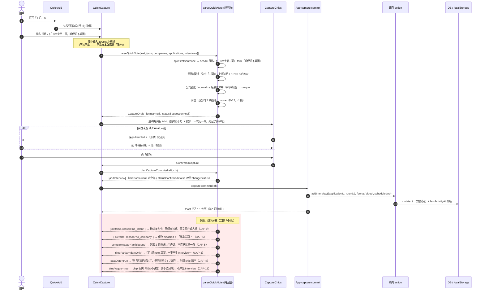
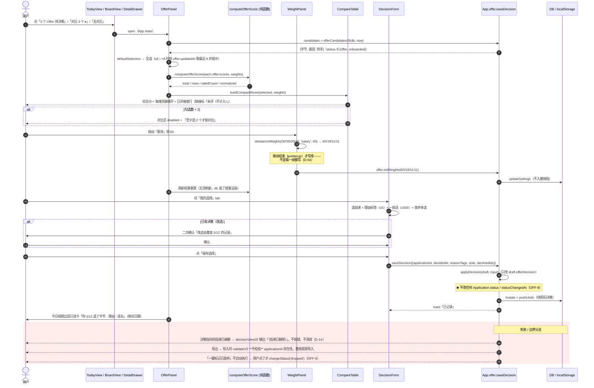

# 求职工作台 v1.0.0 · 增量架构设计与任务分解

| 项 | 内容 |
| --- | --- |
| 上游 | `docs/PRD-v1.0.0.md`（624 行，本文的唯一需求源）+ `PRD.md` + `PRD-v0.2.md` + `CHANGELOG [0.10.0]` |
| 基线代码（实测） | `app/src` 交付代码 **42,013 行**（TS/TSX 35,635 + CSS 6,378），测试 18,081 行 / 1214 条；`dist/index.html` = **753,931 B**（其中 JS 674,623 B、CSS 78,109 B） |
| 本文作用 | 给出**不可再讨论的 16 条决策**、**可直接贴进代码的类型与函数签名**、**改到函数级的文件清单**、**5 个主线 / 30 个子任务**、**逐模块体积预算** |
| 版本口径 | `appVersion` 1.0.0 / `schemaVersion` 6 / `formatVersion` **4 → 5**（导出顶层多了 `offerDecision` 一个键） |
| 产物密度（本文所有 KB 估算的锚） | JS **18.9 B/行**（674,623 / 35,635）、CSS **12.2 B/行**（78,109 / 6,378）。新代码估算一律按此换算，不许凭感觉报数字 |

> 阅读顺序：§1 决策速查 → §3 接口 → §4 时序 → §5 任务 → §7 预算 → §8 风险。
> 只想写代码的人：直接看 §5，每个子任务都写了「改哪个文件的哪个函数」+「影响哪些现有测试」。

---

## 1. 决策速查（决策 + 理由 + 代价）

| # | 决策 | 理由 | 代价 |
| --- | --- | --- | --- |
| D-01 | **不重构 App.tsx 为 store/Context**。它继续做唯一的「状态 + 写库」中枢，本版**硬上限 +340 行** | `mutate` / `dbRef` / `undoStackRef` 是 App 私有且被 40+ 处调用；抽 `useSyncExternalStore` 要动 40 个调用点 + 1214 条测试的渲染前提。而本版 4 个模块的写库动作**全部**要落进同一条撤销栈与冲突检测通道（PRD §5.5），中枢正是它们该待的地方 | App.tsx → ~3,920 行。可读性靠「每个 action ≤ 20 行、逻辑全在纯函数层」维持，不靠拆文件 |
| D-02 | **UI 边界 = 「读派生 → 纯函数 + 组件 useMemo；写库 → App action」**。新组件之间**零 import**，只吃 `api: AppApi` | 沿用 `lib/api.ts:2` 的既有约定与 `AiScenarioPanel` / `SyncDrawer` / `ExperienceEditor` 的既有挂载方式。反过来做（组件里直接 mutate）会绕开撤销栈与 `visibleDB` 的回收站过滤 | 新组件拿不到「和自己无关」的 api 分支（`AppApi` 变大），靠 TypeScript 的窄类型兜住 |
| D-03 | **面板开合状态在 App，面板内部草稿态在组件** | 入口分散在 4 处（今日卡 / 看板列头 / 详情抽屉 / 列表二级 tab），开合必须能被 `Esc` 与键盘统一管；而「勾了哪几个 chip」「理由标签草稿」如果上提到 App，就会和 `selectedId` 一样变成必须手动清理的垃圾状态 | App 多 4 个 `useState` |
| D-04 | **权重滑块「拖动结束即写库」**（`settings.offerWeights`），面板内不保留草稿副本 | 权重是「我的价值观」，一次调完一直生效（PRD §5.1）；两套值（草稿 / 已存）必然打架。从 `db.settings.offerWeights` 单向派生 → 单一真相 | **不入撤销栈**（与 `channelFactor` / `weeklyApplyGoal` 一致），拖错只能再拖回来 |
| D-05 | **`offerDecision` 的写入口只有一个**：`api.offer.saveDecision()`；改选的二次确认在**组件**（`DecisionForm`），App 层只信「调用方已确认」 | App 已经是 3578 行的枢纽，不该再塞交互状态机；而纯函数 `applyDecision(draft, input)` 可单测「保存决策不碰任何 Application 字段」（OFF-8 的断言就是这一条） | 「确认」这件事无法在 App 单测覆盖，只能靠组件测试 |
| D-06 | **`validateV1.normalizeCoreArrays` 是 company/application 的唯一清洗点**，新增的三组清洗放 `lib/offer/validate.ts` 由它调用；`offerDecision`（顶层单对象）与 `offerWeights` 只能在 `normalizeV2Settings` / `validateV2` 里处理 | `normalizeCoreArrays` 被 v1/v2 共用（`validateV2:685` 调它），在这里接一手就同时覆盖「启动迁移」与「导入合并」两条路。而 PRD §4.6 那 11 条规则要单测，塞进已有 807 行的 `validateV2.ts` 会让它的测试面继续膨胀 | 多一个 150 行文件；`validateV1.ts` 从 426 → ~470 行 |
| D-07 | **`migrateV5ToV6` 只做两件事**：`settings.schemaVersion = 6` + 写 `lastMigration`。级联挂载方式与 `migrateV4ToV5` 完全同构（`migrateV4ToV5` 尾部 `return migrateV5ToV6(v5, ctx)`） | PRD §4.6 契约 1–4 是「空迁移」的定义。顺手补 `offerWeights` 会把「缺省即默认」变成「迁移替你决定价值观」，且让契约 3 的断言（迁移后 `settings.offerWeights === undefined`）无法成立 | `AppSettings.schemaVersion` 字面量类型抬到 6，中间态必须经 `as unknown as AppSettings` 中转（沿用 `migrateV3ToV4:178` 的既有写法） |
| D-08 | **`FORMAT_VERSION_CURRENT` 4 → 5** | 导出顶层多了 `offerDecision` 一个键，导出文件形状确实变了；`formatVersion` 的语义是「导出文件格式版本」，不抬等于说谎。旧版工具读到 `settings.schemaVersion: 6` 仍会走「版本过新 → 请升级」三出口，与 formatVersion 无关，所以抬它**零风险** | 无（测试全部引用常量，不硬编码 4） |
| D-09 | **模块四不改 `rules.ts` 的派生逻辑**，只在 `rules.ts` 里**新增** `applyStatusChange`（把 `App.changeStatus:729-746` 的 recipe 原样抽出） | SIL-1 的三条读图规则（只看 `level`、内推 ×3、静音留原组）**全部已经被 `silenceStateOf` / `effectiveWarnDays` / `isMuted` 实现完了**，再算一遍必然算出两套口径。而 SIL-4 要求「批量放弃一次撤销回滚 N 条」，`changeStatus` 的 recipe 必须能复用而不能复制 | 风险最高的一处重构（见 §8 R-08） |
| D-10 | **批量放弃新增一个撤销种类** `{ kind: 'multiStatus'; entries: StatusUndo[] }`，撤销时 `for (e of entries) revertStatusChange(draft, e)` | `revertStatusChange`（`rules.ts:1257`）已经实现「status / statusChangedAt / lastActivityAt / rejectedAtRound / 自动 note 五字段回滚」—— 正是 SIL-4 要的「逐字段 diff 为空」。新种类只新增 6 行分派，零新逻辑 | `Undo` union 多一支（App.tsx 私有类型） |
| D-11 | **沉默清单不做虚拟滚动**，硬上限 `SILENCE_RENDER_LIMIT = 200`，超出时只渲染前 200 并提示导出 | 「分组标题 + 分割线 + 批量勾选」和 `useVirtualList`（固定行高 38px、`<tr>` 占位）是两套结构，混在一起会让 `virtual.range` 的下标和分组下标互相污染。沉默集合天然很小（只收 `level !== null`，样本 7 条） | 极端数据（>200 条沉默）时只显示前 200 |
| D-12 | **快记不猜岗位**：该公司只有 1 条投递才自动带入，≥2 条一律留空 | CAP-5 的验收原文是「库内有两条字节投递时，岗位 chip 为空且保存 disabled」。凡加「按子串猜岗位」都会让这条验收无从成立 | 用户多点一次下拉 |
| D-13 | **快记保存 = 顺序调用 N 个既有 action，N 步 = N 个撤销点**，toast 明说「⌘Z 逐步回退」 | CAP-11 的原文是「不新开写库函数」。做成单撤销点必须把 `addNote`/`changeStatus`/`addInterview` 的 recipe 复制一份进新函数 —— 那正是 PRD 禁止的「第二条写库路径」。而「每个动作一个撤销点」本来就是本应用的既有约定 | 记「面试 + 状态变更」要按 2 次 ⌘Z（**待确认事项 #1**） |
| D-14 | **`offerDecision` 悬空是设计的一部分**：`purgeApplication` **不清理** `offerDecision`；`validateV2` 不校验 `applicationId` 存在性；展示层统一走 `decisionViewOf()` 输出「（投递已删除）」 | 与 `resumeVersionId` 的 A-12 是同一个坑：校验存在性会让「删投递 → 导出 → 导入」整库失败；在删除时顺手清理等于**静默删掉用户写下的理由** | 库里可能长期留一条指向已删投递的决策 |
| D-15 | **不给「清除决策」入口** | OFF 全文没有这个需求；一个人一年 1–2 次决策，唯一的替换路径是「改选」，那本来就该走覆盖 + 二次确认 | 全部 Offer 被删后，决策只能被新决策覆盖 |
| D-16 | **OFF-11（AI 漏项检查）本版不做**，除非 T05-6 实测后仍有 ≥ 10 KB 余量 | 它是唯一要碰 `ai/gateway` 边界的 P0 之外条目，而 `check-no-network` 的 gateway 专项审计（`auditGatewaySource`）会连带被审一遍。把预算先留给 P0 | PRD 的 P1 清单少一条 |

---

## 2. 文件清单

行数为**交付代码**（不含测试），KB 按 §1 表格的密度锚换算。

### 2.1 新增（16 个交付文件 + 9 个测试文件）

| 文件 | 一句话职责 | 行数 | 归属 |
| --- | --- | --- | --- |
| `app/src/lib/offer/validate.ts` | `OfferDetail` / `OfferDecision` / `offerWeights` 的白名单式清洗（PRD §4.6 十一条规则） | 150 | T01 |
| `app/src/lib/offer/score.ts` | 四维加权分、缺维归一、权重再分配（最大余数法）、年薪合计 | 150 | T02 |
| `app/src/lib/offer/compare.ts` | 对比候选集（上限 8）、表格行模型、截止与缺项提醒 | 110 | T02 |
| `app/src/lib/offer/decision.ts` | 决策读写（`applyDecision` / `applyOfferPatch`）、悬空视图、理由标签清洗、Markdown 导出 | 120 | T02 |
| `app/src/lib/company/fields.ts` | `Company` 五新字段清洗 + 概览行（空值不产生空行） | 80 | T02 |
| `app/src/lib/company/dossier.ts` | 公司档案聚合：投递 / 面试 / 时间轴 / 小计 / 面经统计 / 同名候选 | 170 | T02 |
| `app/src/lib/capture/dict.ts` | 快记词典常量 + 单句切分 + 时间短语解析（表驱动） | 140 | T02 |
| `app/src/lib/capture/parse.ts` | `parseQuickNote`：意图 / 公司三态 / 时间 / 轮次 / 形式 / 状态建议 + 写库计划 | 280 | T02 |
| `app/src/lib/silence/list.ts` | 沉默清单派生（分组 / 15 天分割线 / 静音标注）+ 批量动作计划 + Markdown 导出 | 160 | T02 |
| `app/src/components/offer/OfferPanel.tsx` | 决策台全屏面板（chip 条 + 对比 tab + 我的选择 tab + 顶部提醒） | 340 | T03 |
| `app/src/components/offer/CompareTable.tsx` | 并排对比表（内部横向滚动容器）+ 归一化行内标注 | 180 | T03 |
| `app/src/components/offer/WeightPanel.tsx` | 4 个滑块 + 实时再分配 + 和为 100 的断言自检 | 110 | T03 |
| `app/src/components/offer/DecisionForm.tsx` | 理由标签 / 一段话 / 放弃多选 / 覆盖二次确认 | 200 | T03 |
| `app/src/components/offer/OfferSection.tsx` | 详情抽屉里的 Offer 录入区块（9 字段 + 全空折叠成一行） | 190 | T03 |
| `app/src/components/company/CompanyDossier.tsx` | 公司档案全屏抽屉（概览 → 小计 → 投递 → 面试 → 面经 → 时间轴） | 280 | T03 |
| `app/src/components/company/CompanyFields.tsx` | 五个新字段的就地编辑（空值不出行） | 120 | T03 |
| `app/src/components/capture/QuickCapture.tsx` | 「＋记一家」顶部的一句话输入 + 400ms 防抖解析 + 保存/改用手动 | 230 | T04 |
| `app/src/components/capture/CaptureChips.tsx` | 确认条：chip 逐字段可改 + 歧义选择 + 失败态出口 | 150 | T04 |
| `app/src/components/list/SilenceList.tsx` | 沉默待办 tab 内容（两组 + 分割线 + 勾选 + 键盘 J/K/Space） | 260 | T04 |
| `app/src/components/list/BatchBar.tsx` | 批量动作条：催问两步 / 批量放弃 / 静音到 | 180 | T04 |

**测试文件（不进产物，不占 95 KB 预算）**：`lib/offer/{validate,score,compare,decision}.test.ts`、`lib/company/{fields,dossier}.test.ts`、`lib/capture/parse.test.ts`、`lib/silence/list.test.ts`、`components/offer/OfferPanel.test.tsx`、`components/company/CompanyDossier.test.tsx`、`components/capture/QuickCapture.test.tsx`、`components/list/SilenceList.test.tsx`（约 1,900 行）。

### 2.2 改动（14 个文件，逐个到函数）

| 文件 | 改什么 | 净增行 |
| --- | --- | --- |
| `app/src/types.ts` | 追加 §3.1 全部新类型；`AppSettings.schemaVersion: 6`、`+offerWeights?`；`Company` +5 字段；`Application.offer?`；`DB.offerDecision?` | +95 |
| `app/src/lib/migrate.ts` | `SCHEMA_VERSION_V6 = 6`、`SCHEMA_VERSION_CURRENT = V6`、`FORMAT_VERSION_CURRENT = 5`；新增 `migrateV5ToV6`；`migrateV4ToV5` 尾部级联；`migrateV2ToV3` 分发补 v5 输入分支 | +70 |
| `app/src/lib/validateV2.ts` | `normalizeV2Settings` 增 `offerWeights`（条件写入）；`validateV2` 顶层增 `offerDecision`（缺省不写）+ 未知顶层键保留；新增白名单常量 | +45 |
| `app/src/lib/validateV1.ts` | `normalizeCoreArrays`：company 循环加 5 字段、application 加 `offer: normalizeOfferDetail(item.offer)` | +45 |
| `app/src/lib/storage.ts` | `exportJSON` 增 `offerDecision`（条件展开，旧库导出零变化）；新增沉默面板 UI 偏好存取（`loadSilencePrefs` / `saveSilencePrefs` / `sanitizeSilencePrefs`，独立 key） | +55 |
| `app/src/lib/rules.ts` | **只新增** `applyStatusChange(draft, appId, status, opts)`（从 `App.changeStatus` 抽出，行为逐行一致）；既有导出**一行不改** | +45 |
| `app/src/lib/api.ts` | `OfferApi` / `CompanyApi` / `CaptureApi` / `SilenceApi` 四组接口 + `AppApi` 挂四组 + `interviewCompanyFilter` / `listTab` | +140 |
| `app/src/App.tsx` | 4 组 action（各 ≤20 行，逻辑全在纯函数层）+ 4 个面板开合 state + JSX 挂载 + `api` 对象扩展 | +340 |
| `app/src/components/DetailDrawer.tsx` | 头部公司名可点 → 开公司档案；状态 chip 下插入 `<OfferSection />`；`api.offer.decision?.applicationId === app.id` 时显示「你选了这家」 | +40 |
| `app/src/components/TodayView.tsx` | ① Offer 待决策卡 ② 决策回看只读卡（绝对日期） ③ 「N 家已沉默」可点直达沉默 tab | +70 |
| `app/src/components/BoardView.tsx` | 「已发 Offer」列头**下方**一行 `<button className="board__compare">对比 N 个 ▸</button>`（**不放 `board__col-head-right` 里**，见 §5 T05-2 的理由） | +15 |
| `app/src/components/QuickAdd.tsx` | 头部插入 `<QuickCapture onUseManual={...} />`；解析成功后把值回填进既有表单，复用既有 `save()` | +30 |
| `app/src/components/ListView.tsx` | 顶部二级 tab `[全部投递] [沉默待办 ●N]`；`tab==='silence'` 时渲染 `<SilenceList />`（不渲染 `<table>`） | +60 |
| `app/src/components/TodoBar.tsx` | 「N 家已沉默」点击 → 沉默 tab（原行为是 `focusApp` 第一条） | +15 |
| `app/src/components/interview/QuestionBank.tsx` | 新增**并行分支**：`api.interviewCompanyFilter` 非空时按该集合筛（精确匹配那批 `companyName` 字符串），下拉置为只读提示；既有单选逻辑一行不动 | +30 |
| `app/src/styles.css` | M1+M2 ≈ 270 行 / M3+M4 ≈ 210 行（见 §6.5） | +480 |
| `app/package.json` · `extension/manifest.json` · `CHANGELOG.md` | 版本 0.10.0 → **1.0.0**；CHANGELOG 按 PRD §1.4 写「1.0.0 = 数据格式稳定，不代表社区成熟度」 | +0 代码 |

### 2.3 生成物（禁止手改）

| 文件 | 谁生成 | 注意 |
| --- | --- | --- |
| `app/src/lib/classTokens.ts` | `node scripts/tokenize-classes.mjs --write` | 表**已满 100/100**（`MAX_ENTRIES`）。新增高频串会挤掉低频项 → 断言 5「选表一致性」必红，T05-4 是独立收尾任务 |
| `app/src/lib/classTokens.golden.json` | `node scripts/tokenize-classes.mjs --golden` | 断言 6 的基准。**只有确认改表是有意的才重录**；`--write` 不会自动重录（自动重录 = 断言 6 失效） |

---

## 3. 数据结构与接口

### 3.1 `types.ts` 增量（可直接粘贴）

```ts
/* ============ v1.0.0 / 模块一：Offer（schemaVersion 6，纯 additive） ============ */

/** 四维自评键。★ 顺序即展示顺序、即「最大余数法取先者」的顺序，禁止重排 */
export type OfferScoreKey = 'salary' | 'growth' | 'city' | 'wlb';

/** 计薪方式：日常实习按天给钱，校招/全职按月。缺省按月 */
export type OfferPayMode = 'monthly' | 'daily';

/**
 * Offer 详情。★ 全部可选（除 updatedAt）—— 拿到口头 offer 时用户只知道公司名。
 * ★ `scores` 的缺 = 未评，**不按 0 分参与**（OFF-4 的数学前提）。
 * ★ 编辑本区块**不写 note、不动 lastActivityAt**（改了薪资不该让沉默天数归零，
 *   同 v0.9 的 resumeVersionId / F9 口径）。
 */
export interface OfferDetail {
  /** 计薪方式，缺省 'monthly' */
  payMode?: OfferPayMode;
  /** 月薪（元/月，税前）。整数 0–1,000,000 */
  monthlySalary?: number;
  /** 一年发几个月（12–24）。**年终奖已含在薪数里，不另设字段**（PRD §4.1 / Q2） */
  salaryMonths?: number;
  /** 日薪（元/天）。payMode==='daily' 时用 */
  dailyRate?: number;
  /** 签字费（元，一次性）。0 ≠ 未填 */
  signOnBonus?: number;
  /** 股权/期权原文，≤60 字。**不折算成钱** */
  equityText?: string;
  /** 职级原文（"P5" / "T1.2" / "SP"）。自由文本，不做枚举 */
  level?: string;
  /** 单程通勤分钟数。整数 0–240 */
  commuteMin?: number;
  /** 四维自评分 1–5。缺 = 未评 */
  scores?: Partial<Record<OfferScoreKey, 1 | 2 | 3 | 4 | 5>>;
  /** 补充说明 ≤200 字 */
  notes?: string;
  /** 本区块最后编辑时间（ISO）。★ 必填 —— 也是「最近收到 Offer」的排序依据 */
  updatedAt: string;
}

/**
 * 最终选择。★ 单对象而非数组（`db.offerDecision`）——
 * 一个人一次只能选一个 Offer；改选即覆盖（组件层二次确认）。
 * ★ `applicationId` 悬空是设计的一部分（同 resumeVersionId 的 A-12）。
 */
export interface OfferDecision {
  /** 选中的投递 → Application.id。**故意不校验存在性** */
  applicationId: string;
  /** 决策日，YYYY-MM-DD（用户可改，便于补记） */
  decidedAt: string;
  /** 理由标签，≤5 个。内置 8 个 + 允许自由追加（≤10 字/个） */
  reasonTags: string[];
  /** 一段话，≤500 字。回看时展示前 3 行 */
  note?: string;
  /** 当时放弃的 Offer（Application.id[]），用于回看「我放弃了谁」 */
  declinedIds?: string[];
}

/* ============ 模块二：Company 扩充（+5 字段，全可选） ============ */

/** 融资阶段。'unknown' 显式表示「查过但没查到」，与「没填」区分 */
export type CompanyStage = 'angel' | 'a' | 'b' | 'c' | 'd' | 'listed' | 'unknown';

// Company 追加（其余字段不动）：
//   scale?: string;              规模原文，"1000-9999人"。自由文本，不做枚举
//   financingStage?: CompanyStage;
//   website?: string;            官网，http(s):// 开头，≤200 字
//   industryDetail?: string;     行业细分，≤40 字
//   employeeReview?: string;     员工口碑，≤300 字。★ 与既有 impression（面试体感）是两个字段

// Application 追加：
//   offer?: OfferDetail;

// AppSettings 改/追加：
//   schemaVersion: 6;                                            ← 5 → 6
//   offerWeights?: Record<OfferScoreKey, number>;                ← ★ 缺省不写（迁移不造值）

// DB 追加：
//   offerDecision?: OfferDecision;                               ← ★ 缺省不写
```

`settings.offerWeights` **不写进 `defaultSettings()`**：`defaults.ts` 的 `defaultSettings()` 一旦带上它，`settingsWithDefaults()` 就会把它注入每一份 `settings`，契约 3「迁移后 `settings.offerWeights === undefined`」立刻不成立。缺省值只活在代码里：

```ts
// lib/offer/score.ts
export const DEFAULT_OFFER_WEIGHTS: Record<OfferScoreKey, number> = {
  salary: 30, growth: 30, city: 20, wlb: 20,
};
export function offerWeightsOf(settings: AppSettings): Record<OfferScoreKey, number>;
```

### 3.2 迁移与校验

```ts
// lib/migrate.ts（函数签名与 PRD §4.6 一致）
export const SCHEMA_VERSION_V6 = 6;
export const SCHEMA_VERSION_CURRENT = SCHEMA_VERSION_V6;   // 6
export const FORMAT_VERSION_CURRENT = 5;                   // 4 → 5（D-08）

/**
 * v5 → v6（v1.0.0）。**纯函数、幂等、空迁移**：
 * - 唯一改动：settings.schemaVersion 5 → 6 + 写 lastMigration；
 * - 不补 offerWeights、不补空 offer、不填 Company 新字段、不建 offerDecision 空对象；
 * - 幂等：输入已是 v6 → { ok:true, changed:false, db: 原对象引用 }；
 * - 链式保留最初的 from（沿用 migrateV4ToV5:228 的 chainFrom 写法）。
 */
export function migrateV5ToV6(input: unknown, ctx: MigrateContext): MigrateResult;
```

**级联改法（三处，逐行）**：

| 位置 | 现状 | 改成 |
| --- | --- | --- |
| `migrateV2ToV3:87` | `if (version === SCHEMA_VERSION_V4) return migrateV4ToV5(...)` | 再加 `if (version === SCHEMA_VERSION_V5) return migrateV5ToV6(...)` |
| `migrateV4ToV5:237` | `return { ok:true, db:{...}, changed:true }` | 先构造 v5 中间态（`as unknown as AppSettings` 中转 5），再 `return migrateV5ToV6(v5, ctx)` |
| `migrateV3ToV4:189` | `return migrateV4ToV5(v4, ctx)` | 不动（级联自动到达 v6） |

**校验扩展（PRD §4.6 的十一条，逐条落位）**：

| 规则 | 落在哪 | 越界行为 |
| --- | --- | --- |
| `offer.payMode` ∈ `'monthly'\|'daily'` | `normalizeOfferDetail` | 丢弃该字段（不阻断） |
| `offer.scores` key 白名单 | 同上 | 未知 key 丢弃 + warning |
| `offer.scores` value 1–5 整数 | 同上 | 清空该维 |
| `monthlySalary`/`dailyRate`/`signOnBonus` | 同上 | 有限非负整数 ≤1,000,000，越界清空 |
| `salaryMonths` 12–24 / `commuteMin` 0–240 | 同上 | 越界清空 |
| `equityText` 60 / `notes` 200 | 同上 | 截断 + 提示（沿用 §D.4「不静默丢」） |
| `company.financingStage` 7 值枚举 | `normalizeCoreArrays` 的 company 循环 | 清空该字段 |
| `company.employeeReview` ≤300 / `industryDetail` ≤40 / `website` ≤200 | 同上 | 截断 + 提示；website 非 http(s) 开头 → 清空 |
| `settings.offerWeights` 四 key 0–100 整数、和为 100 | `normalizeOfferWeights`（由 `normalizeV2Settings` 调） | 和≠100 → 按比例归一 + warning（不阻断）；单项越界 → clamp 后归一 |
| `offerDecision.applicationId` | **不校验存在性** | 原样保留（D-14） |
| `offerDecision.reasonTags` ≤5 / 每个 ≤10 字 | `normalizeOfferDecision` | 超出的丢弃（保前缀） |
| `offer.updatedAt` | 缺失 → 填 `nowIso`（唯一允许填时间的字段，因为它是必填） | — |

```ts
// lib/offer/validate.ts
export function normalizeOfferDetail(raw: unknown, nowIso: string): OfferDetail | null;   // 无任何有效字段 → null（不造空对象）
export function normalizeOfferDecision(raw: unknown): OfferDecision | null;               // 缺 applicationId 或 decidedAt → null
export function normalizeOfferWeights(raw: unknown): { weights: Record<OfferScoreKey, number>; warning?: string } | null;  // null = 不存在
```

### 3.3 `lib/api.ts` 增量

```ts
/* ---------------- 模块一：Offer 决策台（v1.0.0） ---------------- */

export interface OfferPatch {
  payMode?: OfferPayMode;
  monthlySalary?: number | null;   // null / undefined = 清空该字段（写库时删键，不写空串）
  salaryMonths?: number | null;
  dailyRate?: number | null;
  signOnBonus?: number | null;
  equityText?: string | null;
  level?: string | null;
  commuteMin?: number | null;
  scores?: Partial<Record<OfferScoreKey, 1 | 2 | 3 | 4 | 5>> | null;
  notes?: string | null;
}

export interface SaveDecisionInput {
  applicationId: string;
  decidedAt: string;        // YYYY-MM-DD
  reasonTags: string[];
  note?: string;
  declinedIds?: string[];
}

export interface OfferApi {
  /** 可对比的投递（status ∈ {offer, onboarded}，已排除回收站） */
  candidates: OfferCandidate[];
  weights: Record<OfferScoreKey, number>;
  /** 拖动滑块结束即写 settings.offerWeights（不入撤销栈，D-04） */
  setWeights: (weights: Record<OfferScoreKey, number>) => void;
  /** 写 Offer 详情：一次 mutate = 一个撤销点；不动 lastActivityAt、不写 note */
  saveOffer: (appId: string, patch: OfferPatch) => void;
  /** 保存决策（覆盖式）。调用方必须已完成二次确认 */
  saveDecision: (input: SaveDecisionInput) => void;
  /** 决策视图（悬空时 companyLabel = '（投递已删除）'）；没决策 = null */
  decision: DecisionView | null;
}

/* ---------------- 模块二：公司档案 ---------------- */

export type CompanyExtraPatch = Partial<
  Pick<Company, 'scale' | 'financingStage' | 'website' | 'industryDetail' | 'employeeReview'>
>;

export interface CompanyApi {
  dossierId: string | null;
  openDossier: (companyId: string) => void;
  closeDossier: () => void;
  /** 五字段就地编辑（逐字写库，不入撤销栈） */
  saveExtras: (companyId: string, patch: CompanyExtraPatch) => void;
  /** COM-6：归一化后同名的既有公司（只提示，不拦、不合并） */
  sameName: (name: string, excludeId?: string) => Company[];
  /** COM-3：跳题库并按这批 companyName 精确筛选（集合来自 dossier.experienceNames） */
  openQuestionBank: (companyNames: string[]) => void;
}

/* ---------------- 模块三：一句话快记 ---------------- */

export interface CaptureApi {
  /** 已确认的草案 → 顺序执行写库步骤（D-13：N 步 = N 个撤销点） */
  commit: (draft: ConfirmedCapture) => void;
}

/* ---------------- 模块四：沉默待办 ---------------- */

export interface SilenceApi {
  /** 一次 mutate 写完 N 条 dropped，入栈一个 multiStatus 撤销（SIL-4） */
  batchDrop: (ids: string[]) => void;
  /** 一次 mutate 写完 N 条 mutedUntil（SIL-5，不入栈：静音可再点一次取消） */
  batchMute: (ids: string[], until: string) => void;
  /** 只对 confirmedIds 写 followup note（SIL-3：生成话术 ≠ 发了消息） */
  batchFollowup: (ids: string[], confirmedIds: string[]) => number;
}

// AppApi 追加：
//   offer: OfferApi;
//   company: CompanyApi;
//   capture: CaptureApi;
//   silence: SilenceApi;
//   /** 'all' = 全部投递，'silence' = 沉默待办（二级 tab） */
//   listTab: 'all' | 'silence';
//   setListTab: (tab: 'all' | 'silence') => void;
//   /** COM-3：题库的公司筛选集合；null = 用下拉单选（既有行为） */
//   interviewCompanyFilter: string[] | null;
//   setInterviewCompanyFilter: (names: string[] | null) => void;
```

> 注：`ViewKey` / `VIEWS` **一个字不改** —— 四个模块都不加一级导航（PRD §5.5）。

### 3.4 纯函数层签名（必须能脱离 React 单测）

```ts
/* ================= lib/offer/score.ts ================= */

export const OFFER_SCORE_KEYS: readonly OfferScoreKey[];   // ['salary','growth','city','wlb']
export const OFFER_WEIGHT_TOTAL = 100;

export interface OfferScoreRow {
  key: OfferScoreKey;
  /** 0 = 未评 */
  score: number;
  weight: number;
  /** 该维贡献分（已评才有），= score/5 × weight，1 位小数 */
  contribution: number;
  rated: boolean;
}

export interface OfferScoreResult {
  /** 综合分 0–100（1 位小数）；一维未评 = null（渲染 '—'，**不是 0**） */
  total: number | null;
  rows: OfferScoreRow[];
  /** 已评维度数 0–4 */
  ratedCount: number;
  /** 是否按已评维度归一（ratedCount 在 1..3） */
  normalized: boolean;
}

/**
 * 四维加权综合分（OFF-3 / OFF-4）。
 *
 * 公式（整数运算，杜绝浮点误差）：
 *   total = round( Σ(score_i × weight_i) × 200 / Σ(weight_i over 已评) ) / 10
 * 校验向量：
 *   权重 30/30/20/20 + 四维 5/5/5/5 → 100.0
 *   权重 30/30/20/20 + 四维 3/4/5/2 → 70.0
 *   权重 30/30/20/20 + 只评 salary=5, growth=5 → 100.0（归一，ratedCount=2）
 *   权重 30/30/20/20 + salary=3, growth=5, city=2 → 70.0（PRD §5.1 快手的 70.0）
 *   四维全未评 → null
 */
export function computeOfferScore(
  scores: Partial<Record<OfferScoreKey, 1 | 2 | 3 | 4 | 5>> | undefined,
  weights: Record<OfferScoreKey, number>,
): OfferScoreResult;

/**
 * 权重再分配（OFF-5）：把 key 拖到 value，其余三项**按原比例**分摊剩余值。
 * 整数化用最大余数法；余数相等按 OFFER_SCORE_KEYS 顺序（salary→growth→city→wlb）取先者。
 * 不变式：返回值四项 ∈ [0,100] 整数且和恒为 100（对任意拖动序列成立）。
 * 边界：
 *   - value 四舍五入后 clamp 到 [0,100]
 *   - 其余三项原和为 0 → 平均分摊（仍走最大余数法）
 *   - 剩余值 < 待分摊项数（如剩 2 分给 3 项）→ 按顺序各 +1，其余 0，**不产生负数**
 * 校验向量：30/30/20/20 拖 salary→60 ⇒ 60/18/11/11（PRD §3.1 OFF-5 原例）
 */
export function rebalanceWeights(
  weights: Record<OfferScoreKey, number>,
  key: OfferScoreKey,
  value: number,
): Record<OfferScoreKey, number>;

/** 年薪合计（派生，不落库）：仅 monthly 且两项都有值时返回整数元，否则 null */
export function annualTotalOf(offer: OfferDetail | undefined): number | null;
/** '40.5 万（不含股权）' / '不能算（日薪）' / '薪资未填' —— 三种文案都在这里，UI 不拼 */
export function annualTotalText(offer: OfferDetail | undefined): string;
/** 「还有 N 维没评」的 N（0 = 不缺） */
export function missingScoreCount(offer: OfferDetail | undefined): number;

/* ================= lib/offer/compare.ts ================= */

export const MAX_COMPARE = 8;

export interface OfferCandidate {
  app: Application;
  company: Company | undefined;
  offer: OfferDetail | undefined;
  score: OfferScoreResult;
  deadline: DeadlineState;
  silence: SilenceState;
}

export interface CompareRow {
  key: string;
  label: string;
  /** 每列一个单元格；格内可用 note 表达「未评（不计入）」这类硬文案 */
  cells: Array<{ text: string; tone?: 'muted' | 'warn' | 'primary'; note?: string }>;
}

/** status ∈ {offer, onboarded}，已排除回收站（调用方传 viewDB 的结果） */
export function offerCandidatesOf(db: DB, now: Date): OfferCandidate[];
/** 默认全选；超过 8 个时按 offer.updatedAt 取最近 8 个（并返回被拒条数用于提示） */
export function defaultSelection(candidates: OfferCandidate[]): { ids: string[]; overflow: number };
/** 勾选第 9 个时的守卫：返回被接受的 id 与提示语 */
export function toggleSelection(ids: string[], next: string): { ids: string[]; rejected: boolean };
export function buildCompareRows(selected: OfferCandidate[], weights: Record<OfferScoreKey, number>): CompareRow[];
/** OFF-9：截止 ≤ deadlineWarnDays 的提醒 + 缺维提醒（P0 只做数据，文案在组件） */
export function buildOfferAlerts(candidates: OfferCandidate[], settings: AppSettings, now: Date): OfferAlert[];

/* ================= lib/offer/decision.ts ================= */

export const REASON_TAG_PRESETS: ReadonlyArray<{ key: string; label: string }>;  // 8 个内置
export const DECISION_NOTE_LIMIT = 500;
export const DECISION_TAG_LIMIT = 5;
export const DECISION_TAG_CHAR_LIMIT = 10;

/** ≤5 个、去空、去重、每个 ≤10 字（超长截断而不是丢弃） */
export function sanitizeReasonTags(raw: unknown): string[];

/** ★ 纯写库 recipe：只改 draft.offerDecision，**不碰 applications 任何字段**（OFF-8 的断言） */
export function applyDecision(draft: DB, input: SaveDecisionInput): void;
/** ★ 纯写库 recipe：只改 target.offer(scores/…/updatedAt)，不碰 lastActivityAt、不写 note */
export function applyOfferPatch(draft: DB, appId: string, patch: OfferPatch, nowIso: string): boolean;

export interface DecisionView {
  decision: OfferDecision;
  app: Application | null;
  companyLabel: string;    // 悬空 → '（投递已删除）'
  jobTitle: string;
  /** ★ 绝对日期 YYYY-MM-DD，**绝不出相对文案**（OFF-7 验收） */
  decidedAtText: string;
  reasonText: string;
  /** note 的前 3 行（回看卡只露这些） */
  firstLines: string;
  declined: Array<{ id: string; label: string; alive: boolean }>;
}
export function decisionViewOf(db: DB, decision: OfferDecision | undefined): DecisionView | null;
/** OFF-10（P1）：对比表 + 权重 + 选择与理由，末行「本地加权计算，仅供参考」 */
export function decisionToMarkdown(input: {
  view: DecisionView; rows: CompareRow[]; weights: Record<OfferScoreKey, number>;
}): string;

/* ================= lib/company/dossier.ts ================= */

export interface DossierTimelineEntry {
  id: string;
  /** ISO */
  at: string;
  who: 'me' | 'system';
  text: string;
  /** 岗位标签：「抖音前端」——三个岗位混在一起时这一列不能省 */
  jobLabel: string;
  kind: 'note' | 'interview';
}

export interface CompanyDossier {
  company: Company;
  applications: Array<{ app: Application; silence: SilenceState; hasOffer: boolean }>;
  interviews: Array<{ interview: Interview; appId: string; jobTitle: string }>;
  /** notes（含 type:'system'，按真实数据计）+ interviews，倒序（COM-1） */
  timeline: DossierTimelineEntry[];
  stats: { applications: number; interviewed: number; rejected: number; offer: number; avgSilenceDays: number };
  /** COM-3：命中的面经原始 companyName 集合（跳题库用，保证两边同口径） */
  experienceNames: string[];
  experience: { total: number; unmastered: number };
}
export function companyDossierOf(db: DB, companyId: string, now: Date): CompanyDossier | null;
/** COM-6：归一化后同名（用 sync/normalize 的 normalizeCompanyName），排除自身 */
export function sameNameCompanies(db: DB, name: string, excludeId?: string): Company[];

/* ================= lib/company/fields.ts ================= */

export const COMPANY_STAGES: readonly CompanyStage[];
export const COMPANY_STAGE_LABEL: Record<CompanyStage, string>;
/** 全空 → 每个键都不出现（写 undefined，不写空串/不写占位） */
export function normalizeCompanyExtras(raw: unknown): CompanyExtraPatch;
/** 概览行：空字段**不产生行**（COM-2 验收：全空时不出现「规模：—」） */
export function companyOverviewRows(company: Company): Array<{ label: string; value: string; href?: string }>;

/* ================= lib/capture/dict.ts ================= */

export const CAPTURE_DICT_VERSION = 1;
export const INTENT_RULES: ReadonlyArray<{ intent: CaptureIntent; words: readonly string[] }>;
export const STATUS_WORDS: ReadonlyArray<{ status: Status; words: readonly string[] }>;
export const ROUND_WORDS: Readonly<Record<string, number>>;   // 一面→1 … 十面→10
export const FORMAT_WORDS: ReadonlyArray<{ format: InterviewFormat; words: readonly string[] }>;
export const VAGUE_TIME_WORDS: readonly string[];             // ['过两天','下周左右','月底前',…]

/** CAP-10：只取第一个逗号/句号/分号前的内容；`tail` 非空时 UI 必须提示「一次记一件」 */
export function splitFirstSentence(text: string): { head: string; tail: string | null };

export interface ParsedTime {
  /**
   * 完整日期时间（ISO）→ 可建事件；
   * null + partial 非空 → 只有日期或只有时刻，**不许建 Interview**（CAP-3）；
   * null + vague=true → 时间不确定，chip 标黄要求手选（CAP-13）
   */
  iso: string | null;
  partial: 'dateOnly' | 'timeOnly' | null;
  vague: boolean;
  /** 解析出的日期早于今天（CAP-4：不自动加一年，UI 弹二选） */
  pastDate: boolean;
  /** 命中到的原文片段（用于 chip 展示与调试） */
  matched: string;
}
export function parseTimePhrase(text: string, now: Date): ParsedTime | null;

/* ================= lib/capture/parse.ts ================= */

export type CaptureIntent = 'interview' | 'chat' | 'followup' | 'memo';

export type CapturePick<T> =
  | { state: 'none' }
  | { state: 'unique'; item: T }
  | { state: 'ambiguous'; items: T[] };

export interface CaptureDraft {
  ok: true;
  /** 被采用的前半句原文 */
  raw: string;
  /** 被丢掉的后半句（CAP-10；非空时 UI 必须提示） */
  droppedTail: string | null;
  intent: CaptureIntent;
  company: CapturePick<Company>;
  /** ≥2 条投递时一律 state:'none'（D-12，不猜岗位） */
  application: CapturePick<Application>;
  scheduledAt: string | null;
  timePartial: 'dateOnly' | 'timeOnly' | null;
  timeVague: boolean;
  pastDate: boolean;
  round: number | null;
  kind: InterviewKind | null;
  /** ★ 解析不出就是 null，**绝不默认 'video'**（CAP-12） */
  format: InterviewFormat | null;
  /** ★ 状态建议默认未勾选（CAP-8），勾了才写 */
  statusSuggestion: Status | null;
  noteType: NoteType | null;
  /** 没命中任何时间词但句子里有「面」→ 提示「补个时间就能进日历」 */
  needsTimeHint: boolean;
}

export type CaptureResult =
  | CaptureDraft
  | { ok: false; reason: 'no_intent'; raw: string; hint: string }
  | { ok: false; reason: 'no_company'; raw: string; hint: string };

export interface CaptureContext {
  now: Date;
  companies: Company[];
  /** 未删除的投递 */
  applications: Application[];
  interviews: Interview[];
}
export function parseQuickNote(text: string, ctx: CaptureContext): CaptureResult;

/** 用户点「保存」时把确认条的值交回来（每个 chip 都可改，改完仍走这里） */
export interface ConfirmedCapture {
  raw: string;
  intent: CaptureIntent;
  /** null = 需要新建公司（CAP-5「新建公司『小鹅』」按钮的产物，由 QuickAdd 用既有 addApplication 建） */
  applicationId: string | null;
  newCompanyName: string | null;
  newJobTitle: string | null;
  scheduledAt: string | null;
  round: number | null;
  kind: InterviewKind | null;
  format: InterviewFormat | null;
  noteType: NoteType | null;
  statusSuggestion: Status | null;
  statusConfirmed: boolean;
}

export type CaptureStep =
  | { kind: 'createApplication'; companyName: string; jobTitle: string; status: Status }
  | { kind: 'addNote'; applicationId: string; type: NoteType; content: string }
  | { kind: 'changeStatus'; applicationId: string; status: Status; round?: number }
  | { kind: 'addInterview'; input: NewInterviewInput };

/**
 * 把确认条收敛成**有序**写库步骤（纯函数，便于断言「CAP-3 不产生 addInterview」这类规则）。
 * 顺序固定：建公司/投递 → 改状态 → 写 note → 建面试
 * （状态变更的 system note 会由 changeStatus 自己写，不必再补）。
 */
export function planCaptureCommit(draft: ConfirmedCapture, ctx: CaptureContext): CaptureStep[];

/* ================= lib/silence/list.ts ================= */

export const SILENCE_RENDER_LIMIT = 200;   // D-11

export interface SilenceRow {
  app: Application;
  company: Company | undefined;
  silence: SilenceState;
  muted: boolean;
  muteRemain: number | null;
  suggestion: Suggestion;   // 复用 rules.suggestionFor
}

export interface SilenceGroups {
  /** 红「已沉默」：**只看 silence.level === 'stale'**，不按天数硬切（内推 10 天在黄组） */
  stale: SilenceRow[];
  /** 黄「该跟进」 */
  warn: SilenceRow[];
  /** 红组内 15 天分割线的插入下标（第一个 days < 15 的位置；-1 = 不插） */
  staleSplitAt: number;
  /** 两组条数之和（= 全库 level !== null 的投递数，SIL-1 的核心不变式） */
  total: number;
  mutedTotal: number;
}
export function silenceRowsOf(db: DB, now: Date): SilenceRow[];
export function buildSilenceGroups(rows: SilenceRow[], opts: { hideMuted: boolean }): SilenceGroups;
/** SIL-3：返回真正要写 note 的 id（只有 confirmed 的才写，防「假催」污染沉默计算） */
export function planBatchFollowup(ids: string[], confirmedIds: string[]): string[];
/** SIL-5：'3d' | 'nextWeek' | 'YYYY-MM-DD' → 每条一个 ISO（统一到当日 23:59:59） */
export function planBatchMute(ids: string[], preset: string, now: Date): Array<{ id: string; mutedUntil: string }>;
/** SIL-8（P1）：Markdown 表格，行数 = 传入行数 */
export function silenceListToMarkdown(rows: SilenceRow[]): string;

/* ================= lib/rules.ts 新增（唯一新增导出） ================= */

/**
 * 一个「设置状态」的写库 recipe（从 App.changeStatus:729-746 原样抽出）。
 * 返回撤销快照（null = 投递不存在或状态未变），调用方负责 pushUndo。
 * ★ 抽它的唯一理由是 SIL-4「批量放弃一次撤销回滚 N 条」——
 *   循环调用 changeStatus 会得到 N 个撤销点，一次 ⌘Z 只能回滚 1 条。
 */
export function applyStatusChange(
  draft: DB,
  appId: string,
  status: Status,
  opts: { at: string; round?: number; noteId: string; text: string },
): StatusUndo | null;
```

### 3.5 类图

见 `docs/class-diagram-v1.0.0.mermaid`。核心关系：

```
OfferDetail "1" *-- "1" Application     : 嵌套（不建 offers 表）
OfferDecision "1" o-- "0..1" Application : 弱引用（悬空是设计的一部分）
OfferCandidate ..> OfferScoreResult      : 派生（不落库）
CompanyDossier ..> SilenceState          : 派生
CaptureDraft ..> Company / Application   : 三态匹配（none/unique/ambiguous）
App --|> AppApi                          : 唯一实现者
```

---

## 4. 关键流程时序图

完整版见 `docs/sequence-diagram-v1.0.0.mermaid`。

### 4.1 快记：输入 → 解析 → 确认 → 写库



### 4.2 Offer 决策：评分 → 加权 → 对比 → 记录



---

## 5. 任务分解（5 个主线 / 30 个子任务）

> **为什么是 5 个主线**：仓库既有格式（`ARCHITECTURE-v0.2.md` §5 = 5 个主线 / 31 个子任务）+ 团队硬规则「主线不超过 5 个」。粒度按「一次可独立验证的改动」切在**子任务**上 —— 每个子任务都能单独跑一条命令证明它对。
>
> **文件所有权**：同一文件在同一时间只属于一个主线。唯一的共享写点是 `styles.css`（T03-5 → T04-3）与 `App.tsx`（只属 T05），两处**顺序**执行，禁止并行。

### T01 · 数据层与迁移（P0，无依赖）

| ID | 任务 | 文件 | 依赖 | 行数 | 影响既有测试 | 验证 |
| --- | --- | --- | --- | --- | --- | --- |
| T01-1 | 类型增量：§3.1 全部落地（`schemaVersion: 6`） | `types.ts` | — | +95 | 无（纯类型），但会立刻让 `defaultSettings().schemaVersion = 5` 报类型错 → 同一提交内改 `defaults.ts:41` 为 6 | `npm run typecheck` |
| T01-2 | `normalizeOfferDetail` / `normalizeOfferDecision` / `normalizeOfferWeights` + 单测 | `lib/offer/validate.ts`（新）、`lib/offer/validate.test.ts`（新） | T01-1 | +150 / +200 | 无 | `npx vitest run lib/offer/validate` |
| T01-3 | `normalizeCoreArrays` 接公司 5 字段 + `Application.offer` | `lib/validateV1.ts` | T01-2 | +45 | `lib/csvImport.test.ts`、`lib/merge.test.ts`、`lib/sync/engine.test.ts` 都经这里 → **必须全跑**（新清洗必须对缺失字段宽容） | `npx vitest run lib` |
| T01-4 | `normalizeV2Settings` 增 `offerWeights`；`validateV2` 顶层增 `offerDecision` + 未知键保留 | `lib/validateV2.ts` | T01-2 | +45 | 同上 | 同上 |
| T01-5 | `SCHEMA_VERSION_V6` / `migrateV5ToV6`（空迁移）/ 三处级联 / `FORMAT_VERSION_CURRENT = 5` | `lib/migrate.ts` | T01-1 | +70 | ⚠ `lib/migrate.test.ts` **4 处硬编码版本断言要改**：`452` 的 `toBe(5)` → 6；`625/633` 直调 `migrateV4ToV5` 断言 `SCHEMA_VERSION_V5` → 改为断言中间态 + 最终 `CURRENT`；`669` 用 `6` 当「未来版本」→ 改 `SCHEMA_VERSION_CURRENT + 1`。`lib/disaster.test.ts` 用的是 `CURRENT`（自动适配），但要跑通确认「版本过新」文案未变 | `npx vitest run lib/migrate lib/disaster` |
| T01-6 | `exportJSON` 增 `offerDecision`（条件展开） | `lib/storage.ts` | T01-1 | +30 | `lib/storage.test.ts`（只加用例，不改断言）、`lib/portable.test.ts`、`lib/selfSnapshot.test.ts` | `npx vitest run lib/storage lib/portable` |
| T01-7 | **v5 → v6 五条契约测试**：空迁移 deep-equal / 幂等（引用相等）/ `offerWeights === undefined` / 旧 Company 新字段 `undefined` / `lastMigration` 记「5 → 6」 | `lib/migrate.test.ts` | T01-5 | +120 | — | `npx vitest run lib/migrate` + 手工：拿真实 v5 导出跑一遍迁移，除两处外逐字段 deep-equal |

**T01 出门条件**：`npm run typecheck && npm test` 全绿 + 手工用真实备份验空迁移。

### T02 · 纯函数层（P0，依赖 T01）

| ID | 任务 | 文件 | 依赖 | 行数 | 影响既有测试 |
| --- | --- | --- | --- | --- | --- |
| T02-1 | 加权分 / 归一 / 权重再分配 / 年薪 | `lib/offer/score.ts`、`.test.ts` | T01-1 | +150 / +180 | 无 |
| T02-2 | 对比候选、表格行、提醒 | `lib/offer/compare.ts`、`.test.ts` | T02-1 | +110 / +120 | 无 |
| T02-3 | 决策写入 recipe（`applyDecision` / `applyOfferPatch`）+ 悬空视图 + Markdown | `lib/offer/decision.ts`、`.test.ts` | T02-1 | +120 / +150 | 无 |
| T02-4 | 公司五字段 + 档案聚合 + 同名候选 | `lib/company/fields.ts`、`dossier.ts`、`dossier.test.ts` | T01-2 | +250 / +150 | 无（只读 `visibleDB` 的结果） |
| T02-5 | 词典 + `splitFirstSentence` + `parseTimePhrase` + `parseQuickNote` + `planCaptureCommit` | `lib/capture/dict.ts`、`parse.ts`、`parse.test.ts` | T01-1 | +420 / +260 | 无。★ 必须把 PRD CAP-2 的 12 条时间样例逐条断言 |
| T02-6 | 沉默清单派生 + 批量计划 + Markdown | `lib/silence/list.ts`、`.test.ts` | T01-1 | +160 / +160 | 无。★ 断言「内推 10 天在黄组」与「静音条目留在原组」 |
| T02-7 | `applyStatusChange` 抽取（**逐行搬运，不许顺手优化**） | `lib/rules.ts`、`rules.test.ts` | — | +45 / +80 | ⚠ `rules.ts` 是被 20+ 文件依赖的底座；既有导出**零改动**，但必须跑 `lib/rules`、`App.test.tsx`、`components/DetailDrawer.test.tsx`、`components/BoardView.test.tsx` |

**T02 出门条件**：`npx vitest run lib/offer lib/company lib/capture lib/silence lib/rules` 全绿，且**零 React import**（纯函数必须能脱离 React 单测）。

### T03 · 模块一 + 模块二 组件（P0，依赖 T01 / T02）

| ID | 任务 | 文件 | 依赖 | 行数 | 影响既有测试 |
| --- | --- | --- | --- | --- | --- |
| T03-1 | Offer 录入区块（9 字段、全空折叠成一行、只填月薪也能存） | `components/offer/OfferSection.tsx` | T02-3 | +190 | — |
| T03-2 | 对比表 + 权重面板 + 决策表单 + 面板壳 | `components/offer/{CompareTable,WeightPanel,DecisionForm,OfferPanel}.tsx`、`OfferPanel.test.tsx` | T02-2 | +830 / +120 | — |
| T03-3 | 公司档案抽屉 + 五字段就地编辑 | `components/company/{CompanyDossier,CompanyFields}.tsx`、`CompanyDossier.test.tsx` | T02-4 | +400 / +110 | — |
| T03-4 | ⚠ **改 `DetailDrawer.tsx`**：公司名可点 + 插 `<OfferSection>` | `components/DetailDrawer.tsx` | T03-1 | +40 | ⚠ `components/DetailDrawer.test.tsx`（214 行）：新增区块可能撞上既有 `getByText`；若撞，**改测试的查询范围**（`within(section)`），不改组件多渲染 |
| T03-5 | `styles.css` 追加 M1+M2 样式（`~270` 行，用 `.offer*` / `.cmp*` / `.wcmp*` / `.dossier*` 前缀） | `styles.css` | T03-1..3 | +270 | 无测试断言 CSS，但**每个进 classTokens 表的类名原子必须在这里存在**（断言 2，白名单为空） |

**T03 出门条件**：手工过三个入口（今日卡 / 看板列头 / 详情抽屉）+ `npx vitest run components` 全绿。

### T04 · 模块三 + 模块四 组件（P0，依赖 T02）

| ID | 任务 | 文件 | 依赖 | 行数 | 影响既有测试 |
| --- | --- | --- | --- | --- | --- |
| T04-1 | 快记输入 + 确认条（chip 逐字段可改 / 歧义选择 / 失败态两出口） | `components/capture/{QuickCapture,CaptureChips}.tsx`、`QuickCapture.test.tsx` | T02-5 | +380 / +130 | — |
| T04-2 | 沉默清单 + 批量动作条（催问两步 / 放弃 / 静音） | `components/list/{SilenceList,BatchBar}.tsx`、`SilenceList.test.tsx` | T02-6 | +440 / +150 | — |
| T04-3 | `styles.css` 追加 M3+M4 样式（`~210` 行，`.cap*` / `.sil*` 前缀） | `styles.css` | T04-1..2 | +210 | 同上 |
| T04-4 | ⚠ **改 `QuickAdd.tsx`**（顶部嵌 `<QuickCapture>`）+ **`ListView.tsx`**（二级 tab 壳）+ `lib/storage.ts` 沉默面板偏好（独立 key，**不动 `ListFilterState`**） | `components/QuickAdd.tsx`、`components/ListView.tsx`、`lib/storage.ts` | T04-1..2 | +30 / +60 / +25 | ⚠ `lib/storage.test.ts:252` 的 `saveListFilters`/`loadListFilters` round-trip 是**整对象 `toEqual`** —— 所以「隐藏已静音」**不塞进 `ListFilterState`**，改用独立 key（`jobdesk.v1.silencePrefs` + 自己的 sanitize），既有 4 条断言一字不改。`ListView` / `QuickAdd` 目前无测试文件，风险低 |

**T04 出门条件**：`npx vitest run components/capture components/list lib/storage` 全绿；手工：说一句话能记成一件事、勾 8 家能一次催 3 家。

### T05 · App 集成（P0，依赖 T03 / T04）— **唯一允许改 `App.tsx` 的主线**

| ID | 任务 | 文件 | 依赖 | 行数 |
| --- | --- | --- | --- | --- |
| T05-1 | 4 组 action：`offer.*`（saveOffer / saveDecision / setWeights）、`company.*`、`capture.commit`、`silence.*`（batchDrop 走 `multiStatus` 撤销）+ 4 个开合 state + `multiStatus` 撤销分支 | `App.tsx` | T02 全部 | +230 |
| T05-2 | 入口接线：详情抽屉公司名、今日两张卡、看板列头**下方**的对比按钮、TodoBar 直达沉默 tab、QuestionBank 的 `interviewCompanyFilter` 并行分支 | `App.tsx` + `TodayView` / `BoardView` / `TodoBar` / `QuestionBank` | T05-1 | +110 / +70 / +15 / +15 / +30 |
| T05-3 | `api: AppApi` 对象补齐 4 组 + 挂载 4 个面板的 JSX | `App.tsx` | T05-1 | +80 |
| **T05-4** | **类名表重生成（独立任务，必做，可指派给另一个人）** | `node scripts/tokenize-classes.mjs --write` → `--golden` → `npm run check:classes` | T05-3 | 表已 100/100 满额；新增大量组件后频次排名变了 → 断言 5「选表一致性」与断言 6「黄金副本等价」**必红**。顺序不能反：先 `--write` 再 `--golden`（`--write` 故意不自动重录黄金副本）。跑完还要**人肉核一遍**：被挤出去的旧条目是否还合理、新进表的值是否真的高频 |
| T05-5 | 全量回归 | `npm run typecheck && npm test && npm run lint && npm run check:no-network` | T05-4 | 1214 条既有测试**一条都不能挂**；`check:no-network` 必须仍是「0 处新增 fetch」 |
| T05-6 | 构建 + 体积终检 | `npm run build && npm run check:bundle` | T05-5 | 实测落点写进 CHANGELOG；超 831 KB 就按 §7.2 砍单 |
| T05-7 | 版本与文档 | `app/package.json` → 1.0.0、`extension/manifest.json` → 1.0.0、`CHANGELOG.md`、`docs/RELEASE-NOTES-v1.0.0.md` | T05-6 | `npm run check:versions` 要求两处版本号一致 + `dist` 内含 `v1.0.0` |

> T05-2 的一条硬约束：**「对比 N 个 ▸」不许塞进 `.board__col-head-right`**。`BoardView.test.tsx:257-260` 用 `.board__col-head-right span` 取计数文本，塞进去会让那条断言读到别的字符串。放列头下面单独一行。
>
> T05-4 为什么必须独立成一个子任务：它是**本版唯一「确定会红、跑一下就好、最容易被跳过」**的一步。`--write` 会改写约 50 个源文件的 className 写法，一旦有人在 T05-3 之后手写过高频字面量，diff 会大到没人愿意 review —— 所以它要在所有源文件改动落定之后**一次做完**。

**T05 出门条件**：`npm run verify` 全绿（含 `check:bundle` 与 `check:classes`）+ 手工过 §6.6 的 14 条手测 + `check:bundle` 实测 ≤ 831 KB。

### 5.1 现有测试影响汇总（唯一权威表）

| 现有测试文件 | 为什么会被碰到 | 处置 |
| --- | --- | --- |
| `lib/migrate.test.ts` | 版本号 5→6；`migrateV4ToV5` 改为级联 | **改 4 处断言**（`452`/`625`/`633`/`669`）+ 新增 T01-7 五条 |
| `lib/disaster.test.ts` | 全链路走 `migrateV2ToV3` 分发 | 断言用 `CURRENT`，**不应改**；跑通确认「版本过新」文案与三出口未变 |
| `lib/storage.test.ts` | `exportJSON` 增键；新增静默偏好 | 只加用例；`ListFilterState` 的 4 条断言**一字不改**（D-11 的独立 key 就是为这个） |
| `lib/csvImport.test.ts` · `lib/merge.test.ts` · `lib/sync/engine.test.ts` | 都经 `normalizeCoreArrays` / `validateV2` | 跑通；新清洗对缺失字段必须宽容 |
| `lib/rules.test.ts` | 新增 `applyStatusChange` | 只加用例，既有断言不动 |
| `components/DetailDrawer.test.tsx` | 抽屉新增 Offer 区块 | 跑通；若 `getByText` 撞名，改查询范围 |
| `components/BoardView.test.tsx` | 列头加对比入口 | 入口放列头**下方** → 应零改动，跑通确认 |
| `components/interview/QuestionBank.test.tsx` | 新增 `interviewCompanyFilter` 并行分支 | 既有断言不动（无测试覆盖公司下拉行为） |
| `src/App.test.tsx` | `AppApi` 新增 4 组 | 跑通 |

### 5.2 若要多流并行（给主理人）

| 波次 | 可并行 | 冲突锁 |
| --- | --- | --- |
| 波 1 | T01（1 人） | 无 |
| 波 2 | T02-1/2/3（offer）、T02-4（company）、T02-5（capture）、T02-6（silence）**四路并行**；T02-7 单独一路 | 无共享文件 |
| 波 3 | T03-1/2/3 与 T04-1/2 **两路并行** | ⚠ `styles.css`：让 T04-3 先不写 CSS，由 T03-5 之后一次补齐 —— 代价是中间态视觉不可验收 |
| 波 4 | T05 单人（唯一能碰 `App.tsx`；T05-4 类名表重生成可另派人，但它必须等 T05-3 落定） | 必须独占 |
| 波 5 | T05-5 ~ T05-7 单人顺序（回归 → 体积 → 版本） | 独占 |

---

## 6. 共享知识（跨文件约定，工程师必读）

### 6.1 命名

| 对象 | 规则 |
| --- | --- |
| 新模块目录 | `lib/offer/`、`lib/company/`、`lib/capture/`、`lib/silence/`；组件同级 `components/offer|company|capture|list/` |
| **禁止撞名** | `QuickNote` / `quickNote` / `openQuickNote` **已被面经快记占用**（`components/interview/QuickNote.tsx` + `api.quickNote`）。本版的自然语言快记一律用 **`Capture` / `capture`**，永远不要写成 `QuickNote2` 之类 |
| 纯函数模块 | `lib/<域>/<职责>.ts`，导出具名函数，**不导出 class** |
| 常量表 | 全大写 `_` 分隔，`as const` 或 `Record<>`（`REASON_TAG_PRESETS` / `MAX_COMPARE` / `SILENCE_RENDER_LIMIT`） |
| id 前缀 | 沿用既有 `uid('app'|'c'|'n'|'iv')`，**不新增前缀**（`offerDecision` 是单对象，无 id） |
| CSS 前缀 | 新增只允许 6 个块前缀：`.offer` `.cmp` `.wcmp` `.dossier` `.cap` `.sil`，内部仍 `block__el` / `block--mod` |

### 6.2 错误处理（三层，沿用 §ARCH-v0.2 6.2，禁止越界）

| 层 | 规则 |
| --- | --- |
| 纯函数（`lib/**`） | **不 throw**。返回 `{ok:true,...} \| {ok:false,reason,...}` 或 `null`；`reason` 是**稳定的枚举字符串**（`'no_intent'`），人话文案在 UI 侧组装 |
| `App.tsx` action | 找不到目标（投递被删/状态未变）**静默返回**，不 toast、不造半残数据（沿用 `bindResumeVersion` 的 `return false` 风格） |
| 视图 | 只渲染，不 catch 业务错误；不 `alert()`，一律 `api.toast()`；空态必须给下一步 |

### 6.3 时间与格式

- `OfferDecision.decidedAt` = **纯日期 `YYYY-MM-DD`**；`OfferDetail.updatedAt` = **ISO**。
- ★ **决策回看卡永不显示相对时间**（OFF-7 的验收就是「+180 天后仍显示绝对日期」）→ 直接渲染 `decidedAt`，**不要**调 `relativeCountdown`。
- `mutedUntil` 统一写「当日 23:59:59.999」的 ISO（沿用 `DetailDrawer.muteFor:143` 的口径），不用 `now + N×24h`。
- 全部时间操作走 `lib/date.ts`（`todayISO` / `startOfWeek` / `addDays` / `weekdayOf` / `parseFlexible`）；**禁止手写 `toLocaleDateString`，禁止引入日期库**。

### 6.4 类名 token 纪律（本版最容易红的一条）

1. 表在 `app/src/lib/classTokens.ts`，由 `scripts/tokenize-classes.mjs` 生成，**禁止手改**。
2. 新写的 className 若串值**已在表里**，必须写 `CLS.x`；写回字面量会被断言 1（漏网检查）抓。
3. 新写的**低频**串保持字面量（`className="offer-hint"`），**别往表里塞** —— 条目成本会盖过收益。
4. **T05-4 必须跑 `--write` 再 `--golden`**，否则断言 5（选表一致性）与断言 6（黄金副本等价）必红。这不是可选项：表已 100/100 满额，本版新增的组件必然改变频次排名。
5. 产物里用到的每个类名原子都得在 `src/styles.css` 里有对应样式（断言 2 的 round-trip，`KNOWN_UNSTYLED_ATOMS` 白名单**已归零**，没有豁免）。
6. `--write` 会插入 `import { CLS } from '...'`，别手动删。

### 6.5 CSS 新增硬预算：**≤ 480 行**

| 切分 | 行数 | 折算 |
| --- | --- | --- |
| M1 决策台（`.offer` / `.cmp` / `.wcmp`） | 170 | ≈ 2.1 KB |
| M2 公司档案（`.dossier`） | 100 | ≈ 1.2 KB |
| M3 快记（`.cap`） | 110 | ≈ 1.3 KB |
| M4 沉默（`.sil`） | 100 | ≈ 1.2 KB |
| **合计** | **480** | **≈ 5.9 KB**（占 95 KB 预算的 6%） |

超过 480 行 = 在造第二套设计语言。**优先复用**既有原子：`.card` `.chip` `.chip--red/amber/quiet` `.pill` `.notice` `.field` `.btn` `.drawer` `.modal` `.table` `.empty-block` `.seg` `.multiselect` `.muted` `.link-btn`。

### 6.6 文案纪律（体积与可信度共同约束）

- 一句 ≤ 20 字；长解释走 `title=`（tooltip 不占可视面积但**照样占字节**，所以一条解释只写一次）。
- 禁用形容词空话（「更清晰 / 更流畅 / 更方便」）；用可断言的事实（PRD §3 的验收标准写法就是范本）。
- 免责句只有一个落点：决策台底部「这是按**你**的权重算的，不是我们推荐谁」。
- 空态必须给下一步动作（PRD §10）。

### 6.7 写库纪律

1. **只有 `App.tsx` 能 `mutate`**。纯函数层只接受 `draft: DB` 就地改，并返回撤销快照。
2. 新增一个写库入口，必须在注释里回答两件事：**进不进撤销栈**、**动不动 `lastActivityAt`**。
   - `offer.saveOffer` → 进栈；**不动 `lastActivityAt`**（改薪资不该清零沉默）
   - `offer.saveDecision` → 进栈；**不碰任何 Application 字段**
   - `company.saveExtras` → 不进栈（逐字写库）
   - `silence.batchDrop` → 进栈（一个 `multiStatus`）
   - `silence.batchMute` → 不进栈（可再点一次取消）
   - `silence.batchFollowup` → 逐条 `addNote`（与既有「去催一下」一致，不进栈）
3. **派生量一律不落库**：综合分、年薪、沉默分组、缺失维度数、已评维度数、公司小计。

### 6.8 键盘约定

`Q` 只在 `event.target` **不是** `input` / `textarea` / `select` / `[contenteditable]` 时聚焦快记输入框（否则打字会被吃掉）。既有全局键位（`⌘K` / `⌘Z` / `⌘Y` / `Esc` / `J` / `N` / `1-6`）一个都不动。

---

## 7. 体积预算分配表

### 7.1 分配（口径：新增**交付代码**，按 18.9 B/行 JS、12.2 B/行 CSS 换算）

| 模块 | 内容 | JS 行 | CSS 行 | 估算 KB | PRD 预算 | 差 |
| --- | --- | --- | --- | --- | --- | --- |
| M1 决策台 | score/compare/decision 纯函数 + 5 个组件 | 1,400 | 170 | **28.3** | 30 | −1.7 |
| M2 公司档案 | fields/dossier + 2 个组件 | 650 | 100 | **13.5** | 25 | −11.5 |
| M3 快记 | dict/parse + 2 个组件 | 800 | 110 | **16.4** | 18 | −1.6 |
| M4 沉默清单 | silence/list + 2 个组件 | 600 | 100 | **12.5** | 12 | +0.5 |
| 共用 | types/migrate/validate×3/storage/api/rules/App.tsx + 8 处接线 + 共用 CSS | 1,240 | 100 | **24.6** | 10 | **+14.6** |
| **合计** | | **4,690** | **580** | **≈ 95.3** | 95 | +0.3 |

> **共用为什么超了 PRD 的 10 KB（我不打算粉饰）**：PRD 的「共用 10 KB」没算两笔真实成本 ——
> ① `App.tsx` +340 行的接线（4 组 action + 4 个面板挂载 + api 对象 + `multiStatus` 撤销分支），这是 D-01「不重构中枢」的直接代价；
> ② `lib/offer/validate.ts` +150 行与 `validateV1/V2` +90 行，是 PRD §4.6 那 11 条清洗规则的实现，它属于「共用」而不是任何一个模块。
> 这两笔共约 14 KB，**不可砍**（砍了就是空迁移 + 不校验，等于把 1.0.0 的承诺提前破掉）。

**落点预测**：753,931 + 95.3×1024 ≈ **851,600 B ≈ 831 KB**（正好命中 PRD 的「目标 ≤ 831 KB」），距 WARN 960 KB 留 **108 KB**，距 FAIL 1024 KB 留 **172 KB**。
`tokenize-classes` 重生成通常还能净回收 1–3 KB（新增高频串进表，挤掉的是低频项）。

### 7.2 超支时的砍单顺序（先砍会掉验收的最后一档，绝不碰总闸）

| 序 | 砍什么 | 省 | 掉了什么验收 |
| --- | --- | --- | --- |
| 1 | OFF-11 AI 漏项检查 | ≈ 6 KB | 一条 P1（已决定不做，D-16） |
| 2 | OFF-10 决策导出 Markdown | ≈ 4 KB | 一条 P1 |
| 3 | SIL-8 沉默清单导出 Markdown | ≈ 3 KB | 一条 P1 |
| 4 | COM-6 同名提醒 | ≈ 3 KB | 一条 P1 |
| 5 | COM-5 公司维度小计（保留「3 个岗位」这类纯计数） | ≈ 2 KB | 一条 P1 |
| 6 | CAP-13 模糊时间提示（**保留「不解析」这个行为**，只砍黄标与专用文案，共用 CAP-9 的失败提示） | ≈ 1 KB | 一条 P1 的表现层 |

**绝对不砍**（PRD Q8 点名 + 我的补充）：`OFF-3/4/5`（加权分与归一）、`CAP-5`（公司三态）、`CAP-12`（format 必选）、`SIL-1/3/4`（清单不变式 + 两步催问 + 批量放弃撤销）、`COM-1/2`（档案五块 + 五字段）、§4.6 的 11 条清洗。
这七条是各模块的**存在理由**，砍一条这个模块就退化成「看起来有、其实不敢用」。

---

## 8. 风险清单

| # | 风险 | 概率 | 对策 |
| --- | --- | --- | --- |
| R-01 | **`App.tsx` 突破 +340 行** | 高 | 每完成一个 action 就 `wc -l`；超了先砍 P1。禁止在 App 里写「决策确认 / 批量确认」这类交互态（D-03/D-05 已把责任推给组件） |
| R-02 | **`check:classes` 必红**（断言 5 + 6） | **确定发生** | T05-4 是独立子任务；顺序 `--write` → `--golden` → `--check`；**绝不手改表**；跑完人肉核一遍入选集合的变化 |
| R-03 | 空迁移「顺手补字段」把旧数据写脏 | 中 | `migrateV5ToV6` 只允许两行赋值；T01-7 的对真实 v5 导出做 deep-equal；代码 review 只看这一条 |
| R-04 | 归一化让「少打分」的 Offer 分数虚高，被当 bug 报 | 中 | PRD §5.1 已经写死：「已评维度」单列一行 + 缺维格写「未评（不计入）」+ `normalized` 标记进 `OfferScoreResult`。`score.test.ts` 必须有那条 70.0 的向量 |
| R-05 | 快记时间的浮点/时区错（尤其 `H点半`、`中午`） | 中 | `parseTimePhrase` 只产出「年月日 + 时分」整数，最后用 `new Date(y,m-1,d,H,M)` 本地构造；**禁止字符串拼 ISO**；CAP-2 的 12 条样例逐条断言 |
| R-06 | 正则回溯性能（一句话解析要 < 5ms） | 低 | 禁用 `/.*(今天|明天).*/` 这类写法与嵌套量词；词典一律 `String.prototype.includes`；`splitFirstSentence` 用 `indexOf` 不用正则；时间解析用**前缀锚定** + 固定字符类 |
| R-07 | 虚拟滚动 × 分组清单不兼容 | 低 | D-11：沉默清单不做虚拟滚动，`SILENCE_RENDER_LIMIT = 200` |
| R-08 | **`applyStatusChange` 抽取改坏 `changeStatus`** | 中（本版最高） | 逐行搬运 `App.tsx:729-746`，**不加任何顺手优化**；提交前跑 `rules` + `DetailDrawer` + `BoardView` + `App` 四组测试；`changeStatus` 的 toast 文案与 `redo` 闭包保持不变 |
| R-09 | 批量放弃的撤销回滚不彻底（SIL-4 要求逐字段 diff 为空） | 中 | `multiStatus` 里装的是 N 个 `StatusUndo`，撤销时逐个 `revertStatusChange`（它已经覆盖 status / statusChangedAt / lastActivityAt / rejectedAtRound / 自动 note 五字段）；测试用「N 条操作前后 `JSON.stringify(applications)` 相等」断言 |
| R-10 | 「假催」污染沉默计算（SIL-3） | 中 | `planBatchFollowup` 只返回 `confirmedIds`；`SilenceList` 的「已发出」默认**全不勾**；测试断言「勾 5 确认 3 → 只写 3 条 note、3 条 lastActivityAt 刷新、2 条不动」 |
| R-11 | `offerDecision` 悬空导致崩 | 低 | `decisionViewOf` 必须处理 `app === null`；`validateV2` 不校验存在性（D-14）；`purgeApplication` **不清理** decision |
| R-12 | 与既有测试的文本查询撞名（`DetailDrawer` / `TodayView`） | 中 | 新增区块用稳定的 `aria-label` + 独立 section；撞了就改测试查询范围（`within`），不改渲染 |
| R-13 | 中文文案把字节吃满（每汉字 3 B） | 中 | §6.6 文案纪律；每个模块写完跑一次 `check:bundle` 记录实测，别等到 T05-6 才发现 |
| R-14 | `BoardView.test.tsx:257` 的 `.board__col-head-right span` 断言被对比按钮撞坏 | 低 | 对比入口放列头**下方**独立一行（T05-2 已写死） |

---

## 9. 待明确事项（实现前需要拍板，我已给默认，不阻塞开工）

| # | 问题 | 我的默认 |
| --- | --- | --- |
| 1 | 快记保存做「N 步 = N 个撤销点」还是「一次复合撤销」？ | **N 个撤销点**（D-13）。理由：CAP-11 要求复用既有写库路径，单撤销点必须复制 recipe。代价：记「面试 + 状态」要按 2 次 ⌘Z；toast 会明说 |
| 2 | 权重滑块要不要入撤销栈？ | **不入**（D-04），与 `channelFactor` 一致 |
| 3 | 沉默清单要不要虚拟滚动？ | **不要**（D-11），200 行上限 |
| 4 | `offerDecision` 要不要提供「清除」？ | **不提供**（D-15），只能被新决策覆盖 |
| 5 | 已入职（`onboarded`）的 Offer 参与打分与排序吗？ | **参与**（PRD Q4 的回看场景），只跳过「缺项提醒」与「截止提醒」；且它**可以被选为决策** |
| 6 | OFF-11（AI 漏项检查）本版做不做？ | **默认不做**（D-16）。若 T05-6 实测 ≤ 815 KB 且主理人要，再补 |
| 7 | 公司档案 880px 抽屉在 375px 手机上的形态？ | 沿用 `drawer` 既有行为（`max-width` 生效后自然全屏），只补一条媒体查询，不做移动端专用布局 |
| 8 | `Q` 快捷键与既有键位冲突吗？ | 不冲突（现有 `⌘K/⌘Z/⌘Y/Esc/J/N/1-6`），但必须加「焦点在输入类元素时不触发」守卫（§6.8） |

---

## 10. 附录：跨文件改动锚点（给 review 用）

| 文件 | 函数 / 位置 | 改成什么 |
| --- | --- | --- |
| `types.ts` | `AppSettings.schemaVersion` | `5` → `6` |
| `defaults.ts` | `defaultSettings():41` | `schemaVersion: 6`（**不要**顺手加 `offerWeights`） |
| `migrate.ts` | 常量区 | `+SCHEMA_VERSION_V6`；`CURRENT` 指向 V6；`FORMAT_VERSION_CURRENT = 5` |
| `migrate.ts` | `migrateV2ToV3:87` | `+if (version === SCHEMA_VERSION_V5) return migrateV5ToV6(input, ctx)` |
| `migrate.ts` | `migrateV4ToV5:237` | 返回值改为「构造 v5 中间态 → `return migrateV5ToV6(v5, ctx)`」 |
| `validateV1.ts` | `normalizeCoreArrays:166` / `:200` | company 加 5 字段；application 加 `offer` |
| `validateV2.ts` | `normalizeV2Settings:163` | `+...(source.offerWeights 有效 ? { offerWeights } : {})` |
| `validateV2.ts` | `validateV2:679` 尾部 | `+...(raw.offerDecision ? { offerDecision } : {})`，**不做存在性校验** |
| `storage.ts` | `exportJSON:713` | `+...(db.offerDecision ? { offerDecision: db.offerDecision } : {})` |
| `rules.ts` | 文件尾（与 `revertStatusChange` 同区） | 新增 `applyStatusChange` |
| `App.tsx` | `changeStatus:713` | recipe 改为调 `applyStatusChange`，toast / 撤销 / redo 语义**逐字不变** |
| `App.tsx` | `performUndo:413` | `+else if (undo.kind === 'multiStatus') for (const e of undo.entries) revertStatusChange(draft, e)` |
| `BoardView.tsx` | `board__col-head`（`:309`）之后 | 新增一行 `<button className="board__compare">对比 N 个 ▸`（**不进 `board__col-head-right`**） |
| `QuestionBank.tsx` | `filtered:87` | 新增并行分支：`api.interviewCompanyFilter` 非空时按集合精确筛，否则走既有单选 |

---

## 11. 自评（300 字以内，给主理人）

最可能翻车的是 **T02-7 / R-08（把 `changeStatus` 的 recipe 抽成 `applyStatusChange`）**。理由有三：① 它是本版唯一「改动一处、影响 20+ 依赖文件」的底座级重构，而 `changeStatus` 的撤销快照里塞了 `systemNoteId`、redo 闭包、`userEditedAt` 三处易漏细节，抽的时候少搬一行，SIL-4 的「撤销后逐字段 diff 为空」就静默失效；② 它服务于模块四，但破坏力落在模块一/二/三全部沿用的状态变更通道上，失败现场离改动点很远；③ 现有 1214 条测试里对 `multiStatus` 没有任何覆盖，新分支只能靠自己补测。

第二名是 **T05-4（类名表重生成）**：它是确定会红、且「跑一下就好」的任务，最容易在赶进度时被跳过 —— 而 `--write` 会改写约 50 个源文件，一旦在 T05-3 之后手动补过高频 className，diff 会大到没人愿意 review。

我的兜底：R-08 单独一个提交、逐行搬运、不夹任何优化；T05-4 排在任务列表最后但**在 T05 的出门条件里就前置提醒**。

---

## 12. 实现偏差记录（交付后回填，不粉饰）

本节记录「设计与实现不一致、且**判定理应如此**」的地方。写在这里不是为了让文档好看，
而是让下一个人知道哪些数字是最初的预算、哪些是落地后的真实值。

| 项 | 原定 | 实际 | 处理 |
| --- | --- | --- | --- |
| CSS 新增行数 | ≤ 480 行（§6.5） | **883 条规则**（含空行/注释共 1078 行） | 不返工。体积总量 819 KB / 上限 1 MB，QA 复核**零死代码**（122 个新增选择器全部有引用；3 个 `.cmp__cell--*` 由模板串动态拼出，属静态扫描误报）。CSS 超预算换的是「四个模块一次做完」，这个交换成立 |
| 新增类名前缀 | 授权 6 个（`.offer .cmp .wcmp .dossier .cap .sil`） | 另有 `dec` / `list-shell` / `list-tabs` / `list-tab` / `today-dec` / `is-empty` / `is-system` / `is-checked` / `is-muted` / `score-btn` / `qa-fallback` / `board__compare` / `todobar__silence` / `card--offer` / `qb__filter-note` / `drawer--dossier` / `modal--offer` | 记录不返工：都是单一视图内的局部状态类，改前缀不会带来任何用户可见收益，只会制造一次大 diff |
| 共用开销 | 10 KB | 24.6 KB | 超支的两笔是 `App.tsx` +340 行接线（D-01 的选择）与 `lib/offer/validate.ts` 等清洗规则（PRD §4.6 的 11 条）。不可砍，已在 §7.2 的砍单顺序之外 |
| 快记撤销粒度 | 单撤销点 | 一次写库一个点（N 步 N 个 ⌘Z） | 产品裁决：单点必须复制 `addNote`/`changeStatus` 的 recipe，那就是 PRD 明令禁止的第二条写库路径。用一次多按换数据一致性 |
| 类名表重生成 | 「跑一下 `--write` 就好」 | `--write` 会**复用短号**，导致 29 处旧界面静默换样式 | 已修工具：`detokenizeStale` 在改写前把「值已掉出表」的 `CLS.x` 还原成字面量；`stablePlan` 保证存活值的 token 不变。补了 7 条脚本自测 |
| CAP-4 拦截位置 | UI 层二选 | **写库规划层** `planCaptureCommit` 也拦（`isPastDateBlocked`） | 加强：只在 UI 拦的话，任何新调用方都能绕过。现在没表态就一个字节都不写 |
| 状态变更配方 | 抽取 `applyStatusChange` | 交付时变成了**内联副本 + 搬运副本两份** | 已改回单一配方：`App.changeStatus` 直接调 `rules.applyStatusChange`，App 只负责入栈与提示 |
| 批量放弃的 redo | 未涉及 | 交付时 redo 只 `mutate` 不入栈，**重做后再也撤不回来** | 已修：首次执行与重做走同一条路径，重做重新入栈 |
