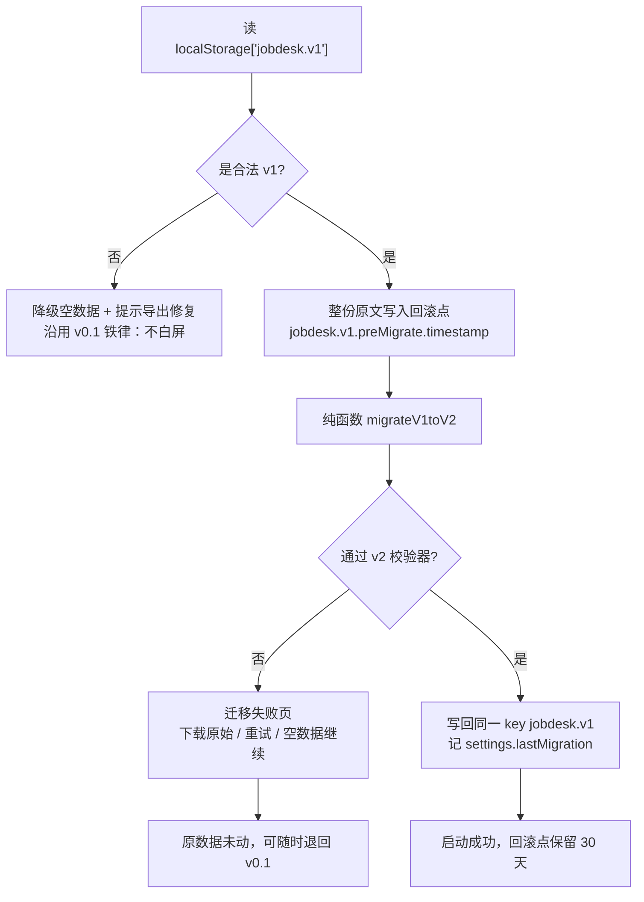

# 求职工作台 v0.2 · 增量 PRD

| 项 | 内容 |
| --- | --- |
| 基线 | `docs/PRD.md` v1.0（下称「见 PRD §x.x」）+ QA Round 3 |
| 品牌 | 许清楚 |
| 仓库根 | `F:/简历/求职工具/job-desk/`（未来 GitHub 仓库根，尚未 `git init`） |
| 技术基线 | Vite 5 + React 18 + TS，手写 CSS，零运行时依赖，`dist/index.html` 单文件 284,198 B |
| 数据基线 | `localStorage['jobdesk.v1']`，`schemaVersion: 1`，5 个实体 |
| 本版主题 | 能被陌生人用、能被陌生人改；把投递的**上游（平台）**与**下游（面经）**接上 |

| 模块 | 一句话 | 优先级 | 动 schema | 动导航 |
| --- | --- | --- | --- | --- |
| A 开源化 | 从「能跑的软件」变成「能被贡献的项目」 | P0 | 否 | 否 |
| B 平台同步 | 用户主动触发、本地处理的投递状态回填 | P0 粘贴 / P1 扩展 | 是 | 是 |
| C 面经 | 面完 3 分钟记完，考前 3 分钟看完 | P0 快记+题库 | 是 | 是 |
| D 数据 v2 | `1 → 2` 无损迁移 | P0 | 是 | 否 |
| E 界面 | 5 个 tab 不动，新增内容走二级与抽屉 | P0 | — | 是 |

---

## A. 开源化改造

要回答的不是「加个 LICENSE」，而是：**陌生人凭什么愿意用，又凭什么愿意贡献？**

### A.1 定位

| 项 | 内容 |
| --- | --- |
| 中文 slogan | **求职工作台 —— 把投递当管线管，数据只留在你自己的浏览器里。** |
| 英文 slogan | **JobDesk — Treat your job hunt as a pipeline. Nothing leaves your browser.** |
| 差异点 | Excel 模板让你自己填，我们告诉你今天该干什么；Notion 模板要联网，我们连请求都不发 |
| 人群（用） | 找日常实习/校招的在校生，BOSS 为主战场，投过 20 家开始丢状态 |
| 人群（改） | 想给新平台写解析器的开发者——不用读懂状态机，只写一个纯函数 |
| 反人群 | 需要多端同步/团队协作的人（边界不变，见 PRD §1.3） |

**「愿意贡献」的起点**：把最容易贡献的部分（平台解析）做成**不碰业务逻辑、不用跑起来、喂样例就能测**的纯函数（A.4）。

### A.2 必选文件

| 文件 | 职责与硬要求 |
| --- | --- |
| `README.md` | 前 3 屏回答：这是什么（看板截图）、为什么安全（「无网络请求」+ 如何自证）、怎么 30 秒用上（下 release 的 `index.html` 双击） |
| `README.en.md` | 只译 概述/安装/隐私/贡献入口，不译全文（避免双份维护腐烂），顶部互链 |
| `LICENSE` | **MIT**。零服务端零商业化，不靠许可证留人；用户多是学生会 fork 改，GPL 是无谓负担；适配器贡献的是解析规则，MIT 下无「被闭源吃掉」顾虑。**不用 AGPL**——它的前提是「有网络服务」，我们没有 |
| `CONTRIBUTING.md` | Conventional Commits；`typecheck && build` 必过；**脱敏五条**（C.5）；适配器专项入口 |
| `CODE_OF_CONDUCT.md` | Contributor Covenant 2.1 原文，零改动 |
| `CHANGELOG.md` | Keep a Changelog + SemVer，`[Unreleased]` 起手，补 v0.1/v0.2 两节 |
| `.gitignore` | `node_modules/`、**`dist/`**（284 KB 二进制式 diff 会冲垮历史，改走 Release 附件）、`*.local` |
| `.editorconfig` | 2 space / lf / utf-8 / final newline |
| `SECURITY.md` | 威胁模型（只有本地存储，威胁＝同机他人＋扩展滥用）、报告渠道不开 public issue、隐私承诺清单、承诺「引网络请求的 PR 一律拒」并指明 CI 如何拦 |

### A.3 `.github/`

| 文件 | 要点 |
| --- | --- |
| `workflows/ci.yml` | 4 项检查，见下表 |
| `bug_report.yml` | 浏览器版本、双击 `index.html` 还是 dev、**脱敏后的导出 JSON 片段**（注明「请删掉公司名和真实姓名」） |
| `feature_request.yml` | 现在怎么做、卡在哪、愿不愿提 PR |
| `adapter_request.yml` | **社区增长的关键入口**。平台名、页面 URL 特征（如 `zhipin.com/web/geek/chat`）、能看到哪些字段、是否愿意自己写解析器（勾选后自动打 `good first issue` + `adapter`） |
| `pull_request_template.md` | 见下 |

```
- [ ] 我新增/修改了平台适配器  → 若是，以下 4 项必勾：
      - [ ] fixtures/ 放了脱敏样例数据
      - [ ] 有 parse.test.ts 且 npm test 全绿
      - [ ] 更新了 docs/adapters/<platform>.md
      - [ ] 适配器内无任何网络请求（fetch/XHR/beacon/WebSocket）
- [ ] 未引入新的运行时依赖
- [ ] 未让 dist 超过预算
- [ ] 内容不含公司名以外的个人信息
```

| # | CI 检查 | 阈值 |
| --- | --- | --- |
| 1 | `npm ci && typecheck && build` | 0 error |
| 2 | `dist/index.html` 体积 | **> 400 KB 失败**，> 350 KB 警告（当前 284 KB，留 40% 给面经+同步） |
| 3 | 产物自包含：无 `<script src=`、无外链样式、无 CDN 字体 | 0 命中 |
| 4 | **零网络调用扫描**：`src/` 与 `extension/` grep `fetch( /XMLHttpRequest/ sendBeacon/ WebSocket` | 0 命中（白名单须在 `.github/no-network-allowlist` 登记） |

> 检查 4 是这个项目最值钱的一行代码。**「我们不收集你的数据」由 CI 保证，而不是由 README 保证**——谁想偷偷加一行上报，PR 会红。

### A.4 适配器贡献机制（贡献飞轮）

一个适配器 = 一个纯函数，只做 `字符串 → 结构化对象`；不请求、不碰 DOM、不 import 业务代码。

```
src/adapters/
├── types.ts          # 协议（唯一稳定契约，改它要 MAJOR）
├── registry.ts       # ['boss','shixiseng','nowcoder']
├── boss/
│   ├── adapter.ts    # platform / urlPattern / lastVerifiedAt / fields
│   ├── parse.ts      # parse(input: AdapterInput): AdapterResult  纯函数
│   ├── parse.test.ts # 必填：happy + 3 个异常用例
│   ├── fixtures/     # 脱敏 HTML / 文本 + expected.json
│   └── README.md     # 支持的页面、字段、已知限制
└── shixiseng/ …
```

`AdapterInput` 只有 `{ url, title, text, html, capturedAt }`——全是字符串。**这既是可测性的来源，也是可审计性的来源**：reviewer 只须确认 300 行纯函数里没有 `fetch`。门槛：不会 React 也能写（不 import 组件）、不用跑起来（`npm test -- boss`）、不需要账号（fixtures 是别人抓的）；必须写 `lastVerifiedAt`，超 6 个月未验证 UI 标「⚠️ 可能已失效」（标但不阻断）。

### A.5 版本策略：两个号，服务两拨人

| 版本号 | 位置 | 服务对象 | 何时 +1 |
| --- | --- | --- | --- |
| `appVersion` | `package.json` / 关于页 / Release | 用户、贡献者 | MAJOR＝核心语义破坏（状态机重构）；MINOR＝新模块或新适配器（v0.1→**v0.2**）；PATCH＝修 bug/文案 |
| `schemaVersion` | `settings.schemaVersion` / 导出文件 | 数据本身 | **仅当存储结构变化且需迁移** |

**解耦**：`appVersion` 到 2.0 时 `schemaVersion` 可仍是 2；反之 `schemaVersion` 升到 3，`appVersion` 只需 MINOR——用户感知不到数据搬家。**v0.2 停在 0.x**（0.x 的语义就是「MINOR 位允许小破坏」），**v1.0.0 的发布条件＝schema 连续 3 个 MINOR 未变 + 2 位外部贡献者合并过适配器**。**禁令**：`schemaVersion` 只增不减，迁移只做加法。

### A.6 隐私声明（独立成节——它就是这个项目的准入证）

| 承诺 | 怎么自己验证（README 给路径） |
| --- | --- |
| 无服务器、无后端、无账号 | DevTools → Network → 刷新，除本地文件外零请求 |
| 无统计、无埋点、无崩溃上报 | 全局搜 `fetch`/`beacon`/`gtag`；CI 也在扫（A.3-4） |
| 无 CDN、无外部字体 | 单文件自包含，**字体只用系统字体栈**（限制设计，但值得） |
| 卸载＝清站点数据，无残留 | 设置页直接显示原始 JSON，随你复制 |
| 同步功能也不上传 | 解析在浏览器内完成；扩展只读页面文本（B.2） |

**功能池**

| 优先级 | 功能 | 验收标准 |
| --- | --- | --- |
| P0 | 9 个必选文件 + `.github/`（CI + 3 Issue 模板 + PR 模板） | 陌生账号 clone 后按 README 三步能在 5 分钟内跑出 `dist/index.html`，首个 PR 上 CI 全绿 |
| P0 | CI 四项（含零网络扫描） | 故意提交含 `fetch(` 的 PR 必须失败并指出行号；产物 >400 KB 必须失败 |
| P0 | 适配器目录规范 + `docs/adapters/README.md` | 按文档加一个假平台适配器，只需 3 个文件 + 1 行注册，不改任何组件 |
| P0 | 隐私承诺 + README 自证路径 | 断网后双击 `index.html`，除同步外全部可用；DevTools 显示 0 请求 |
| P1 | `README.en.md`、`CHANGELOG` 补 v0.1/v0.2、`SECURITY.md` | — |
| P2 | 英文完整文档、落地页 | — |

---

## B. 招聘平台状态同步

### B.1 先说不做什么（这一节必须排在所有宣传物料第一位）

| # | 事实 | 结论 |
| --- | --- | --- |
| F1 | BOSS 直聘、实习僧、牛客**无公开 API** | 不存在「官方对接」；声称「一键同步全平台」的产品都在做协议外的事 |
| F2 | 其用户协议通常**禁止自动化抓取** | 我们不会用你的账号去请求任何接口 |
| F3 | 反爬与风控（验证码、频率、设备指纹） | 高频自动化可能触发**限流、封禁、人脸验证** |
| F4 | 我们没有服务器，也永不为此建服务器 | 数据没有「经过我们」的可能 |

**明确不做**：❌ 代登录 / 代持 cookie / 索要账号密码 · ❌ 后台模拟请求、重放接口、轮询 · ❌ 云端抓取、定时任务、「自动投递/自动打招呼」 · ❌ 以任何形式绕过验证码与登录态。

**只做一件事，四个前提写进 UI**：在**你自己已登录的浏览器**里、由**你亲手点击**触发、只读**你屏幕上已经能看到的**内容、全程**本地内存**解析、不发任何网络请求。

心智模型一句话：**「我们不是帮你登录 BOSS，我们只是帮你把手抄变成复制粘贴。」**

### B.2 风险提示（原文，首次启用与每次抓取确认处都要出现）

> ⚠️ **请先读这段再开同步**
>
> 平台没有公开接口，我们做的是「读你自己屏幕上的内容」，不会替你登录、不会替你发请求、不会在后台跑。
> 但**这仍属于平台可能判定为「异常使用」的行为**，理论上存在账号被限流或封禁的风险，**风险由你自己承担**。
> 建议只用自己的账号、投递量不大时偶尔同步（一天 1～2 次足够）。不接受这个风险，**请继续用手动记录**——v0.1 的 3 秒记一家一直可用。

必须点「我已了解风险，由我自行决定」才能进面板（记 `settings.sync.riskAckAt`，永不二次弹窗，设置页可查）。

### B.3 三通道

| 通道 | 用户动作 | 优先级 | 理由 |
| --- | --- | --- | --- |
| ① **粘贴解析** | BOSS 页面 `Ctrl+A`→`Ctrl+C`→面板 `Ctrl+V`→自动解析 | **P0** | 零安装、零审核、今天可用；复用已有肌肉记忆 |
| ② **文件导入** | 把 `.json` 拖进面板 | **P0** | 成本近零（复用 D.3 校验），也是 ①→③ 的桥 |
| ③ **扩展 MV3** | 在 BOSS 沟通/投递页点注入的「⇅ 抓取本页」 | **P1** | 真一键，但要上架（审核、开发者账号、隐私声明、维护），且可能被平台投诉下架。**不能把 P0 压在它身上** |

> **关于「一键」的诚实交代**：v0.2 的「一键」是扩展形态（P1）；P0 交付的是复制粘贴（约 10 秒，比手抄 20 条快 50 倍）。两条路径共用**同一个适配器**与**同一套预览合并逻辑**，P1 不是补功能，只是换输入源。扩展优先走**「未上架、加载已解压」+ 图文教程**，商店上架降为 P2——学生能接受一次性操作，而上架要绑个人开发者身份，一旦被投诉就是所有用户同时失效。

**扩展技术边界**：MV3；只申请 `activeTab` + `scripting`，**不申请** `<all_urls>`/`tabs`/`cookies`/`webRequest`；URL 未命中 `urlPattern` 时按钮不出现；点击时才 `executeScript` 读 `innerText`/`outerHTML`，读完即销毁、不写 storage；结果经**剪贴板**交给工作台（postMessage 需同源，不可靠）；代码进 `extension/`，**共用同一套零网络扫描**。

### B.4 适配器协议（产品视角）

| 承诺项 | 说明 | 用户可见处 |
| --- | --- | --- |
| 平台名 | `boss`/`shixiseng`/`nowcoder`/`custom` | 面板顶部「来源：BOSS 直聘」 |
| 匹配特征 | 页面 URL + 标题特征，判断「这页能不能读」 | 扩展按钮是否出现；粘贴匹配失败时提示「没识别出是哪个平台的页面，请确认复制的是投递/沟通列表页」 |
| 能解析的字段 | `companyName`/`jobTitle`/`platformStatus`/`lastContactAt`/`jdUrl`/`city`/`salaryText` | 预览表头逐列显示，解析不到的显示 `—` 可手填 |
| 置信度 | 每字段 high/medium/low | `low` 的格子标黄且**默认不勾选** |

| 平台 | 优先级 | 目标页面 | 备注 |
| --- | --- | --- | --- |
| BOSS 直聘 | **P0** | 「沟通中」+「已投递」两个列表 | 信息量占 80% 价值 |
| 实习僧 / 牛客 | P1 | 各自的「我的投递」 | 页面规整，适合当**社区第一个 good-first-issue** |
| `custom` 兜底 | P1 | 任意 | 只提取「公司名+岗位名」，本质是「粘贴表格解析」 |
| 拉勾/猎聘/智联 | P2（社区） | 待贡献 | 由 adapter_request 驱动 |

> **社区可贡献的边界＝只有解析层。** 状态映射（B.7）、字段 ownership（B.6）、合并规则（B.5）属产品语义，改动要过 maintainer 讨论，不能由单个 PR 顺手改。

### B.5 同步面板交互（右侧抽屉 640px，四步单向前进）

```
┌──────────────────────────────────────────────────────┐
│ 同步投递状态    来源：BOSS 直聘 · 沟通列表      ✕    │
├──────────────────────────────────────────────────────┤
│ ① 抓取                                                │
│  把 BOSS 沟通列表整页复制过来（Ctrl+A → C → V）       │
│  或拖入 .json / 点扩展的「⇅ 抓取本页」                │
│  ┌────────────────────────────────────────────────┐  │
│  │（粘贴区 200px，支持拖拽文件）                    │  │
│  └────────────────────────────────────────────────┘  │
│  识别 18 条 · 置信度 高12/中4/低2              [解析] │
├──────────────────────────────────────────────────────┤
│ ② 预览差异      新增 6 · 更新 9 · 无变化 2 · 冲突 1   │
│  ┌────────────┬──────┬─────────────┬──────────┐      │
│  │ 公司·岗位   │判定  │ 本地 → 平台 │ 会写入    │      │
│  ├────────────┼──────┼─────────────┼──────────┤      │
│  │美团 到家前端│更新  │已沟通→已约面│ 状态      │      │
│  │字节 抖音前端│冲突  │已约面→沟通中│ ⚠不写入   │      │
│  │小红书 前端  │新增  │—            │ 整条新建  │      │
│  │快手 商业化  │无变化│已挂=已挂    │ 仅刷时间  │      │
│  └────────────┴──────┴─────────────┴──────────┘      │
│  冲突 1 条：平台说"沟通中"但你已标"已约面" [以我为准]✓│
├──────────────────────────────────────────────────────┤
│ ③ 逐项确认 ☑全选新增 ☑只勾「我未手改过」的更新 ☐冲突  │
│   ☑ 美团 到家前端  状态 已沟通 → 已约面              │
│   ☑ 快手 商业化    最后联系 3/10 14:20（本地 3/08）  │
│   ☐ 字节 抖音前端  ⚠冲突：平台落后于你，建议以你为准 │
│   ☐ 得物 前端      ⚠待归类 → 请选：已投递/已沟通     │
├──────────────────────────────────────────────────────┤
│ ④ 合并    将写入 2 条 · 1 条留暂存 · 可撤销           │
│               [ 放弃 ] [ 只导出预览 ] [ 确认合并 ]    │
└──────────────────────────────────────────────────────┘
```

**四条硬规则**

1. **默认绝不覆盖用户手改过字段**。判据：该字段 `userEditedAt` 晚于平台数据时间 → 预览里**默认不勾选**，标「你 3/10 手动改过」。
2. **冲突＝双方都有值且不同**，一律**默认以用户为准**，不自动合并、不自动取新。
3. **无变化的行不产生写入**（除可选 `lastSyncedAt` 心跳），否则「同步一次，30 条记录全变成今天活动」。
4. **撤销按次快照**（沿用 v0.1 机制）：生成 `SyncSnapshot{before, written:{appIds,noteIds}, stagedIds}`，toast「撤销」一次性回滚并还原暂存。

### B.6 合并与去重

| 顺序 | 规则 | 命中后 |
| --- | --- | --- |
| 1 | `sync.platform` 同 且 `sync.externalId` 同 | 更新这条 |
| 2 | 归一化 `company.name` 相等 且 `jobTitle` 相似度 ≥ 0.8 | 更新（标「按公司+岗位匹配」） |
| 3 | 归一化 `company.name` 相等 且 该条 `jobTitle` 为空 | 更新，并填入岗位名 |
| 4 | 都不中 | **新增** |

归一化纯函数 `normalizeCompanyName`：全角转半角 → 去空白 → 去后缀（有限公司/有限责任公司/股份有限公司/科技/网络）→ 小写。`jobTitle` 用「去括号内容 + 去城市名 + 二元组 Dice 系数」。

> **绝不按公司名单独合并。** 同公司投两个岗位是常态（PRD §8.2），误合并会让两条管线变一条、用户丢数据。宁可多显示「新增」，也不能错并。

| 字段 | 谁能覆盖 |
| --- | --- |
| `status` / `lastActivityAt` / `appliedAt` | 平台可覆盖（受 B.7 映射与置信度约束）；`lastActivityAt` 仅当平台时间 **晚于**本地；`appliedAt` 仅当本地为空 |
| `jobTitle` / `jdUrl` / `city` / `salaryText` | 平台可覆盖，**仅当本地为空**（补全型） |
| `channel` | 按平台名设定一次，已有值不改 |
| `sync.*` | 平台独占，用户不可见 |
| `notes` | 平台**从不写**用户可编辑的 note，只写 `type:'sync'`、`auto:true` |
| `priority` / `tags` / `resumeVersion` / `daysPerWeek` / `durationMonths` / `silenceOverride` / `rejectReason` / `rejectedAtRound` / 所有 `interview` | **永远以用户为准，平台永不触碰**（主观判断与私有资产） |

### B.7 外部状态 → 9 个内部状态

| 平台原文案（BOSS 为主） | 映射 | 附加动作 | 置信度 |
| --- | --- | --- | --- |
| 已投递 / 简历已送达 | `applied` | 补 `appliedAt` | 高 |
| 沟通中 + 对方发过消息 | `chatting` | 刷 `lastActivityAt` | 高 |
| 沟通中 + 只有我发过 | `applied` | 不刷活动时间 | 中（默认不勾） |
| 邀请面试 | `chatting` | 待办「平台邀面了，去约时间」；**不自动变 `scheduled`** | 高 |
| 已面试 / 面试完成 | `interviewing` | **不自动造 Interview**，只提示「补一场面试记录」 | 中 |
| 不合适 / 已结束 / 不符合 | `rejected` | `rejectedAtRound=null`，复用 v0.1 的「轮次未记」补录 chip（QA R-6） | 高 |
| 已录用 / 发放 offer | `offer` | | 高 |
| 已入职 | `onboarded` | | 高 |
| 其他任何文案 | **不映射** → 进暂存标「待归类」，用户从 9 个状态里选；不选则**不写任何数据** | | — |

**三条原则**：① 平台状态只做**事实**不做**推断**——平台说「邀请面试」是事实，约在第几轮只有用户知道，绝不自动进 `scheduled`（其定义要求存在未来时间的 Interview，见 PRD §5.1）；② 映射可覆盖（`settings.sync.statusMapOverrides`），默认值只是起点；③ **映射不出来的不落库**，进暂存，不塞一条 `status: applied` 的脏记录。

### B.8 副作用

| 问题 | 结论 | 理由 |
| --- | --- | --- |
| 刷不刷 `lastActivityAt` | **刷，但只用平台给的 `lastContactAt`，绝不用「抓取时刻」** | 抓取不是沟通事件。用抓取时刻会让 20 条沉默记录瞬间全变绿，用户以为自己被回了 20 次——**这是在骗用户**，比不刷糟得多。平台不给时间 → 不刷 |
| 写不写时间线 | **写一条 `type:'sync'`、`auto:true`**：`平台同步：状态 已沟通 → 已约面（BOSS · 平台时间 3/12 10:20）` | 用户要能一眼分出「我记的」和「同步来的」，所以**必须新开 `sync` 类型**，不复用 `system` |
| 写不写 `chat` | **绝不** | `chat` 意味着「我和 HR 真实沟通过」，冒用会污染时间线与沉默计算 |
| 能不能解除沉默 | **能，但必须是平台确有新动态** | 与 PRD §5.4 的自动解除一致 |

> `NoteType` 5 → 6，必须同步改导入校验，见 D.3。

### B.9 功能池

| 优先级 | 功能 | 验收标准 |
| --- | --- | --- |
| **P0** | 粘贴解析通道 | BOSS 沟通列表 `Ctrl+A/C` 后粘入，识别 ≥10 条的「公司+岗位+平台状态」；解析出错的条目**一定**落进「待归类」，不被静默丢弃 |
| **P0** | 差异预览（四类计数+明细） | 四个计数之和严格等于识别条数；每条能看到「本地值 → 平台值」与「会不会写入」 |
| **P0** | 字段 ownership / 不覆盖手改 | 手改过 `status` 的记录同步后状态不变，预览标出「你 X 月 X 日手动改过」 |
| **P0** | 状态映射 + 待归类暂存 | 9 条映射有单测；无法映射的 100% 进暂存、不写主库；暂存可逐条处理/全部忽略 |
| **P0** | 按次撤销 | 撤销后 `applications`/`notes`/`staging` 精确回到合并前（逐字段 diff 为空） |
| **P0** | 风险提示与授权门 | 未确认风险前所有解析按钮 disabled |
| **P0** | 文件导入通道 | 拖入合法 JSON 直接进预览；非法文件给出字段级错误 |
| P1 | MV3 扩展（BOSS） | 沟通列表页出现「⇅ 抓取本页」，点击后工作台自动进预览；权限清单不含 `cookies`/`webRequest`/`<all_urls>` |
| P1 | 实习僧 / 牛客 / `custom` | fixtures 的 parse 测试全绿；粘贴真实页面文本识别 ≥5 条 |
| P2 | 增量提醒、扩展上架商店 | — |

---

## C. 面经板块

投递是为了面试，面完的沉淀才是复利。两个「3 分钟」：**面完 3 分钟记完，考前 3 分钟看完**。

### C.1 与主产品的关系：数据上挂靠，交互上一等公民

- 数据层：`InterviewExperience` 通过 `applicationId` 关联投递（**可空**），`Question` 挂在 Experience 下——面经继承公司/岗位/轮次，用户不用重填。
- 交互层：面经有**独立三视图**（快记/题库/统计），不是投递详情里的小 tab。
- **为什么必须允许 `applicationId = null`**：① 先收到面试才知道是哪家投的；② 笔试原题、群面题、「我朋友被问到的」没有对应投递；③ 社区导入的面经天然没有本地 application。**强制挂 Application 下，这三类内容会全部流失。**

### C.2 字段

**`InterviewExperience`（一场面试 = 一个壳）**：`id` / `createdAt` / `updatedAt` / `applicationId?` / `companyName` / `jobTitle?` / `round?` / `interviewDate` / `result`(`passed`\|`failed`\|`pending`\|`unknown`) / `overallNote?`(≤200 字) / `source`(`self`\|`community`，后者不可编辑成 `self`)。
`companyName`/`jobTitle` 是**冗余快照**——投递被删了面经还在，否则题库出现「未知公司」。

**`Question`（一道题 = 一张复习卡）**

| 字段 | 说明 |
| --- | --- |
| `id` / `experienceId` / `createdAt` / `updatedAt` | |
| `category` | `algo` / `concept` 八股 / `project` 项目深挖 / `behavior` 行为 / `reverse` 反问 / `hr`（6 类，不再扩） |
| `difficulty` / `text` | 1-3 / 题干 ≤2000 字 |
| `myAnswer` | **我当时怎么答的**——面经最值钱的字段，比正确答案值钱（≤5000 字） |
| `mastery` | `0` 不会 / `1` 模糊 / `2` 会（**唯一的复习驱动字段**） |
| `rootCause` | `conceptGap` 概念没懂 / `forgot` 写过忘了 / `nervous` 紧张 / `misread` 没听懂题 / `neverSeen` 没见过 |
| `nextTime` / `tags` / `nextReviewAt` / `reviewCount` / `lastReviewedAt` | 下次怎么改（一句话）/ 标签 / 派生 `interviewDate + 1·3·7 天` / 计数 / 时间 |

> 为什么不合成一个大文本框：**复习时只想看题干**，复盘时要看「我错在哪」，检索时要按 `category` 聚合。一坨文本做不到这三件事。

### C.3 三个核心视图

**① 快记（面完立刻记，移动端优先）**——一行一题，不打断心流，允许不完整。顶部自动带入「字节跳动 · 抖音前端 · 二面 · 3/12」（来自投递，可改）；一个输入框，**一行即一题，Enter 立刻变下一条**，下方 `+ 再加一题`；每题可顺手标 `category`/`mastery` 但**可跳过**（`category` 默认 `null`，`mastery` 默认 `0`，「没标」约等于「心里没底」）；首屏**绝不出现大文本框**，`myAnswer`/`overallNote` 走「回头补」；移动端输入框固定底部，键盘弹起不遮挡，单题卡片 ≤2 行；存完 toast `已记 4 题 · 3 天后提醒复习`。

**② 题库/复习**——筛选：公司 / `category` / `mastery` / 时间 / 来源。
**默认排序＝间隔复习轻量版**，只有一条规则，不引 SM-2/FSRS：`mastery=0` 最前（按 `interviewDate` 升序，越早问的越该会）→ 其次 `1` → 最后 `2`；同组内按 `nextReviewAt` 升序，到期未复习置顶标红。复习一次 → `reviewCount+1`、`mastery` 可升一级、`nextReviewAt＝今天 + 3/7/14 天`。**上限就是 14 天，永不退化成每天刷题。**
复习卡片模式：只显示题干 → 点「看答案」→ 显示 `myAnswer`+`nextTime`；`←/→` 切换，`空格` 翻面。考前一分钟按钮：只看**这家公司 + 这个岗位**的 `mastery ≤ 1`。

**③ 复盘统计**——**哪类题最容易挂**：`category` × `result=failed` →「算法类：命中 18 题，挂的场次里出现率 67%」；**某公司高频题**：按 `companyName` 聚合去重题干 Top N（这是「面试前必看」的核心价值）；**`rootCause` 分布**：概念没懂 / 写过忘了 / 紧张——若「紧张」占大头，问题不在知识而在练习量，这个洞察 Excel 给不了。

### C.4 导出与分享

| 形式 | 优先级 | 说明 |
| --- | --- | --- |
| Markdown（单条/按公司/全量） | **P0** | 固定模板直接能发牛客/小红书：`## 字节跳动 抖音前端 二面（2025-03-12）` + `**Q：手写 Promise.all**` + `我当时答：…` + `复盘：…`；导出前有「一键脱敏」（去面试官姓名/薪资/手机号） |
| 纯文本复制单题 | **P0** | 一键复制「Q：… / A：…」发给同学 |
| 单条面经长图（PNG） | P2 | 需 canvas 渲染，收益不确定；Markdown 已够社交平台发布 |

### C.5 社区面经（不建服务器）

```
community/
├── README.md      # 格式 + 怎么提 PR + 怎么一键转小红书文案
├── SCHEMA.md      # 字段定义（与 C.2 同源，单一事实）
├── _index.json    # 生成物：文件清单 + 公司/岗位/轮次，供 App 展示
├── boss/2025-03-bytedance-fe-2.json
└── shixiseng/2025-03-meituan-fe-1.json
```

| 决策 | 结论 | 理由 |
| --- | --- | --- |
| 格式 | **JSON**（一文件 = 1 个 Experience + 其 Questions） | md 更好读，但 App 导入必须结构化；引 md 解析器会破「零依赖 + 单文件」底线，手写正则又脆。JSON 在 diff 里同样可审 |
| 审核 | **PR review + CI schema 校验**（`npm run validate:community`） | 校验 schema、`id` 唯一、必填、字数上限，不人工逐条读 |
| 脱敏 | **CI 正则拦截**：手机号/邮箱/微信/身份证/QQ 命中即 fail | CONTRIBUTING「脱敏五条」：①不写面试官真名（用「一面面试官」）②不写 HR 联系方式 ③薪资只写区间 ④不写能定位到个人的项目细节 ⑤NDA 覆盖的题只写考点不抄原题 |
| 内容许可 | `community/` 单独 **CC BY-SA 4.0**（代码 MIT，内容不是代码） | 代码许可不该吞掉用户贡献的文字；BY-SA 防面经被爬去做付费题库 |
| 冷启动 / 防滥用 | maintainer 先写 **5 篇**示例撑起目录；文件 ≤500 时全量同步 `_index.json`，App 按需下载单个文件 | 空目录没人敢提第一个 PR；不建服务器就拿 GitHub 静态文件当 CDN |

**App 内「导入社区题库」**：设置 → 面经 → 粘贴仓库地址 / 拖入下载的 `.json` → 预览（`source:'community'`，只读、可删、不可编辑）→ 按 `id` 去重合并。**不做自动联网拉取**（否则破 A.3-4），用户必须手动下载再导入；这条限制要在 UI 上**写出原因**，否则会被当成缺点。

### C.6 功能池

| 优先级 | 功能 | 验收标准 |
| --- | --- | --- |
| **P0** | 快记（一行一题 + Enter 连记） | 从打开到存下 5 道题 ≤90 秒，全程不用鼠标（键盘可达） |
| **P0** | 面经↔投递关联 + 冗余公司快照 | 删除关联投递后，该面经仍显示正确公司名，不出现「未知公司」 |
| **P0** | 题库筛选 + 掌握度优先排序 | 筛「不会」时只含 `mastery=0`；排序规则被单测覆盖 |
| **P0** | 复习卡片模式 | 翻面不回退滚动位置；标完 `mastery` 后列表顺序按规则实时重排 |
| **P0** | Markdown 导出 + 脱敏 | 粘到任意 md 渲染器层级正确；勾脱敏后不含面试官姓名与薪资数字 |
| **P0** | 复盘统计：分类 × 挂的关联 | 无数据时显示引导文案而非空图表（沿用 PRD §10 空态原则） |
| P1 | 社区导入 + `source` 只读标记 | 导入题目带「社区」角标，编辑 disabled |
| P1 | `validate:community` + 脱敏正则 CI | 故意提交含手机号的样例，CI 必须失败并指出行号 |
| P2 | 卡片长图、可调复习间隔 | — |

---

## D. 数据模型 v2 与迁移

### D.1 新增与变更

| 位置 | 变更 | 关键字段 |
| --- | --- | --- |
| **`InterviewExperience`**（新表） | 新增 | `id, applicationId?, companyName, jobTitle?, round?, interviewDate, result, overallNote?, source, createdAt, updatedAt` |
| **`Question`**（新表） | 新增 | `id, experienceId, category, difficulty, text, myAnswer?, mastery, rootCause?, nextTime?, tags[], nextReviewAt?, reviewCount, lastReviewedAt?, createdAt, updatedAt` |
| **`StagedSyncItem`**（新表，暂存，上限 200） | 新增 | `id, platform, externalId?, parsed{}, confidence, reason(unmapped\|ambiguous\|conflict), capturedAt` |
| `Application.sync` | 可选嵌套 | `{ platform, externalId?, platformStatusRaw?, lastContactAt?, lastSyncedAt? }` |
| `Application.userEditedAt` | 可选 | `Record<字段名, ISO>`，**只记被用户改过的字段**，用于 B.5 判定 |
| `Note.type` | 枚举扩张 | 加 `'sync'`（5→6） |
| `settings` | 改 | `schemaVersion: 2`；新增 `sync{ riskAckAt, defaultPlatform, statusMapOverrides, autoRefreshActivity }`、`lastMigration{ from,to,at,backupKey }` |
| `DB` | 顶层加 3 数组 | `experiences`、`questions`、`staging` |

> **`experiences`/`questions` 平铺顶层而非塞进 `applications`**：一场面试可能挂不到投递上（C.1），塞进去会让孤儿数据无处可放。顶层数组 + 可选外键是唯一能容纳「游离面经」的形状。

### D.2 迁移契约（`1 → 2`）



| # | 契约 |
| --- | --- |
| 1 | **无损**：4 个既有数组的条数与每条既有字段值，迁移前后完全一致（自动化测：v1 真实导出 → 迁移 → 逐字段 deep-equal） |
| 2 | **只加不减**：只允许新增字段/表、扩张枚举；删除或重命名推迟到下一个 MAJOR |
| 3 | **幂等**：`migrate(migrate(x)) === migrate(x)`；对已是 v2 的输入直接返回原对象 |
| 4 | **纯净**：不读时间、不发请求、不碰 DOM、不用随机数；时间戳由调用方注入 |
| 5 | **先备份后改**：回滚点写入失败 → **中止迁移**（宁可这次打不开新版，也不能在没退路时改数据） |
| 6 | **失败可退出**：三个出口，且「以空数据继续」也必须**保留**回滚点 |
| 7 | **不改 storage key**：仍用 `jobdesk.v1`。key 是命名空间不是版本号——换 key 会让留着旧 `dist` 的用户打开旧版时读到空数据而白屏 |

### D.3 向后兼容

| 场景 | 要求 |
| --- | --- |
| **v1 备份 → 导入 v0.2** | **必须成功**。走同一条 `migrateV1toV2`（不另写「宽容解析」），保证迁移逻辑只有一处实现 |
| v2 → 导入 v0.2 | 走 v2 校验器，字段级错误（沿用「第 N 条投递缺少 jobTitle」风格） |
| v2 → 导入 v0.1 | 老版会因 `schemaVersion 只支持 1` 报错——这**是正确的**，但文案要改成「这份备份来自 v0.2 或更新版本，请先升级工具」，不要裸露「收到的是 2」 |
| 导出字段 | `version` 改为 `2`，同时保留 `settings.schemaVersion`；冲突时以后者为准（v0.1 已是该优先级，见 `storage.ts:146`） |
| 枚举扩张 | 旧数据无 `sync`，天然兼容；但 `validateImport` 的 `allowedNoteTypes` **必须同步加**，否则 v0.2 导出再导入会挂 |

### D.4 体积与性能边界

localStorage 约 5 MB（UTF-16），安全水位按 **4 MB** 算。

| 对象 | 单条估算 | 实际上限 |
| --- | --- | --- |
| `Application`（含公司+2 note+1 面试） | ≈ 1.1 KB | ≈ 3000 条 |
| `InterviewExperience` | ≈ 400 B | ≈ 8000 条 |
| `Question`（题干+答案+复盘，均 400 字） | ≈ 1.2 KB | **≈ 3000 题** ← 真正的瓶颈 |

一年 300 条投递 + 500 题 ≈ 900 KB，离上限很远。真正的风险不是条数，而是**长文本**——用户把整段代码、整场录音转写贴进 `myAnswer`。

**防护（P0）**：① 字段级上限 `myAnswer ≤5000`、`text ≤2000`、`overallNote ≤3000`，超出时截断并**提示**（不静默丢）；② `saveDB` 前估算 `JSON.stringify(db).length`：>3.5 MB 弹「接近上限，建议导出归档」，>4.5 MB **暂停写入**，只允许「导出+清理」；③ 写入失败沿用 `saveDB` 返回错误字符串的现有机制，提示「保存失败 + 去导出」，不能让用户以为存上了。
**P1 归档**：把终态且超 6 个月的投递及其面经导出为独立 `.json` 并从主库移除（可再导入回来）。

### D.5 功能池

| 优先级 | 功能 | 验收标准 |
| --- | --- | --- |
| **P0** | `1→2` 自动迁移 + 回滚点 | 用 v0.1 真实导出（26 条投递）迁移后，4 个数组条数与字段值逐项相等；`localStorage` 内存在回滚点 key |
| **P0** | 迁移失败页（下载原始/重试/空数据继续） | 注入一个非法 v1，三个按钮都能工作，且原数据未被覆盖 |
| **P0** | v1 备份导入 v0.2 | 同一份 v1 文件既走自动迁移、又走「导入」，两条路径结果 deep-equal |
| **P0** | `Note.type` 扩张同步到校验 | 导出含 `type:'sync'` 的备份再导入，0 报错 |
| **P0** | 体积水位提示与写入保护 | 构造 3.6 MB 出现警告；4.6 MB 时写入被拒并提示可导出 |
| P1 | 归档导出 | 归档后主库体积下降，归档文件可原样导入回来 |

---

## E. 界面结构变化

### E.1 导航决策：7 个 tab 太多

现状 5 个 tab（今日/看板/列表/日历/复盘，快捷键 `1`-`5`）。直接变 7 个：1440px 下每个 tab 只剩约 70px，三字标题要挤；375px 下必然折叠成汉堡菜单，**移动端更糟**。更本质的是——**「同步」和「面经」都不是每天要看一眼的视图**：同步是低频动作（一天 1 次），面经是事件驱动（面完才用）。把低频功能放进一级导航，会稀释「今日/看板」的权重。

| 新增模块 | 安放 | 理由 |
| --- | --- | --- |
| **面经** | 「复盘」内做**二级 tab**：`[数据] [面经]` | 两者是同一心智——「回头看」：数据复盘看漏斗与渠道，面经复盘看题目与手感。`5` 号快捷键与肌肉记忆全保留 |
| **同步** | **TopBar 右侧图标** `⇅ 同步`（带未确认红点）+ 设置页同入口 | 它是「往库里灌数据」的动作，与「＋ 记一家」同性质，属动作而非视图，不占导航位 |
| **待复盘** | 今日视图新增卡片「**2 场面试待复盘**」→ 进快记 | **用待办驱动，不用导航驱动**。用户不需记住面经在哪，只需被提醒「你有 2 场没复盘」 |

**代价与补偿**：面经发现性变差（藏在二级）。用两个入口补：① 今日视图待复盘卡片；② 投递详情里那场面试的「记面经」按钮——用户面完一定会回来看这条投递。快捷键 `5` 进复盘并**记住上次的二级 tab**，第二次按 `5` 不重置。
> 若未来题量超过投递量（成为高频），再升为一级 tab 并给迁移说明。现在升是过早优化。

### E.2 新的全局外壳

```
┌─────────────────────────────────────────────────────────────────────┐
│ 职 求职工作台 [今日][看板][列表][日历][复盘]  ⌕搜索 ⇅同步●● ⚙ ＋记一家│
│                                                └ 12 条待确认         │
├─────────────────────────────────────────────────────────────────────┤
│ ● 2 家已沉默 7 天 ● 今天 15:00 面试 1 场 ● 2 场待复盘 ● 1 条冲突待决│
├─────────────────────────────────────────────────────────────────────┤
│  复盘                                                                │
│   ┌──────────┬──────────┐                                           │
│   │  数据    │  面经 ●  │  ← 二级 tab（● = 有未读/待办）             │
│   └──────────┴──────────┘                                           │
│  ┌───────────────────────────────────────────────────────────────┐  │
│  │  页面内容区                                                    │  │
│  └───────────────────────────────────────────────────────────────┘  │
└─────────────────────────────────────────────────────────────────────┘
```

待办条新增两类信号（聚合机制见 PRD §9.1）：

| 信号 | 触发 | 色 | 点击 |
| --- | --- | --- | --- |
| `N 场面试待复盘` | `Interview.result ≠ pending` 且 `scheduledAt` 已过，但无对应 `InterviewExperience` | 蓝 | 进快记，自动带入公司/岗位/轮次 |
| `N 条同步待确认` / `1 条冲突待决` | `staging.length > 0` 或上次同步有冲突未决策 | 琥珀 | 打开同步面板 |

面经二级结构：`[快记] 一行一题` / `[题库] 筛选+掌握度排序+复习卡片` / `[统计] 分类×挂、公司高频题、rootCause 分布`。新视图复用现有 `AppApi` 契约，避免组件互相 import。投递详情抽屉只加区块不改布局：①「面试」区每场右侧加「记面经 / 已有 4 题 ▸」；② 有 `sync` 的记录在基本信息区显示灰色小字 `来源：BOSS 同步 · 3/12 10:20`，点开可看平台原文状态。

---

## 待确认问题（附默认建议，不阻塞开发）

| # | 问题 | 默认建议（可直接照此实现） |
| --- | --- | --- |
| Q1 | 同步 P0 只做复制粘贴，会不会算「没做到一键」？ | **就先这样**。扩展（P1）与粘贴共用同一适配器与同一套预览合并逻辑，扩展开出来是纯增量。先把「能同步上、绝不覆盖你手改的东西」做扎实，比先做一键更值 |
| Q2 | 面经藏在「复盘」二级 tab 会不会太深？ | **先用待办驱动补发现性**（今日「N 场待复盘」卡片 + 投递详情入口）。用满两周若面经频次超过「日历」，再升一级 tab |
| Q3 | 社区面经用 JSON 而非 Markdown，贡献者会不会觉得不友好？ | **JSON**（理由见 C.5）。补偿：给模板文件 + App 内「导出成 Markdown 发小红书」一键转换，让贡献者「写 JSON、发 md」 |
| Q4 | 留着手上的 v0.1 `dist/index.html` 会不会打不开数据？ | 会报错但**不丢数据**：沿用同一 storage key，v0.1 只是读不了 `schemaVersion:2` 而降级成空数据界面，原数据仍在 localStorage。**建议升级后删掉旧 dist**，避免误开 |
| Q5 | `lastVerifiedAt` 超 6 个月标「可能已失效」会不会太吵？ | **标但不阻断**。角落一行灰字「本适配器最后验证于 2025-09」，用户仍可用。宁可持续提醒，也不要让一个静默失效的适配器败掉信任 |
