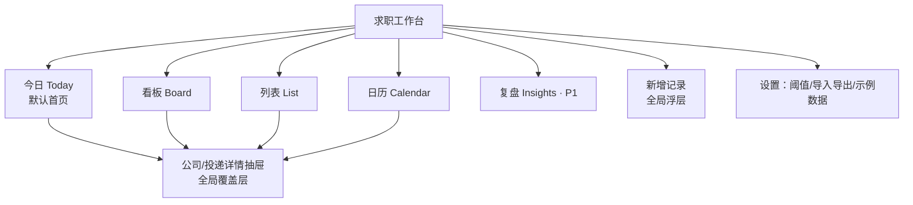

# 求职工作台（Job Desk）产品需求文档

| 项目 | 内容 |
| --- | --- |
| 项目名称 | `job_desk` |
| 文档版本 | v1.0 |
| 产品经理 | 许清楚 |
| 目标用户 | 在校大学生（大三/研二），找**日常实习** |
| 技术形态 | 单页 Web 应用（Vite + React + MUI + Tailwind CSS），数据存浏览器 localStorage，无需登录 |
| 一句话定位 | 一个把「投递」当「管线」看的求职工作台 |

---

## 1. 产品定位与价值主张

### 1.1 一句话价值主张

**让正在找日常实习、主要在 BOSS 直聘上广撒网的你，在一屏之内看清每一家公司走到了哪一步、下一步该干嘛——不用再靠翻聊天记录去回忆"我到底投没投那家"。**

### 1.2 定位说明

这不是一个"求职 CRM"，也不是"简历工具"。它只解决一件事：**多线程求职时，状态不丢、动作不断**。

市面上的 Excel 模板、Notion 求职模板，本质是"表格思维"——你得自己想清楚要哪些列、自己写公式算天数、自己盯着看。它们不会在周一早上告诉你"美团那家已经 7 天没动静了，该催一下了"。我们要补的就是这个"主动提醒"的位置。

### 1.3 三条产品边界（明确不做什么）

1. **不做自动抓取 BOSS 聊天**（无 API、有合规风险）。数据靠用户 3 秒手动记，我们保证记录成本足够低。
2. **不做简历生成/润色**。简历版本只存"标签"（如 `v3-前端-项目版`），用于对比效果。
3. **不做多端同步/账号体系**。P0 全部本地存储 + JSON 导入导出，零门槛。

---

## 2. 核心痛点拆解

用户原话：**「在 boss 上投递，但是沟通的公司越多，我不容易看各个公司的进度」**。

这句话看起来是"一个"问题，实际是六个互相独立的子问题。逐个拆：

| # | 子问题 | 真实场景（大学生的语气） | 本质 |
| --- | --- | --- | --- |
| P-1 | **状态记忆负荷爆炸** | 一周投了 20 家，聊天列表里全是"某某公司 HR"，翻三屏才找到那家说"下周联系你"的。到底哪家约了面、哪家已读不回，全靠脑子硬记 | 记忆外包，需要单一可信来源 |
| P-2 | **已读不回之后不知所措** | 消息发出去是"已读"，然后就没了。等 3 天？等 7 天？再问一句会不会显得很急？还是干脆当它挂了？没人告诉我 | 缺少"什么时候该做什么"的规则 |
| P-3 | **面试撞期 & 撞课** | 两家都约周三下午两点；或者面试正好卡在《数据结构》课上。日常实习本来就要配合上课，排期一乱全乱 | 时间维度的冲突检测 |
| P-4 | **投的是哪个简历版本，记不清了** | 前端岗投的是"项目版"，产品岗投的是"运营版"，改到 v5 之后，连自己都分不清哪家收到的是哪一版。后面收到面试，也不知道是哪个版本起的作用 | 版本可追溯 |
| P-5 | **说不清整体转化率，全凭感觉** | "我是不是投得太少了？" "BOSS 和内推哪个渠道更靠谱？" 只能靠印象，没法回答。于是要么盲目海投，要么焦虑不敢投 | 量化漏斗，支持决策 |
| P-6 | **投递节奏失控** | 某天心情好一口气投 15 家，接下来三天一条消息没有，再往后集中来 4 个面试全撞在一起。节奏没有节拍器 | 节奏可视化 + 目标管理 |

> 一句话总结痛点：**不是不会投，是投出去之后"散"了。** 产品要做的就是把散落的状态收成一条条看得见的管线。

---

## 3. 用户画像与典型一天

### 3.1 人物卡

- **姓名**：小林（虚构人物，用于设计参照）
- **身份**：某 211 高校计算机学院大三下，课程集中在周二、周四上午
- **目标**：6 月前进一家互联网公司做前端日常实习，每周到岗 3 天，能做满 4 个月
- **渠道**：BOSS 直聘为主（80%），实习僧/牛客/学长内推为辅
- **当前状态**：两周内投了 26 家，正在聊的 9 家，已面 3 家，0 offer，开始焦虑
- **工具现状**：手机备忘录里记了半截，剩下靠 BOSS 聊天列表往回翻

### 3.2 典型的一天（时间线叙事）

**周二 08:20 · 地铁上**
打开工作台。顶部一条待办："**2 家已沉默 7 天**、**今天 15:00 有一场面试**、3 家该跟进了"。她先点了"去催一下"，复制系统生成的一句话术 `"您好，上周投递的抖音前端日常实习，想再确认下进度，方便的话我可以补一份项目说明～"`，粘到 BOSS 发出去，回来点"已催，等回复"。**耗时 40 秒，两家清完。**

**周二 10:00 · 课间**
收到实习僧 HR 回复约面。她点开那家公司卡片 → 「约面试」→ 填 3/14 14:00、视频、飞书链接。系统立刻弹一句：**"⚠️ 与你的课程《计算机网络》冲突（周四 14:00-15:40）"**。她改成 16:00，避开。

**周二 12:30 · 食堂**
又刷到一家想投的。单手输入"小红书 前端"，回车保存，30 秒后补了渠道和到岗天数。**一共 3 个字段，20 秒。**

**周二 15:00 · 图书馆研讨间**
一面。面试前一小时她点开准备清单：`项目难点 / 事件循环 / 手写 Promise / 反问 2 个问题`，勾掉 4 个。面完回工作台，切到"面试中 → 二面"，顺手记一条："问了 Vite 打包原理和浏览器缓存，手写了防抖。感觉还行，说 3 天内给消息。"

**周二 21:00 · 宿舍**
打开"复盘"页，看见漏斗：投 26 → 聊 9 → 面 3 → offer 0。渠道对比里 BOSS 回复率 32%、内推 100%（只投了 1 家）。她决定明天把学生会的学长再问一圈内推。同时看到"本周投递 5 家"离目标 8 家还差 3 家，但"沉默超时 2 家"已经清零。

**这一天，她一次都没有往回翻 BOSS 聊天记录。** 这就是产品成功的样子。

---

## 4. 核心设计理念

### 理念一：一家公司 = 一条管线，不是一堆散表格

表格的天然缺陷是"行是罗列、状态是字段"，你得自己脑补流程。我们把它反过来：**每条投递记录就是管线上的一个节点，节点只能沿着预设轨道往前走**。

- 状态是有限枚举（9 个），不允许自由填写 → 保证任何一家公司的位置都可以被一眼定位。
- 每次状态变化都被视作一次"事件"，自动写入时间线 → 状态不再是一个被覆盖的字段，而是一段可回看的历史。
- 同一家公司的多个岗位（字节的抖音/飞书），共享公司档案、各自独立管线 → 既能看"这家公司整体到哪了"，也能看"哪个岗位在推进"。

### 理念二：「下一步该做什么」永远是界面上最显眼的信息

用户不是在"管理数据"，是在"决定现在做什么"。所以：

- 全局顶部常驻**今日待办条**（沉默超时 / 今天有面试 / 该跟进），任何页面都在。
- 每张卡片右上角永远显示**一个**动作按钮，而不是一排图标（"去催一下" / "约面试" / "记结果" / "准备面试"）。系统按状态 + 沉默天数算出唯一建议动作。
- 详情抽屉的第一屏是"下一步"，基本信息排在后面。
- **零信息空态也不空**：没有任何记录时，直接给 3 家示例数据 + 一句"从这家开始？"。

### 理念三：录入成本极低，3 秒能记一家

- 新增只要求 **公司名 + 岗位名** 两个字段，其余 10 个字段全部选填、可后补。回车即保存。
- 保存后 toast 里给"补细节"入口，而不是强制跳表单。
- 列表/看板卡片上的字段支持**就地编辑**（点一下直接改，不打开弹窗）。
- 状态流转用**拖拽或点选**，不写表单。
- P1 再上"自然语言快记"：`字节 抖音前端 日常 3天 boss` → 自动解析出公司/岗位/类型/到岗天数/渠道。

---

## 5. 投递状态机设计（重点）

### 5.1 状态清单

| 状态 key | 界面label | 类型 | 含义 | 进入条件 |
| --- | --- | --- | --- | --- |
| `wishlist` | 想投 | 进行中 | 看到 JD 觉得可以，还没投 | 用户手动添加（默认状态） |
| `applied` | 已投递 | 进行中 | 简历已发出，还没收到任何回复 | 用户点"已投递"或添加时选择 |
| `chatting` | 已沟通 | 进行中 | 和 HR/面试官在 BOSS 等渠道上有来有回 | 对方首次回复，或用户主动打招呼后收到回应 |
| `scheduled` | 已约面 | 进行中 | 约定了具体面试时间，但还没面 | 必须有 ≥1 条 Interview 记录且时间在未来 |
| `interviewing` | 面试中 | 进行中 | 已面完至少一轮，等结果或等下一轮 | 第一轮面试状态变为 completed |
| `offer` | 已发 Offer | 进行中 | 收到口头或书面 offer，还在考虑 | 用户手动标记 |
| `onboarded` | 已入职 | 终态 | 已到岗 | 用户手动标记 |
| `rejected` | 已挂 | 终态 | 明确被拒 | 用户手动标记，**必须选挂在哪一轮** |
| `dropped` | 已放弃 | 终态 | 自己放弃（岗位关了/不感兴趣/接了别家） | 用户手动标记 |
| `silent` | 沉默超时 | **派生** | 超过阈值无任何互动 | **不存库**，由规则实时算出，见 5.4 |

> **为什么"沉默"不做成存储状态？**
> 如果把它做成一个真实状态，就会出现"公司其实回你了，但状态还停在沉默"这种错误，用户必须手动改回来。而"沉默"本质是**时间产生的**，不是**人选择的**。所以我们把它做成一层"影子状态"叠加在 `applied` / `chatting` 之上：到点自动变红、有互动自动消失。这样它永远不会脏。
>
> 视觉上：卡片加红色左边框 + 角标「已沉默 7 天」，顶部待办条聚合。若用户希望看板上有独立一列，P1 提供"沉默项单独聚合"视图开关。

### 5.2 状态流转图

```mermaid
stateDiagram-v2
    direction LR
    [*] --> 想投

    想投 --> 已投递 : 发出简历
    想投 --> 已放弃 : 岗位关了/不投了

    已投递 --> 已沟通 : 对方回复或主动搭话成功
    已投递 --> 已挂 : 明确被拒
    已投递 --> 已放弃 : 自己不想去了

    已沟通 --> 已约面 : 约定具体时间
    已沟通 --> 已挂 : 明确被拒/不合适
    已沟通 --> 已放弃 : 自己不想去了

    已约面 --> 面试中 : 完成第1轮
    已约面 --> 已放弃 : 撞期/不去了
    已约面 --> 已挂 : 面试前被取消

    面试中 --> 面试中 : 进入下一轮
    面试中 --> 已发Offer : 收到口头或书面offer
    面试中 --> 已挂 : 挂在第k轮
    面试中 --> 已放弃 : 自己不想去了

    已发Offer --> 已入职 : 接受并到岗
    已发Offer --> 已放弃 : 拒了offer

    已入职 --> [*]
    已挂 --> [*]
    已放弃 --> [*]

    state 沉默超时(派生) as Silent {
        [*] --> 疑似沉默
        疑似沉默 --> 沉默超时 : 超过阈值天数且无互动
        沉默超时 --> [*] : 产生任何Note或状态变更
    }
```

> 上图主链路已覆盖真实实习招聘流程；`沉默超时` 作为派生层单独画出，表示它附着在 `已投递` / `已沟通` / `面试中`（等结果）三个阶段上，不是一条独立泳道。

### 5.3 每状态的自动规则与允许的下一步

| 当前状态 | 自动规则 | 允许的下一步（界面给出的动作） |
| --- | --- | --- |
| 想投 | 创建后 7 天未推进 → 待办条提示"还想投吗？" | 已投递 / 已放弃 |
| 已投递 | 3 天无互动 → 黄色「该跟进了」；7 天 → 红色「沉默超时」；渠道=内推时阈值 ×3 | 已沟通 / 已挂 / 已放弃 / 去催一下 |
| 已沟通 | 3 天无互动 → 黄色；7 天 → 红色；提示生成催问话术 | 已约面 / 已挂 / 已放弃 / 去催一下 |
| 已约面 | 自动校验面试时间冲突（同日其他面试、录入的课程）；面试时间已过但未记结果 → 当天 20:00 起提示"记一下结果" | 面试中 / 已挂 / 已放弃 |
| 面试中 | 上一轮结束 5 天无新记录 → 「等结果超时」，提示催问；若已知总轮次，显示 2/3 进度 | 面试中（下一轮）/ 已发Offer / 已挂 / 已放弃 |
| 已发Offer | 显示"offer 已到手 N 天"，提示确认到岗日期、天数、薪资 | 已入职 / 已放弃 |
| 已入职 / 已挂 / 已放弃 | 只读；已挂必须记录 `rejectedAtRound` | 可复活为 `已投递`（重投） |

**终态保护**：进入终态时把卡片从看板移入右侧折叠的「已结束」列，避免污染视线；但保留在统计里。

### 5.4 沉默判定规则（核心算法）

**基准时间** `lastActivityAt` = max(
　`statusChangedAt`,
　最近一条 `note.createdAt`（任何类型的记录，含自动生成的状态变更记录）
)

**沉默天数** `silenceDays` = 今天 − `lastActivityAt`（按自然日计算）

> 为什么用自然日而不是工作日？因为 BOSS 上很多 HR 周末也在刷人，学生也不在乎"第几个工作日"。日历天最直观，少一个理解成本。

**阈值（可配置，默认值）**

| 参数 | 默认值 | 含义 |
| --- | --- | --- |
| `warnAfterDays` | 3 | 超过 3 天 → 黄色「该跟进了」 |
| `staleAfterDays` | 7 | 超过 7 天 → 红色「已沉默 X 天」 |
| `interviewResultWaitDays` | 5 | 面试后等结果超 5 天 → 「等结果超时」 |
| `wishlistExpireDays` | 7 | 想投超 7 天没动 → 提醒决定 |
| 渠道系数 | 内推 ×3，官网 ×2，BOSS ×1 | 内推流程天然慢，别让学生白白焦虑 |

**沉默的自动解除**：只要新增任意一条 Note，或状态发生变更，`lastActivityAt` 立刻刷新，红色标记消失。**不需要用户手动"取消沉默"**。

**不参与沉默计算的状态**：`想投`（用 `wishlistExpireDays`）、`已约面`（有明确面试日，看面试）、三个终态。

---

## 6. 信息架构与页面清单



| # | 页面 | 优先级 | 职责 | 回答用户的问题 |
| --- | --- | --- | --- | --- |
| 1 | 今日（驾驶舱） | P0 | 顶部待办条 + 漏斗数字 + 今日待办列表 | "我现在该干什么？" |
| 2 | 看板 | P0 | 按状态分列，卡片拖拽流转 | "每家都到哪一步了？" |
| 3 | 列表 | P0 | 表格化，可排序筛选，突出沉默天数 | "哪家最久没动静？" "我投了几家？" |
| 4 | 详情抽屉 | P0 | 单家的完整档案：下一步 / 基本信息 / 面试 / 时间线 | "这家到底聊到哪了？" |
| 5 | 面试日历 | P0 | 月视图 + 当日面试详情 + 冲突警告 | "这周哪几天要面试？会不会撞课？" |
| 6 | 复盘分析 | P1 | 漏斗 / 渠道 / 简历版本 / 周节奏 | "我的策略对不对？" |

> 4 个主视图 + 1 个全局抽屉，控制在单页应用可完成的范围内。单页内用 Tab 切换，不做路由刷新（保持状态）。

---

## 7. 功能需求池

### 7.1 P0（必须有，单页应用可实现，纯 localStorage）

| 功能 | 说明 | 优先级 | 验收标准 |
| --- | --- | --- | --- |
| 新增/编辑投递记录 | 字段：公司名*、岗位名*、城市、渠道、投递日期、JD 链接、简历版本、薪资、是否日常实习、每周到岗天数、备注。仅前两项必填 | P0 | 只填公司名+岗位名按 Enter 即可保存成功；保存后出现在看板默认列"想投" |
| 看板视图 | 6+1 列（想投/已投递/已沟通/已约面/面试中/已发Offer/已结束折叠），卡片显示公司、岗位、沉默角标、建议动作 | P0 | 拖拽卡片到另一列 → 状态更新 + 自动写时间线 + toast 可撤销（5s） |
| 列表视图 | 表头可排序（投递日/沉默天数/公司名/状态），支持按状态、渠道、简历版本、城市筛选，支持关键词搜索 | P0 | 按沉默天数降序时，>7 天的行整行浅红底 |
| 智能待办 | 三条聚合规则：①沉默超时（红）②今天/明天有面试（蓝）③该跟进（黄）；点击直达对象 | P0 | 待办条数字等于对应卡片数；处理一项后数字实时减 1 |
| 面试日程 | 每条投递可挂多个 Interview：轮次、日期时间、形式（现场/视频/电话）、地点或链接、面试官、准备清单（可勾选）、结果 | P0 | 同一投递下第二场面试自动继承轮次 +1；时间冲突时保存后弹黄色警告（不阻止保存） |
| 时间线与备注 | 每条投递的垂直时间线，区分"我记的"和"系统自动的"；支持按类型标签（沟通/面试/催问/其他） | P0 | 新增 Note 后 `lastActivityAt` 刷新，沉默标记立即消失 |
| 统计卡片 | 漏斗（投递→沟通→面试→Offer，各环节数量 + 转化率）、本周投递 x 家 / 目标 8 家、渠道回复率对比、简历版本面试率对比 | P0 | 数字随数据变化实时重算；无数据时显示"再投 1 家就能看到转化率了" |
| 本地持久化 | 所有数据写 localStorage，刷新不丢；版本号 `schemaVersion` 预留迁移 | P0 | 刷新页面后数据、当前视图、筛选条件均保留 |
| JSON 导入导出 | 导出全量 JSON 文件；导入时校验 schema，冲突可选覆盖或合并 | P0 | 导出再导入到空环境，数据完全一致；非法 JSON 给出明确错误提示 |
| 示例数据 | 首次打开提供"加载示例数据（8 家）"与"从空白开始"两个入口 | P0 | 一键加载后看板、漏斗、待办条均有内容；可一键清空 |
| 催问话术生成 | 按沉默天数与当前状态生成一段可直接复制的中文话术 | P0 | 点"去催一下"→ 复制到剪贴板 → 记一条 Note → 沉默清零 |
| 空态引导 | 每个视图的空态都有下一步按钮，而不是一句"暂无数据" | P0 | 看板空态直接给"记第一家"按钮；列表空态给"清除筛选" |

### 7.2 P1（体验增强）

| 功能 | 说明 | 优先级 | 验收标准 |
| --- | --- | --- | --- |
| 自然语言快记 | 输入 `字节 抖音前端 日常 3天 boss` 自动解析字段 | P1 | 解析结果以高亮确认条展示，可手动修正后再保存 |
| 课表冲突检测 | 录入每周固定课程时间段，约面试时自动检测冲突 | P1 | 冲突时在日历和详情抽屉均显示警告 |
| 复盘分析页 | 漏斗图、渠道对比柱状图、简历版本对比、周投递节奏折线 | P1 | 图表随筛选条件联动 |
| 沉默项独立视图 | 把沉默超时的投递单独聚合为一列/一屏 | P1 | 开关切换，看板仍保留原列 |
| 公司档案聚合 | 同一公司多岗位合并为一张卡，内部 tab 切换 | P1 | 公司卡片显示"N 个岗位"，点击展开 |
| 撤销与回收站 | 删除记录进回收站保留 7 天 | P1 | 删除后 5s 内可撤销；回收站可恢复 |

### 7.3 P2（未来）

| 功能 | 说明 | 优先级 | 验收标准 |
| --- | --- | --- | --- |
| 面试题库沉淀 | 按公司/岗位沉淀"被问了什么" | P2 | 可在面试前按公司筛选历史问题 |
| 浏览器插件一键收录 JD | 在 BOSS 页面提取岗位信息 | P2 | 点击插件后回到工作台出现待确认卡片 |
| PWA + 面试提醒推送 | 加到桌面、面试前 1 小时提醒 | P2 | 离线可打开；提醒可关闭 |
| 多设备同步 | 轻量账号或加密云同步 | P2 | 两台设备数据一致 |

---

## 8. 数据模型定义

字段统一 **英文小驼峰**，时间统一 **ISO 8601 字符串**（`2025-03-12T15:00:00+08:00`），纯日期用 `YYYY-MM-DD`。

### 8.1 Company（公司档案）

| 字段 | 类型 | 必填 | 说明 | 示例 |
| --- | --- | --- | --- | --- |
| `id` | string | 是 | uuid | `"c_01HX..."` |
| `name` | string | 是 | 公司名 | `"字节跳动"` |
| `shortName` | string | 否 | 简称，卡片上显示 | `"字节"` |
| `industry` | string | 否 | 行业 | `"互联网"` |
| `scale` | string | 否 | 规模 | `"10000人以上"` |
| `city` | string | 否 | 主要城市 | `"北京"` |
| `referrer` | string | 否 | 内推人/介绍人 | `"学长张"` |
| `impression` | string | 否 | 公司印象/面试风格备注 | `"面试官偏八股，节奏快"` |
| `createdAt` | string | 是 | | |

### 8.2 Application（一次投递 = 一条管线）

| 字段 | 类型 | 必填 | 说明 | 示例 |
| --- | --- | --- | --- | --- |
| `id` | string | 是 | uuid | |
| `companyId` | string | 是 | 关联 Company | |
| `jobTitle` | string | 是 | 岗位名 | `"前端开发实习生"` |
| `jobType` | enum | 否 | `daily`日常 / `summer`暑期 / `fulltime`校招，默认 `daily` | `"daily"` |
| `city` | string | 否 | 工作城市 | `"北京"` |
| `channel` | enum | 否 | `boss` / `shixiseng` / `nowcoder` / `referral` / `official` / `other` | `"boss"` |
| `appliedAt` | string | 否 | 投递日期 | `"2025-03-05"` |
| `status` | enum | 是 | 见 5.1，默认 `wishlist` | `"chatting"` |
| `statusChangedAt` | string | 是 | 状态最后变更时间，沉淀用 | |
| `lastActivityAt` | string | 是 | 沉默计算基准，派生但落库便于排序 | |
| `jdUrl` | string | 否 | JD 链接 | |
| `resumeVersion` | string | 否 | 简历版本标签（自由文本） | `"v3-前端-项目版"` |
| `salaryText` | string | 否 | 薪资原文（不强制结构化） | `"200-300/天"` |
| `daysPerWeek` | number | 否 | 每周到岗天数（日常实习关键字段） | `3` |
| `durationMonths` | number | 否 | 可实习时长（月） | `4` |
| `silenceOverride` | number\|null | 否 | 覆盖全局沉默阈值 | `10` |
| `rejectedAtRound` | number\|null | 否 | 挂在第几轮（`status=rejected` 时必填） | `2` |
| `rejectReason` | string | 否 | 挂的原因（自我复盘用） | `"手写 Promise 没写出来"` |
| `nextActionAt` | string\|null | 否 | 用户自己定的下次动作时间 | `"2025-03-13"` |
| `priority` | number | 否 | 心动程度 1-3 星 | `3` |
| `tags` | string[] | 否 | 自定义标签 | `["想去","有转正"]` |
| `createdAt` / `updatedAt` | string | 是 | | |

### 8.3 Interview（面试场次）

| 字段 | 类型 | 必填 | 说明 | 示例 |
| --- | --- | --- | --- | --- |
| `id` | string | 是 | | |
| `applicationId` | string | 是 | 关联投递 | |
| `round` | number | 是 | 第几轮，从 1 开始 | `2` |
| `totalRounds` | number\|null | 否 | 已知总轮次，用于显示 2/3 | `3` |
| `scheduledAt` | string | 是 | 面试时间（ISO） | `"2025-03-12T15:00:00+08:00"` |
| `durationMin` | number | 否 | 预计时长 | `45` |
| `format` | enum | 是 | `onsite`现场 / `video`视频 / `phone`电话 | `"video"` |
| `locationOrLink` | string | 否 | 地址或会议链接 | `"飞书会议 xxx"` |
| `interviewer` | string | 否 | 面试官/称呼 | `"前端 leader"` |
| `prepChecklist` | `{id,text,done}[]` | 否 | 准备清单 | `[{text:"手写防抖",done:true}]` |
| `result` | enum | 是 | `pending` / `passed` / `failed` / `cancelled` | `"pending"` |
| `conflictWarn` | boolean | 否 | 是否与课程/其他面试冲突（派生） | `true` |
| `notes` | string | 否 | 面完的即时感受 | |

### 8.4 Note（时间线条目）

| 字段 | 类型 | 必填 | 说明 | 示例 |
| --- | --- | --- | --- | --- |
| `id` | string | 是 | | |
| `applicationId` | string | 是 | | |
| `type` | enum | 是 | `chat`沟通 / `interview`面试 / `followup`催问 / `system`系统 / `memo`随手记 | `"chat"` |
| `content` | string | 是 | 内容 | `"HR说这周内给消息"` |
| `auto` | boolean | 否 | 是否系统自动生成（true 时不可编辑） | `true` |
| `touchedAt` | string | 是 | 发生时间，参与沉默计算 | |

### 8.5 AppSettings（全局设置）

```json
{
  "schemaVersion": 1,
  "warnAfterDays": 3,
  "staleAfterDays": 7,
  "interviewResultWaitDays": 5,
  "wishlistExpireDays": 7,
  "channelFactor": { "referral": 3, "official": 2, "boss": 1, "shixiseng": 1, "nowcoder": 1, "other": 1 },
  "weeklyApplyGoal": 8,
  "courseSlots": [{ "weekday": 4, "start": "14:00", "end": "15:40", "name": "计算机网络" }],
  "defaultResumeVersion": "v3-前端-项目版"
}
```

### 8.6 一条完整数据示例

```json
{
  "id": "app_001",
  "companyId": "c_001",
  "jobTitle": "前端开发实习生（抖音）",
  "jobType": "daily",
  "city": "北京",
  "channel": "boss",
  "appliedAt": "2025-03-05",
  "status": "chatting",
  "statusChangedAt": "2025-03-05T10:12:00+08:00",
  "lastActivityAt": "2025-03-05T10:12:00+08:00",
  "jdUrl": "https://www.zhipin.com/job_detail/xxx.html",
  "resumeVersion": "v3-前端-项目版",
  "salaryText": "200-300/天",
  "daysPerWeek": 3,
  "durationMonths": 4,
  "rejectedAtRound": null,
  "nextActionAt": "2025-03-12",
  "priority": 3,
  "tags": ["想去", "有转正"]
}
```

---

## 9. 关键界面结构稿

### 9.1 全局外壳

```
┌──────────────────────────────────────────────────────────────────────┐
│  Logo  求职工作台      [今日] [看板] [列表] [日历] [复盘]   🔍  ⚙  ＋记一家 │
├──────────────────────────────────────────────────────────────────────┤
│  ● 2 家已沉默 7 天   ● 今天 15:00 有面试 1 场   ● 3 家该跟进了        │  ← 今日待办条（常驻）
├──────────────────────────────────────────────────────────────────────┤
│                                                                      │
│                          页面内容区                                   │
│                                                                      │
└──────────────────────────────────────────────────────────────────────┘
```

**为什么待办条要常驻在导航下方？** 因为它是这个产品的"心跳"。用户任何时候切到任何视图，都必须第一眼看到"有事没处理"。它不是 dashboard 的一个 widget，而是全局状态。

### 9.2 今日（驾驶舱）

```
┌──────────────┬───────────────────────────────────────────────────────┐
│ 状态筛选      │  我的漏斗                                             │
│ □ 想投     3 │  投递 26 ──32%──> 沟通 9 ──33%──> 面试 3 ──0%──> Offer 0 │
│ ■ 已投递  12 │                                                       │
│ ■ 已沟通   9 │  ┌────────┬────────┬────────┬────────┐               │
│ ■ 已约面   2 │  │ 本周投递│ 回复率  │ 面试率  │ 沉默超时│               │
│ ■ 面试中   1 │  │  5/8   │  35%   │  12%   │   2    │               │
│ ■ Offer    1 │  └────────┴────────┴────────┴────────┘               │
│ □ 已结束   8 │                                                       │
│              │  今天要处理的 4 件事          [按紧急度排序 ▾]          │
│ 渠道筛选      │  ┌─────────────────────────────────────────────────┐ │
│ ☑ BOSS      │  │ 🔴 沉默 8 天 · 美团 到店前端    [去催一下] [记一条]│ │
│ ☑ 内推      │  │ 🔴 沉默 7 天 · 快手 商业化前端  [去催一下] [放弃] │ │
│ ☑ 官网      │  │ 🔵 15:00 · 字节 抖音前端 二面   [准备清单 2/5]   │ │
│              │  │ 🟡 待跟进 · 小红书 前端          [去催一下]       │ │
│ 简历版本      │  └─────────────────────────────────────────────────┘ │
│ ▾ 全部       │                                                       │
└──────────────┴───────────────────────────────────────────────────────┘
```

**布局理由**：左侧筛选是"范围"，右侧上半是"结果"（漏斗+4 个数字），下半是"行动"（待办列表）。先看全局健康度，再处理具体事项，符合人从宏观到微观的认知顺序。行动项按"红 > 蓝 > 黄"排序，因为红色代表机会在流失。

### 9.3 看板

```
┌──────────────────────────────────────────────────────────────────────────┐
│  看板   视图: [紧凑 ▾]  分组: [状态 ▾]   共 28 条   [只看该跟进的]        │
├──────────┬──────────┬──────────┬──────────┬──────────┬──────────┬────────┤
│ 想投 3   │ 已投递 12│ 已沟通 9 │ 已约面 2 │ 面试中 1 │ Offer 1  │已结束 8▸│
├──────────┼──────────┼──────────┼──────────┼──────────┼──────────┼────────┤
│┌────────┐│┌────────┐│┌────────┐│┌────────┐│┌────────┐│┌────────┐│        │
││小红书   │││美团     │││字节     │││腾讯     │││阿里     │││华为    ││        │
││前端     │││到店前端 │││抖音前端 │││PCG前端 │││淘天前端│││终端前端││        │
││★★★     │││🔴 沉默8天│││🔴 沉默7天│││3/14 14:00│││二面 3/18│││300/天  ││        │
││[已投递] │││[去催一下]│││[去催一下]│││[看准备] │││[记结果] │││[确认到岗]││       │
│└────────┘│└────────┘│└────────┘│└────────┘│└────────┘│└────────┘│        │
│┌────────┐│┌────────┐│┌────────┐│          │          │          │        │
││得物     │││快手     │││网易     ││          │          │          │        │
││前端     │││商业化   │││前端     ││          │          │          │        │
││[已投递] │││[去催一下]│││[约面试] ││          │          │          │        │
│└────────┘│└────────┘│└────────┘│          │          │          │        │
└──────────┴──────────┴──────────┴──────────┴──────────┴──────────┴────────┘
```

**布局理由**：列即状态，从左到右就是时间顺序，符合"往右走 = 有进展"的心理暗示。每张卡只放 4 样东西：公司、岗位、最紧急的一个信号（沉默天数 / 面试时间 / 薪资）、一个动作按钮。**信息密度要让 7 列在 1440px 屏幕上不用横向滚动也能看到列头。**

### 9.4 详情抽屉（右侧滑出，宽 480px）

```
┌────────────────────────────────────────────────┐
│ 字节跳动 · 抖音前端（日常实习）              ✕ │
│ [已沟通]   🔴 已沉默 7 天                     │
├────────────────────────────────────────────────┤
│ 下一步                                         │
│ [去催一下]  [记一条沟通]  [约面试]  [标为已挂] │  ← 第一屏必须是行动
├────────────────────────────────────────────────┤
│ 基本信息                            [编辑]     │
│ 渠道 BOSS · 北京 · 3 天/周 · 4 个月 · 250/天   │
│ 简历 v3-前端-项目版 · JD 链接 ↗                │
│ 投递 3/05 · 心动程度 ★★★                       │
├────────────────────────────────────────────────┤
│ 面试                                           │
│ ● 二面  3/12 15:00  视频  飞书    准备 2/5  ▸  │
│ ● 一面  3/08 10:00  电话  已通过              │
├────────────────────────────────────────────────┤
│ 时间线                          [＋ 记一条]    │
│ 3/10  我：HR 说这周内给消息          #沟通     │
│ 3/08  我：一面问了事件循环和防抖      #面试     │
│ 3/05  系统：状态 已投递 → 已沟通               │
│ 3/05  我：BOSS 上打招呼，发了项目链接  #沟通    │
└────────────────────────────────────────────────┘
```

**布局理由**：抽屉而不是跳页，因为用户看详情时通常想"看完这家接着看下一家"，跳页会丢掉看板的滚动位置和筛选。抽屉从上到下是"动作 → 事实 → 历史"，正好对应"我要做什么 / 这家是什么 / 之前发生了什么"。

### 9.5 列表

```
┌────────────────────────────────────────────────────────────────────────────┐
│ 共 28 条  [全部状态▾] [全部渠道▾] [全部版本▾]  🔍搜公司/岗位   导出 ▾       │
├──────────┬────────────┬────────┬──────┬────────┬────────┬────────┬───────┤
│ 公司  ↑↓ │ 岗位       │ 状态   │ 渠道 │ 投递日 │沉默天数│ 简历版本│ 操作  │
├──────────┼────────────┼────────┼──────┼────────┼────────┼────────┼───────┤
│ 美团     │ 到店前端   │ 已沟通 │ BOSS │ 3/04   │ 🔴 8天 │ v3     │ ⋯     │
│ 快手     │ 商业化前端 │ 已沟通 │ BOSS │ 3/05   │ 🔴 7天 │ v3     │ ⋯     │
│ 腾讯     │ PCG前端    │ 已约面 │ 内推 │ 3/01   │  —     │ v2     │ ⋯     │
│ 阿里巴巴 │ 淘天前端   │ 面试中 │ 官网 │ 2/26   │  —     │ v2     │ ⋯     │
└──────────┴────────────┴────────┴──────┴────────┴────────┴────────┴───────┘
```

沉默 > 7 天的整行浅红底；单元格支持就地编辑（点状态直接下拉选择）。

### 9.6 面试日历

```
┌──────────────────────────────────────────────────────────────┐
│  ‹ 2025 年 3 月 ›        [月] [周]        ⚠ 2 处时间冲突      │
├────┬────┬────┬────┬────┬────┬────────────────────────────────┤
│ 一 │ 二 │ 三 │ 四 │ 五 │ 六 │  3 月 12 日 周三（今天）       │
├────┼────┼────┼────┼────┼────┼────────────────────────────────┤
│ 10 │ 11 │ 12 │ 13 │ 14 │ 15 │ 15:00 字节 抖音前端 二面       │
│    │    │▣15 │    │▣14 │    │       视频 · 飞书 · 45min      │
│    │    │    │    │    │    │       准备清单 2/5  [打开]     │
│    │    │    │    │    │    │ ⚠ 与《计算机网络》冲突         │
│    │    │    │    │    │    │ ─────────────────────────      │
│    │    │    │    │    │    │ 20:00 快手 一面（待确认）      │
└────┴────┴────┴────┴────┴────┴────────────────────────────────┘
```

---

## 10. 关键交互细节

| 场景 | 交互设计 | 理由 |
| --- | --- | --- |
| **拖拽流转** | 松手后右下角弹出轻量面板（3 个字段：发生日期、可选备注、若进"面试中"则填轮次），面板默认聚焦备注框，**直接 Esc 或点空白即跳过**，状态照常生效 | 状态变化的那一刻是记忆最新鲜的时刻，顺手记一句价值极高；但绝不能变成强制填表，否则用户会放弃用拖拽 |
| **点选流转** | 卡片动作按钮 → 确认气泡（"标为已约面？"）→ 若缺面试时间则直接打开面试表单 | 手机上拖拽体验差，必须有等价路径 |
| **状态变更写时间线** | 每次变更自动生成 `type=system` 的 Note：`状态 已沟通 → 已约面` | 状态不再是覆盖式字段，而是有历史的事件流；复盘时能看到节奏 |
| **撤销** | 状态变更后 toast 保留 5 秒，含「撤销」 | 拖错列是高频误操作，必须可逆 |
| **沉默天数计算** | 见 5.4；`lastActivityAt` 在任意 Note 或状态变更时刷新 | 避免"公司回我了但还标红"的信任崩塌 |
| **催问话术** | 模板变量：`{公司}` `{岗位}` `{投递日期}` `{沉默天数}`；分"3 天轻催"和"7 天确认"两档；一键复制并自动记一条 `followup` Note | 降低"不知道怎么开口"的心理门槛，这是 P-2 痛点的直接解法 |
| **面试时间冲突** | 保存面试时比对：①同一 application 的其他面试 ②同日其他公司的面试 ③`courseSlots` 课程；冲突只警告不阻止 | 日常实习的核心矛盾就是和上课打架，不能沉默地放过 |
| **空态** | 看板空态：插画 + "还没有记录。要不要先加载 8 家示例看看效果？[加载示例] [自己记一条]"；列表筛选无结果："这个筛选下没有公司，[清除筛选]" | 空态是新手唯一会认真读的页面 |
| **键盘快捷键** | `N` 新增，`/` 聚焦搜索，`1/2/3/4` 切视图，`Esc` 关抽屉/取消拖拽，`Cmd/Ctrl+Enter` 保存，`Cmd/Ctrl+Z` 撤销上一步状态变更 | 高频用户（每天开 3 次）的效率杠杆 |
| **加载示例数据** | 设置页提供"导入示例数据（8 家，覆盖 7 种状态）"，可随时一键清空 | 让用户在 10 秒内理解产品长什么样，而不是面对空白 |
| **本周目标** | 驾驶舱显示 `本周投递 5/8`，超过 12 家时提示"本周投得有点多了，先把手上的跟进完" | 针对 P-6 节奏失控，做温和的节流提醒 |

---

## 11. 成功指标

不需要埋点，用户自己能测：

| 指标 | 定义 | 达标线 |
| --- | --- | --- |
| **M1 记录效率** | 从点"＋记一家"到保存成功的中位耗时（自己掐表 3 次） | **≤ 20 秒** |
| **M2 沉默清零率** | 每周日检查："沉默超时且未跟进"的条数 | **≤ 2 条**（连续两周） |
| **M3 记忆外化** | 随机抽 5 家公司，不看 BOSS，能否说出当前轮次/下一步 | **5/5 说得出** |
| **M4 打开即行动** | 每次打开应用后 30 秒内是否处理了至少 1 条待办（自评） | **≥ 70% 的打开次数** |

> M3 是最硬的一条——如果用户还得回去翻 BOSS，这个产品就没成立。

---

## 12. 待确认问题（附默认建议，不阻塞开发）

| # | 问题 | 我的默认建议（可直接按此实现） |
| --- | --- | --- |
| Q1 | 你更关心"公司"维度还是"岗位"维度？同一家公司投两个岗位怎么算？ | **以岗位为管线单位**（一条投递一个岗位）。P0 不做公司聚合卡，公司名相同则在列表里相邻显示并加"同公司 N 个岗位"小标；P1 再做合并卡 |
| Q2 | 沉默阈值 3 天 / 7 天合适吗？内推要不要放宽？ | **保持 3 天提醒、7 天标红**，内推渠道自动 ×3（21 天）。阈值在设置页可调，不用等你确认 |
| Q3 | 面试要不要记"被问了什么"的题库？ | P0 只在面试记录里留一块自由文本"问了什么"，**不做结构化题库**；P1 再做按公司聚合 |
| Q4 | 需要在手机上看/收到面试提醒吗？ | P0 只做响应式布局（窄屏看板变单列），**不做 PWA 和推送**。等你用满两周再决定 |
| Q5 | 要不要记录"投递上限/节奏目标"？ | **默认开启"本周投递目标 8 家"**，超过 12 家给温和提示。这个数字可以随时在设置里改 |

---

## 附录：状态 key 与 UI 文案对照

| key | 看板列名 | 卡片角标文案 | 建议动作按钮 |
| --- | --- | --- | --- |
| `wishlist` | 想投 | 拖了 7 天还没投 | 去投递 / 放弃 |
| `applied` | 已投递 | 已投 X 天 · 无回应 | 去催一下 |
| `chatting` | 已沟通 | 已沉默 X 天 | 去催一下 / 约面试 |
| `scheduled` | 已约面 | 明天 15:00 面试 | 看准备清单 |
| `interviewing` | 面试中 | 二面 3/18 · 等结果 3 天 | 记结果 / 约下一轮 |
| `offer` | 已发 Offer | Offer 到手 2 天 | 确认到岗 |
| `onboarded` | 已结束 | 已入职 | — |
| `rejected` | 已结束 | 挂在一面 | 重投别的岗位 |
| `dropped` | 已结束 | 我放弃了 | — |

---

## 附注：v0.4 起课程表不再放在 settings 里

上文 `settings.courseSlots` 的示例**已废弃**（v0.4 起）。课程与「任何事」统一为顶层 `events` 表：

- `kind: 'course'`：每周固定课表（`weekly: true` + `weekday`）
- `kind: 'personal'`：单次日程（`date`），组会 / 体检 / 急事都记在这里
- 导入课表只替换 `course && weekly`，手动记的事不受影响
- 冲突检测覆盖「面试 × 面试 × 课 × 任何事」，按同一天的具体时间段精确重叠判定

详见 [`CHANGELOG.md`](../CHANGELOG.md) 的 `[0.4.0]` 段与 `docs/ARCHITECTURE-v0.2.md` 末尾补记。
